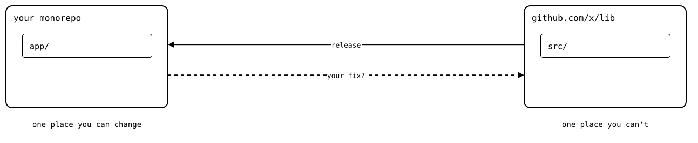
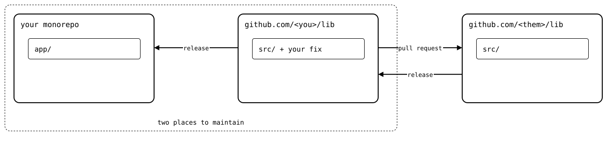
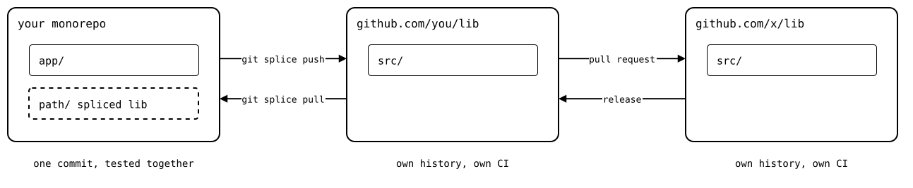
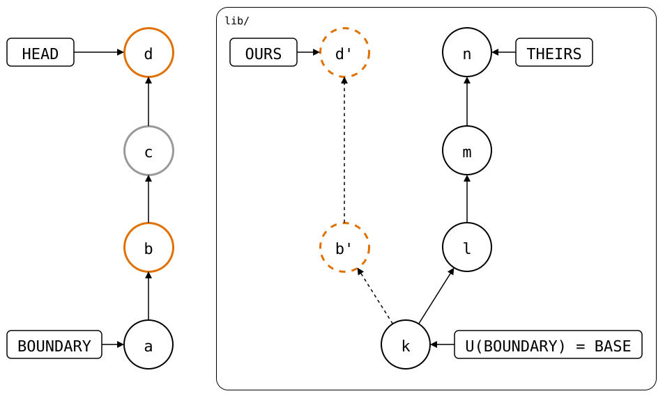

# git-splice

`git-splice` is a developer-friendly way to work across repositories from
one monorepo. Edit them as folders, test them together, and sync both ways
with plain Git.

## The problem

Your app depends on a library from another repository. You find a bug in
the library while working on the app, but its code isn't yours to change:
all you get is its releases.

<div align="center">



</div>

## The common workaround

Fork the library and point your package manager at the fork. The fix goes
back to the library as a pull request, and its releases come in through
the fork. But now you maintain two repositories: the fix lives outside the
monorepo, not versioned and tested with the app that needs it. Submodules
and side-by-side checkouts split the work the same way.

<div align="center">



</div>

## The solution

Keep the fork, but work on it from the monorepo. The library becomes a
folder next to the app: one commit can change both, tested together.
`git splice push` sends the library's part of your commits to the fork,
and `git splice pull` merges the fork's releases back in. The fork and the
original keep their own histories, reviews and CI.

<div align="center">



</div>

## No shared history

The monorepo and the library share no commits: only file changes cross
the splice. `push` rebuilds yours as library commits, and `pull` brings
theirs in as one monorepo commit. So you can compose repositories as you
like, and everyone else keeps working in each one with plain `git`.

It's worktree friendly, too. The library's own commits are fetched into
the monorepo's repository, so a linked worktree can check them out: you
work on two unrelated histories side by side, in one repository.

## Not only libraries

A splice works for any repositories you change together:

- **Instead of submodules:** `git splice clone --from-submodule` turns a
  submodule into a folder. No more gitlinks to bump, and a change across
  the boundary is one commit.
- **Services split across repositories:** change an API and its clients
  in one commit, test them together, and push each part to its own
  repository.
- **Each repository keeps its pipeline:** your pushes arrive as ordinary
  commits, so GitHub Actions, reviews and releases run in each repository
  as before.

## How it works

Splice your fork of the library in once:

<!--
```scrut {fail_fast: true, output_stream: combined}
$ source "$TESTDIR/test/readme/scrut-setup.sh"
```
-->

```scrut
$ git splice clone 'https://github.com/<you>/lib.git' lib
===  lib: fetching https://github.com/<you>/lib.git
ok   lib: cloned e849115 from main
```

The folder is now a splice: a folder of the monorepo that is also the
library. A committed `.splice` file inside it records which repository,
and the library commit the folder last matched.

From there, both sides move on. Say you fix a bug in the library while working
on the app, and the fork takes in a release of the original meanwhile:

<!--
```scrut
$ source "$TESTDIR/test/readme/both-sides-move-on.sh"
```
-->

<div align="center">



</div>

At *a*, the BOUNDARY, you spliced in *k* (`e849115`). To splice out,
`git-splice` rebuilds the commits since *a* on top of *k*. *c* never touched
`lib/`, so it's left out. The result is *d'*, OURS, a library commit
ready for an ordinary three-way merge with THEIRS from BASE:

```scrut
$ git splice status
On branch main

  ahead 2, behind 3  lib
```

`git splice pull lib` merges *l*, *m* and *n* in, as one ordinary monorepo
commit. Then `git splice push lib` sends *b'* and *d'*, and the pull,
rebuilt as their merge with *n*. Changes cross the
splice, but commits don't: both repositories keep their own histories.

## Getting started

Head over to the [documentation](https://roschaefer.github.io/git-splice/docs/installation/)
to install `git-splice`, try it in a sandbox, and walk through every
command.

## Contribute

- [Contributing](CONTRIBUTING.md)

## License

MIT, see [LICENSE](LICENSE).
