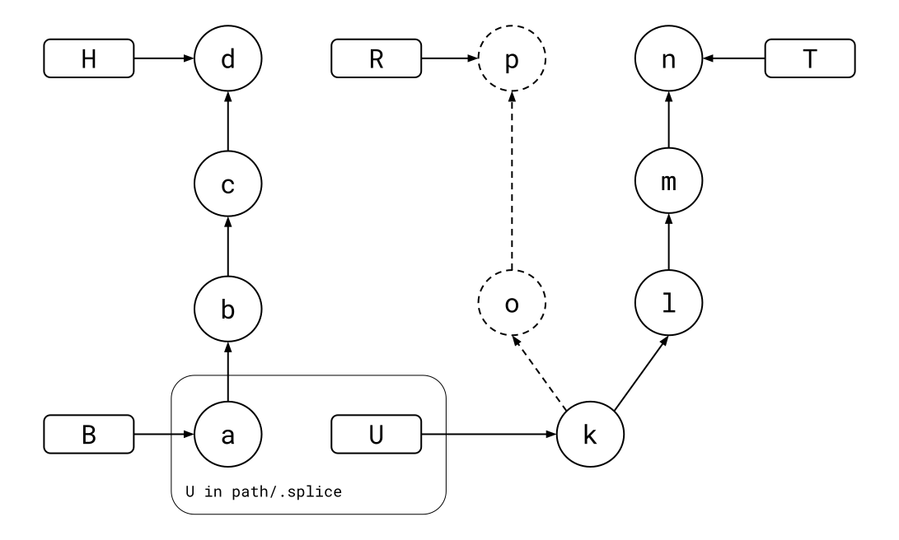

# git-splice

`git-splice` is a developer-friendly way to contribute to other repositories
from one monorepo. Edit them as folders, test them together, and sync both
ways with plain Git.

## The problem

You vendored a library into your monorepo and fixed a bug in it, tested
together with your app. Now the fix should go back to the library's own
repository, but it is buried in monorepo commits that also touch `app/`,
and the two repositories share no history:

```text
  your monorepo                              github.com/x/lib
 ┌──────────────────────────────┐           ┌─────────────────────┐
 │ app/                         │           │ src/                │
 │ path/        (copy of x/lib) │           │ README.md           │
 │   src/       <- your fix     │ ───?───>  │                     │
 └──────────────────────────────┘           └─────────────────────┘
   one history for app and lib                its own history
```

Meanwhile the library moves on, and its next release should come in
without overwriting your fix. The same holds the other way round: a
package developed in the monorepo that you publish as its own repository,
while still merging outside contributions back in. Neither side should
become the source of truth.

## The common workaround

Fork the library and point your package manager at the fork, or at a
checkout on your disk. The fix is easy to send back, but it lives outside
the monorepo, not versioned with the app that needs it.

So it's either or: change the library outside the monorepo and maintain
it in two places, or inside and have no way out. `git-splice` gives you
both.

## The solution

Instead of copying the library, splice it in once:

<!--
```scrut {fail_fast: true, output_stream: combined}
$ source "$TESTDIR/test/readme/scrut-setup.sh"
```
-->

```scrut
$ git splice clone https://github.com/x/lib.git path
===  path: fetching https://github.com/x/lib.git
ok   path: cloned e849115 from main
```

The folder is now a splice: a folder of the monorepo that is also the
library. A committed `.splice` file inside it records which repository,
and **U**, the library commit the folder last matched.

From U, both sides move on. Say you fix a bug in the library while working
on the app, and the library gets a release meanwhile:

<!--
```scrut
$ source "$TESTDIR/test/readme/both-sides-move-on.sh"
```
-->

<div align="center">



</div>

`git-splice` rebuilds the monorepo's commits on top of U, with only the
folder's changes, and skips those like c that don't touch it: b+ is b
rebuilt, d+ is d. The result,
**R**, is a commit of the library, ready to send upstream as it is. R and
**T**, where the library's branch points, relate like a branch and its
tracking branch:

```scrut
$ git splice status
On branch main

  ahead 2, behind 3  path
```

`git splice pull path` merges l, m and n in, as one ordinary monorepo
commit. Then `git splice push path` sends b+ and d+, and the pull,
rebuilt as their merge with n. Changes cross the
splice, but commits don't: both repositories keep their own histories.

## Getting started

Head over to the [documentation](https://roschaefer.github.io/git-splice/docs/installation/)
to install `git-splice`, try it in a sandbox, and walk through every
command.

## Contribute

- [Contributing](CONTRIBUTING.md)

## License

MIT, see [LICENSE](LICENSE).
