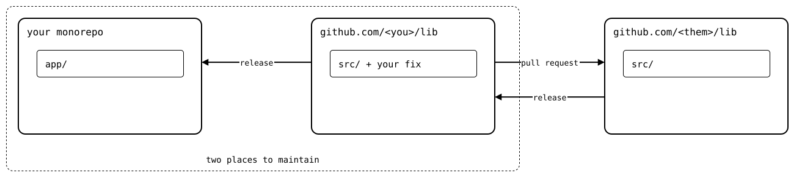
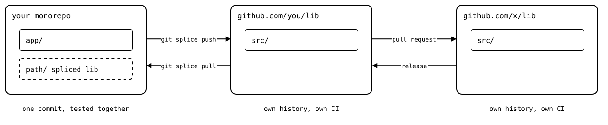
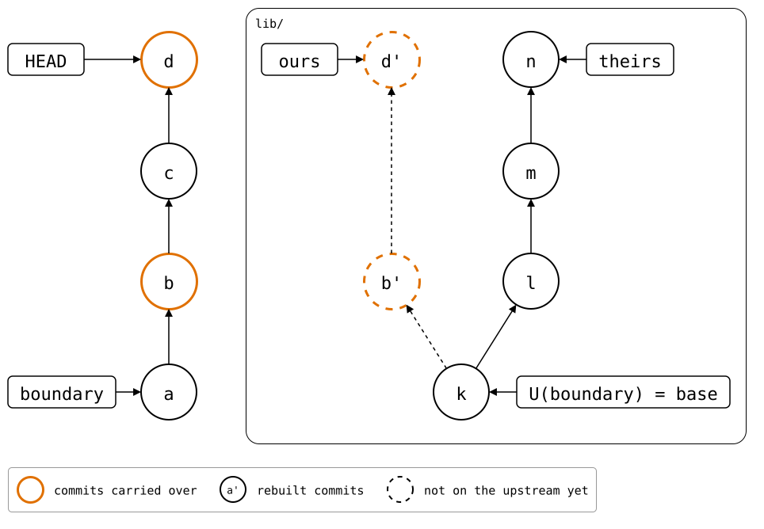

# git-splice

`git-splice` is a developer-friendly way to work across repositories from
one monorepo. Edit them as folders, test them together, and sync both ways
with plain Git.

## The problem

Your app depends on a library from another repository. You find a bug in
the library while working on the app, but its code isn't yours to change:
all you get is its releases.

<div align="center">


</div>

## The common workaround

Fork the library and point your package manager at the fork. But now you
maintain two repositories: the fix lives outside the monorepo, not
versioned and tested with the app that needs it.

<div align="center">



</div>

## The solution

Keep the fork, but work on it from the monorepo. The library becomes a
folder next to the app: one commit can change both, tested together.
Each repository keeps its own history, reviews and CI.

<div align="center">



</div>

## No shared history

The monorepo and the library share no commits: only file changes cross
the splice. `git splice push` rebuilds yours as library commits, and
`git splice pull` brings theirs in as one monorepo commit. So you can
compose repositories as you like, and everyone else keeps working in each
one with plain `git`.

It's worktree friendly, too. The library's own commits are fetched into
the monorepo's repository, so a linked worktree can check them out: you
work on two unrelated histories side by side, in one repository.

## Not only libraries

A splice works for any repositories you change together:

- **Instead of submodules:** `git splice clone --from-submodule` turns a
  submodule into a folder. No more gitlinks to bump, and a change across
  the boundary is one commit.
- **Services split across repositories:** change an API and its clients
  in one commit, test them together, and push each part to its own
  repository.
- **Each repository keeps its pipeline:** your pushes arrive as ordinary
  commits, so GitHub Actions, reviews and releases run in each repository
  as before.
- **Private monorepo, public folders:** open-source part of your code
  as its own repository. `git splice push` sends only the folder's changes,
  never the monorepo's history, so the rest of the files stay private.

## How it works

Splice your fork of the library in once:

<!--
```scrut {fail_fast: true, output_stream: combined}
$ source "$TESTDIR/docs/readme/scrut-setup.sh"
```
-->

```scrut
$ git splice clone 'https://github.com/<you>/lib.git' lib
===  lib: fetching https://github.com/<you>/lib.git
ok   lib: cloned e849115 from main
```

The folder's committed [`.splice` file](docs/03-concepts/README.md)
records its upstream and last synced commit. Say you fix the library while
working on the app, and the fork takes in an upstream release meanwhile:

<!--
```scrut
$ source "$TESTDIR/docs/readme/both-sides-move-on.sh"
```
-->

<div align="center">



</div>

`git splice push` rebuilds only the commits that changed `lib/`, in the
library's layout. `git splice status` compares that rebuild with the
fetched upstream:

```scrut
$ git splice status
On branch main

  ahead 2, behind 3  lib
```

`git splice pull lib` merges upstream changes into one monorepo commit;
`git splice push lib` publishes the rebuilt library history.
See the [sync model](docs/03-concepts/02-sync-model.md) for the details,
and [upstream worktrees](docs/06-command-reference/02-fetch.md#looking-at-an-upstream)
to work directly on the library's history.

## Why not X?

The comparisons of [Git's own tools](docs/05-comparisons/01-git/README.md)
and [third-party tools](docs/05-comparisons/02-third-party/README.md) take
one example through each of these tools until it hits the tool's pain
points, then show how `git-splice` handles them in the same example.

- [`git submodule`](docs/05-comparisons/01-git/01-git-submodule.md): a checkout of the
  monorepo is incomplete. The library stays a repository of its own inside
  it, which every clone, `git status` and fix has to handle separately.
- [`git subtree`](docs/05-comparisons/01-git/02-git-subtree.md): syncing pollutes your
  history with merges, and can bring the library's whole history along.
- [`git-subrepo`](docs/05-comparisons/02-third-party/01-git-subrepo.md): it records
  each push in a commit of your monorepo, a redundant commit that a squash
  merge or rebase makes invalid.
- [Josh](docs/05-comparisons/02-third-party/02-josh.md): the library has to share
  its history with the monorepo, so it fits repositories that are meant
  to be one, not ones with histories of their own.

## Getting started

Head over to the [documentation](https://git-splice.roschaefer.de/docs/getting-started/)
to [install `git-splice`](docs/01-getting-started/README.md), try it in a
[sandbox](docs/01-getting-started/01-sandbox.md), or follow the
[walkthrough](docs/01-getting-started/02-walkthrough.md).

## Contribute

- [Contributing](docs/10-contributing/README.md)

## License

MIT, see [LICENSE](LICENSE).
