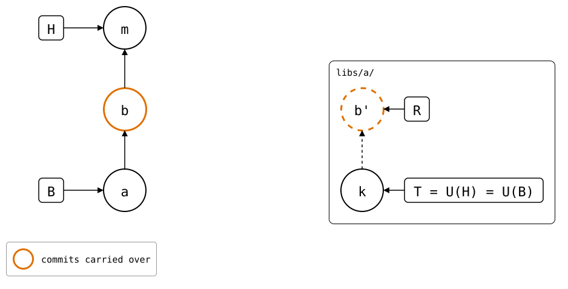
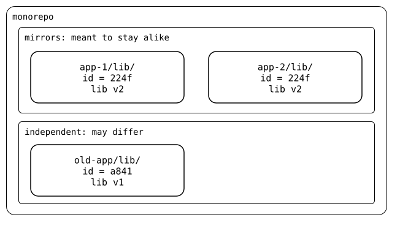

# Splice identity

Git has no such thing as a splice id. `git-splice` writes one into each
`.splice` it creates, because it needs to recognize a splice when its path
can't identify it. That matters in three situations.

<!--
```scrut {fail_fast: true, output_stream: combined}
$ source "$TESTDIR/../09-scenarios/readme-setup.sh" &&
>   source "$TESTDIR/splice-identity-setup.bash" &&
>   source "$TESTDIR/../09-scenarios/07-moved-folders/01-moved-with-unpushed-commits/setup.bash" &&
>   mkdir moved &&
>   scenario_moved_with_unpushed_commits "$PWD/moved/monorepo" "$PWD/moved/upstream" >/dev/null 2>&1 &&
>   cd moved/monorepo
```
-->

## A move carries the commits along

`git mv` changes a splice's path. Here commit *m* moves `vendor/a/` to
`libs/a/`, and `.splice`, with the id in it, moves along:

```scrut
$ git mv vendor/a libs/a &&
>   git commit -q -m "m: reorganize folders"
```

```scrut
$ git show --summary --format=%s HEAD
m: reorganize folders

 rename {vendor => libs}/a/.splice (100%)
 rename {vendor => libs}/a/file.txt (100%)
```

Commit *b* changed the splice before the move and wasn't pushed yet. It
still belongs to the splice, so a push follows the id back to the old path:

<div align="center">



</div>

```scrut
$ git splice log libs/a
===  libs/a (main)
< e859a6b local change  (Test <test@example.com>)
```

Where a `.splice` is new at a path, or has another id, and no move explains
it, the splice's history starts there. Nothing older is published
([scenario](../09-scenarios/07-moved-folders/01-moved-with-unpushed-commits/README.md)).

<!--
```scrut
$ cd ../..
```
-->

## Same id, same splice

Two paths with the same id are one splice in two places, *mirrors*. Splices
with different ids can move independently, even when they hold the same
library at different versions:

<div align="center">



</div>

When mirrors have different files, they have *drifted*, and that's
something to fix. [Mirrors](../09-scenarios/07-moved-folders/03-mirrors/README.md) shows how that happens.

## A repeated id exposes a cycle

With [nesting](04-nesting.md), a `.splice` with the same id as one
above it means a splice contains itself. The id is what makes that
visible, though nothing refuses it yet
([cycle](../09-scenarios/05-nested-splices/04-cycle/README.md)).

## What an id is

An id names a splice. It names neither a path nor an upstream:

| What happens | The id |
|---|---|
| `clone` or `init` | is new, even for an upstream another splice already uses |
| `git mv` of the splice | moves along with `.splice` |
| a new URL, or another upstream | stays |
| `cp -r` of the splice, or a nested `.splice` reaching the monorepo twice | is copied: now two paths have it |

<!--
```scrut
$ build_scenario scenario_splice_identity
```
-->

## Each `clone` is a new splice

```scrut
$ git splice clone https://git.example.com/a.git vendor/a
===  vendor/a: fetching https://git.example.com/a.git
ok   vendor/a: cloned bde4164 from main
```

```scrut
$ cat vendor/a/.splice
[splice]
	id = 224f2c2563d3b6f7
	commit = bde416459fbcc09c9b585f3b65a94cab3f68bfcd
[upstream "origin"]
	url = https://git.example.com/a.git
```

A second clone of the same upstream, at the same commit, gets another id:

```scrut
$ git splice clone https://git.example.com/a.git libs/a
===  libs/a: fetching https://git.example.com/a.git
ok   libs/a: cloned bde4164 from main
```

```scrut
$ git grep 'id = ' -- '*/.splice' | tr '\t' ' '
libs/a/.splice: id = a841bb3c200928e9
vendor/a/.splice: id = 224f2c2563d3b6f7
```

The two share the upstream's fetched refs
([upstreams](01-upstreams.md)), and nothing else.

## Read more

- Two [splices that swap paths](../09-scenarios/07-moved-folders/02-swapped-splices/README.md) each keep their own history.
- [Mirrors](../09-scenarios/07-moved-folders/03-mirrors/README.md) can swap paths, or make a move ambiguous.
- [How the id is derived](../07-design/01-state-and-upstreams.md#the-splice-file).
