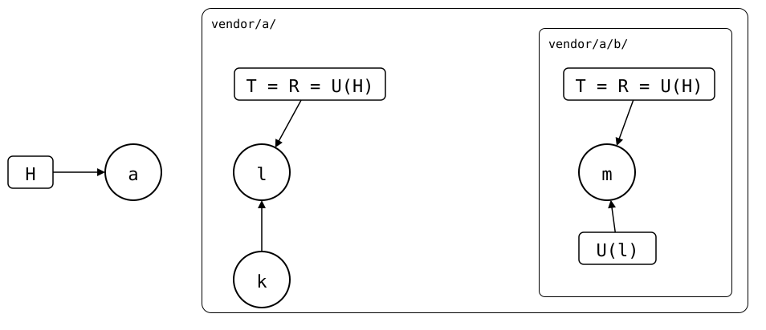

# Nesting

An upstream can use `git-splice` itself, e.g. an app with its library
spliced in. Clone the app into the monorepo, and the library comes along
as a splice of its own, *nested* in the app's. Nothing has to be cloned
recursively, as with `git clone --recurse-submodules`: the library's
`.splice` is an ordinary file of the app.

<!--
```scrut {fail_fast: true, output_stream: combined}
$ source "$TESTDIR/../09-scenarios/readme-setup.sh" &&
>   source "$TESTDIR/../09-scenarios/05-nested-splices/03-diamond/setup.bash" &&
>   scenario_diamond "$PWD/monorepo" "$UPSTREAM" >/dev/null 2>&1 &&
>   cd monorepo
```
-->

The app's upstream has its library at `c/`, with a `c/.splice`. One
`clone` gives the monorepo both:

```scrut
$ git splice clone https://git.example.com/a.git a
===  a: fetching https://git.example.com/a.git
ok   a: cloned 6962bd0 from main
```

```scrut
$ git splice status
On branch main

  ?? never fetched  a/c  run 'git splice fetch a/c'

  up to date        a
```

`a/c/` is a splice now. `clone` fetched only the app's upstream, so the
library's upstream waits for a [`fetch`](../06-command-reference/02-fetch.md).

## Each splice syncs with the monorepo

A nested splice syncs like any other: `merge` and `pull` merge its
upstream straight into the monorepo, and `push` sends its own commits.
The library's folder ends up with the same files as if you pulled the
library in a clone of the app, and then the app into the monorepo. But no commit of the
app with the pulled library is made on the way, and each `.splice` is
read once, when the command starts
([#336](https://github.com/roschaefer/git-splice/issues/336)).

<div align="center">



</div>

The nested `.splice` is a file of the splice above, so it travels with
it. In the drawing, commit *l* of the upstream above has the `.splice` of
the splice below, which records *m*: U(l) = *m*. That ties the splices
together in three ways:

- **Pull top-down.** Pulling the splice above brings in the nested
  `.splice` as its upstream has it, which can move the synced commit of
  the splice below. So `merge` and `pull` take the splice above first.
- **Push bottom-up.** Pushing the splice above sends the nested
  `.splice`, which must not name a commit its own upstream doesn't have
  yet ([why](../07-design/README.md#splicing-in-merge-and-pull--fetch--merge)).
- **History from above.** The splice above came in squashed, so the
  monorepo lacks the older history of the splice below. A push takes it
  from the upstream above
  ([scenario](../09-scenarios/05-nested-splices/01-nested-splices/spliced-elsewhere.md)).

## Settings come from the splice above

You could run `git-splice` in a clone of the app, with the app as the
monorepo. A nested `.splice` has to mean the same there as here. So a
nested `.splice` without `default-branch` follows the default branch of
the splice above, which follows its own splice above, up to the
monorepo
([scenario](../09-scenarios/05-nested-splices/02-nested-default-branch/README.md)).
If a splice above is pinned with `default-pin` instead, the splice below
refuses until it records a `default-branch` of its own.

## Read more

- [Nested splices](../09-scenarios/05-nested-splices/01-nested-splices/README.md)
  that are dropped, replaced or pushed from above, and [three
  levels](../09-scenarios/05-nested-splices/01-nested-splices/02-three-levels/README.md).
- A [diamond](../09-scenarios/05-nested-splices/03-diamond/README.md):
  two apps that splice in the same library.
- A [cycle](../09-scenarios/05-nested-splices/04-cycle/README.md): a
  splice that contains itself.
