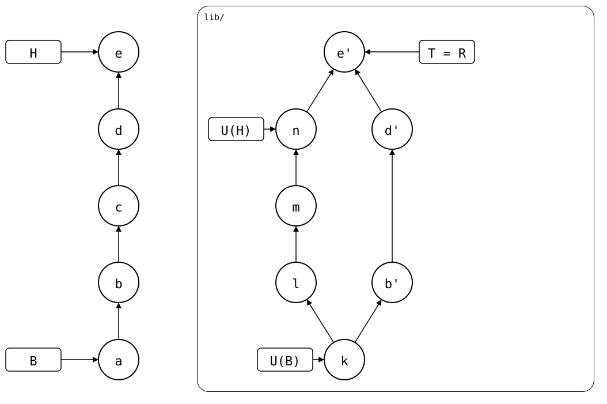
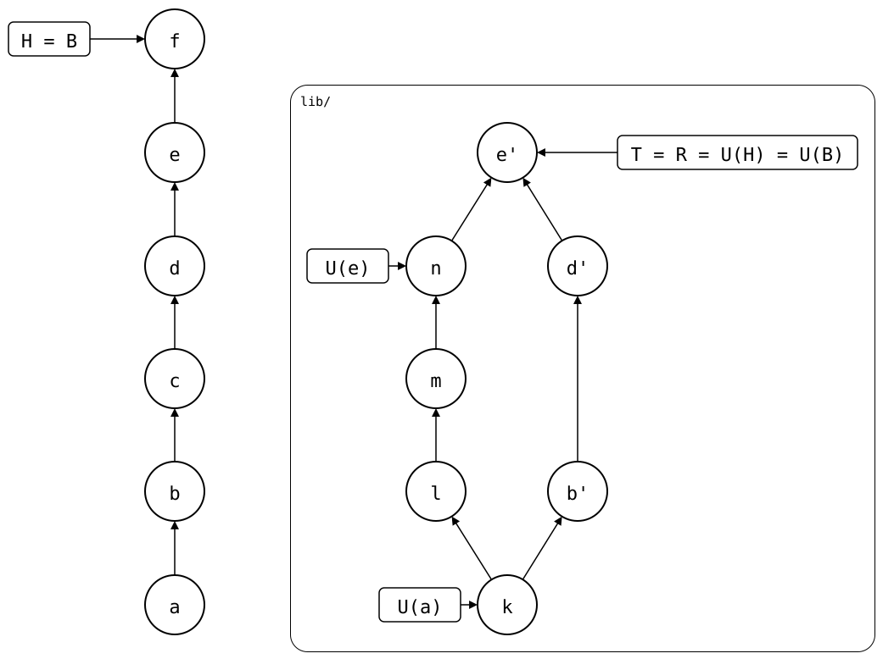

# Bumping the sync point

With Git submodules, you bump the submodule after each change upstream:
you commit the new upstream commit in the monorepo. With `git-splice`,
you don't have to. `.splice` names the upstream commit the folder was
last synced with, and it doesn't need to be up to date: pulls and pushes
work without it. A push doesn't even change it
([why](../03-concepts/02-sync-model.md#r-is-computed-not-stored)).

But if you want to, you can: after a push, `git splice pull --bump`
commits the pushed commit in `.splice`, and changes nothing else.

Here the monorepo pushed *b*, *d* and *e*, which upstream now has as
*b'*, *d'* and *e'*. Before the bump, `.splice` still names *n*, from the
last pull. The bump *f* changes it to *e'*
([scenario](../09-scenarios/01-everyday-sync/01-sync-model/01-after-pull/01-pushed/README.md)):

| After the push | After the bump |
|---|---|
|  |  |

## When to bump

- **To make rebuilds faster.** A rebuild starts at the commit `.splice`
  names. Without a bump, every rebuild copies the commits you pushed
  again ([scenario](../09-scenarios/01-everyday-sync/02-up-to-date/02-push-ahead/01-pushed-then-pulled/bump-after-push.md)).
- **To bisect a pull.** Without a bump, the pull after a push seems to
  bring in the pushed commits too, so a bisect of that pull goes through
  them as well
  ([scenario](../09-scenarios/03-branches-and-teamwork/05-bisect-into-a-pull/01-after-a-push/README.md)).
- **Before you change a splice's [id](../03-concepts/03-splice-identity.md).**
  Here a bump is required: without it, the next push is refused
  ([scenario](../09-scenarios/01-everyday-sync/02-up-to-date/02-push-ahead/01-pushed-then-pulled/new-id-after-push.md)).

## When not to bump

- **On a feature branch, when the library squash-merges its pull
  requests.** The bump commits the pull request's commit in `.splice`,
  but the library's `main` gets another commit, the squashed one. Then:
  - If the monorepo merges `feature` into `main` after that, `.splice`
    conflicts. Rebase the library's `feature` onto its `main` and pull
    on `feature`, then merge. For a library you don't maintain, that
    branch is in your company's fork of it
    ([contributing through a fork](04-fork.md)).
  - If the monorepo merges `feature` before that, `main`'s `.splice`
    names the pull request's commit. Once the library deletes the
    branch, a new clone of the monorepo can't fetch that commit.

  A [scenario](../09-scenarios/03-branches-and-teamwork/08-bumped-on-a-feature-branch/README.md) shows both.

<!-- Builds a fresh sandbox; see `just docs-check`.
```scrut {fail_fast: true, output_stream: combined}
$ source "$TESTDIR/../tests/walkthrough/scrut-setup.sh"
```
-->

## Bump on main, after a push

Bring `pkg-a` up to date, as in the [main walkthrough](../01-getting-started/02-walkthrough.md#pull),
then change it and push:

```scrut
$ git splice pull vendor/pkg-a >/dev/null &&
>   echo "a faster parser" >>vendor/pkg-a/file.txt &&
>   git commit -qam "k: a faster parser"
```

```scrut
$ git splice push vendor/pkg-a
ok   vendor/pkg-a: pushed dd60ba4 to main
```

A plain pull would find nothing to pull. With `--bump`, it records the
pushed commit:

```scrut
$ git splice pull --bump -m "a: bump pkg-a to the faster parser" vendor/pkg-a
ok   vendor/pkg-a fetched
ok   vendor/pkg-a: bumped the synced commit to dd60ba4
```

```scrut
$ git log -1 --format=%s "$(git config --file vendor/pkg-a/.splice splice.commit)"
k: a faster parser
```
