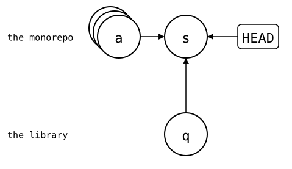
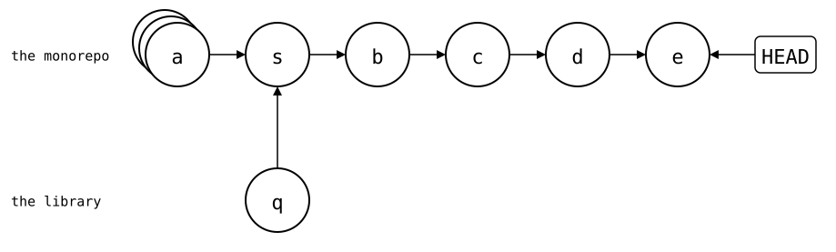
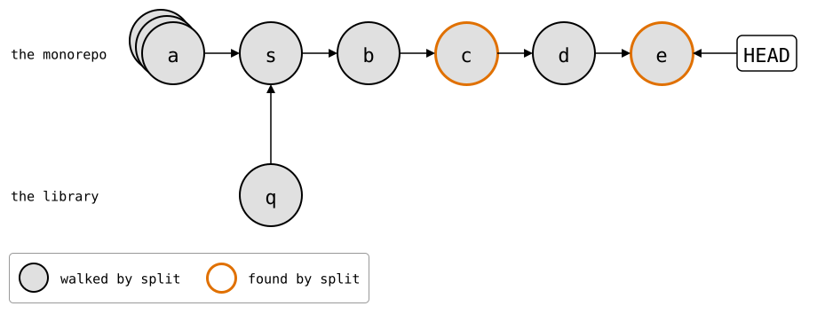
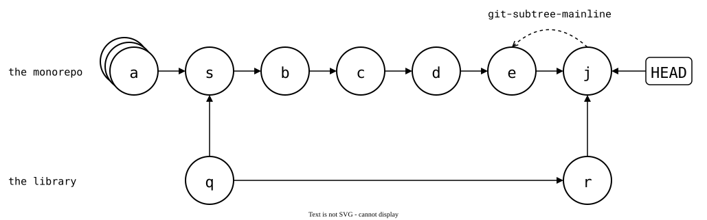
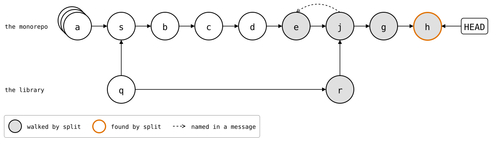
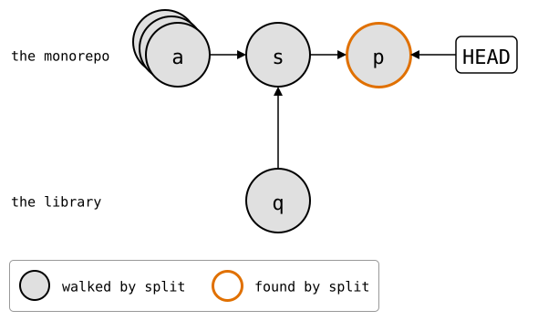
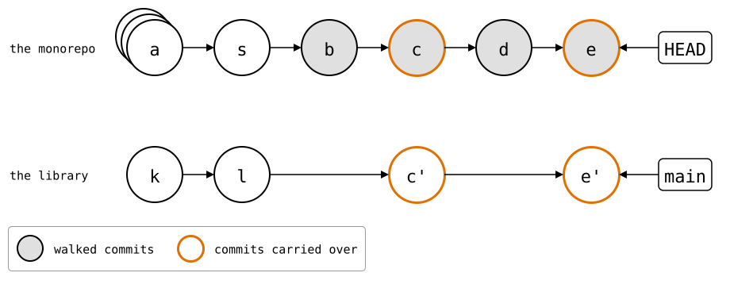

# `git subtree` compared

[`git subtree`](https://github.com/git/git/blob/master/contrib/subtree/git-subtree.adoc)
puts the library's files into a folder of the monorepo, like a splice.
`add` and `pull` merge the library's history into the monorepo's, either
whole or squashed into one commit. `split` and `push` turn the monorepo's
commits that touched the folder back into library commits.

`git-splice` started as a wrapper around `git subtree`, and stopped
because of the problems this page shows: without `--squash`, the
library's whole history comes into the monorepo; with it, `split` walks
the monorepo's whole history on every push; and the sync points that
`--rejoin` adds against that are lines in commit messages.

The setup: `https://git.example.com/lib.git`, a library with 30 commits by
three developers, and a monorepo with an app and 40 commits.
[How these pages run](README.md).

<!--
```scrut {fail_fast: true, output_stream: combined}
$ source "$TESTDIR/../scrut-setup.sh"
```
-->

```scrut
$ git branch before-lib
```

```scrut
$ git rev-list --count HEAD
40
```

## Problem 1: the library's whole history comes in

Without `--squash`, `add` merges all of the library's commits into the
monorepo:

```scrut
$ git subtree add -q --prefix=vendor/lib https://git.example.com/lib.git main
git fetch https://git.example.com/lib.git main
From $COMPARISON/upstream/lib
 * branch            main       -> FETCH_HEAD
```

```scrut
$ git rev-list --count HEAD
71
```

```scrut
$ git log --graph --format=%s -4
*   Add 'vendor/lib/' from commit 'bafd496b1f4512a95b69464604f3da428aa9e33b'
|\  
| * lib commit 30
| * lib commit 29
| * lib commit 28
```

The monorepo doesn't need those 30 commits: it uses the library, it
doesn't develop it.

They're the price for a fast `split`. The merge's message names the
folder, the monorepo commit before it, *a* (`app commit 40`), and the
library commit that matches it. `split` finds these lines, and walks
only the commits after *a*:

```scrut
$ git log -1 --format=%B | grep '^git-subtree-'
git-subtree-dir: vendor/lib
git-subtree-mainline: 7de219808bfd601897cdad67aa5c90b5a2e9bce8
git-subtree-split: bafd496b1f4512a95b69464604f3da428aa9e33b
```

### With `git-splice`: one commit, and no history

In a copy of the monorepo from before the library, `clone` adds one
ordinary commit, and the history stays linear. It also adds
`vendor/lib/.splice`, which stays in the monorepo: `push` never sends it
to the library.

```scrut
$ cd ../splice-monorepo && git splice clone https://git.example.com/lib.git vendor/lib
===  vendor/lib: fetching https://git.example.com/lib.git
ok   vendor/lib: cloned bafd496 from main
```

```scrut
$ git log --graph --format=%s -3
* splice: clone vendor/lib from main at bafd496
* app commit 40
* app commit 39
```

## Problem 2: with `--squash`, `split` walks everything

`--squash` keeps the library's history out: `add` merges a single commit
with the library's files:

```scrut
$ cd ../monorepo &&
>   git switch -q -c squashed before-lib &&
>   git subtree add -q --squash --prefix=vendor/lib https://git.example.com/lib.git main
git fetch https://git.example.com/lib.git main
From $COMPARISON/upstream/lib
 * branch            main       -> FETCH_HEAD
```

```scrut
$ git rev-list --count HEAD
42
```

It's still a merge: *q* (`Squashed 'vendor/lib/' content from commit
bafd496`) has the library's files and no parents, and the merge *s*
puts them into `vendor/lib/`. *a* is drawn as a stack: it stands for
the 40 app commits:

<div align="center">



</div>

<!--
```scrut
$ check_drawing "$TESTDIR/git-subtree-squash-add.drawio.svg" --alias HEAD=H \
>   a=before-lib s=HEAD q=HEAD^2
ok   git-subtree-squash-add.drawio.svg: 3 commits, 3 arrows, 1 boxes
```
-->

Two fixes to the library, *c* and *e*, between app commits *b* and *d*:

```scrut
$ echo "app commit 41" >>app/main.txt && git commit -q -a -m "app commit 41" &&
>   echo "lib fix 1" >>vendor/lib/src/parse.txt && git commit -q -a -m "lib fix 1" &&
>   echo "app commit 42" >>app/main.txt && git commit -q -a -m "app commit 42" &&
>   echo "lib fix 2" >>vendor/lib/src/parse.txt && git commit -q -a -m "lib fix 2"
```

<div align="center">



</div>

<!--
```scrut
$ check_drawing "$TESTDIR/git-subtree-squashed.drawio.svg" --alias HEAD=H \
>   a=before-lib s=HEAD~4 b=HEAD~3 c=HEAD~2 d=HEAD~1 e=HEAD q=HEAD~4^2
ok   git-subtree-squashed.drawio.svg: 7 commits, 7 arrows, 1 boxes
```
-->

*q*'s message names the library commit, but no monorepo commit, no
`git-subtree-mainline:`:

```scrut
$ git log -1 --format=%B HEAD~4^2 | grep '^git-subtree-'
git-subtree-dir: vendor/lib
git-subtree-split: bafd496b1f4512a95b69464604f3da428aa9e33b
```

So `split` has nowhere to start, and walks all 46 commits, every time,
to find *c* and *e*:

```scrut
$ subtree_split_walks vendor/lib
46
```

<div align="center">



</div>

<!--
```scrut
$ check_drawing "$TESTDIR/git-subtree-split-walks.drawio.svg" --alias HEAD=H \
>   a=before-lib s=HEAD~4 b=HEAD~3 c=HEAD~2 d=HEAD~1 e=HEAD q=HEAD~4^2
ok   git-subtree-split-walks.drawio.svg: 7 commits, 7 arrows, 1 boxes
```
-->

[`splitsh-lite`](../02-third-party/03-splitsh-lite.md) replaces `split` with a
faster one that gives the same commits, and caches the commits it has
split, so the next run doesn't split them again. It's made for
publishing a monorepo's folders as read-only repositories: nothing comes
back.

### `--rejoin`: a merge for every push

`split --rejoin` merges the split result back into the monorepo, as a
starting point for the next `split`:

```scrut
$ git subtree split --rejoin --squash --prefix=vendor/lib
Merge made by the 'ort' strategy.
48108daa0f798109c3e672ed47a7de6204cf4e02
```

`48108da` is the library commit with the two fixes, the same one
`git splice push` makes [below](#with-git-splice-the-walk-starts-at-b). It comes
in squashed, as *r* on top of *q*, and the merge *j* names *e*, its
first parent:

<div align="center">



</div>

<!--
```scrut
$ check_drawing "$TESTDIR/git-subtree-rejoin.drawio.svg" --alias HEAD=H \
>   a=before-lib s=HEAD^~4 b=HEAD^~3 c=HEAD^~2 d=HEAD^~1 e=HEAD^ j=HEAD \
>   q=HEAD^~4^2 r=HEAD^2
ok   git-subtree-rejoin.drawio.svg: 9 commits, 11 arrows, 1 boxes
```
-->

```scrut
$ git log -1 --format=%B | grep '^git-subtree-'
git-subtree-dir: vendor/lib
git-subtree-mainline: 9d3cc6061455cb38432ce9846218e1227e4771be
git-subtree-split: 48108daa0f798109c3e672ed47a7de6204cf4e02
```

After two more commits, *g* (`app commit 43`) and *h* (`lib fix 3`),
`split` starts at *e* and walks only the few commits since:

```scrut
$ git switch -q -c rejoined &&
>   echo "app commit 43" >>app/main.txt && git commit -q -a -m "app commit 43" &&
>   echo "lib fix 3" >>vendor/lib/src/parse.txt && git commit -q -a -m "lib fix 3" &&
>   subtree_split_walked vendor/lib
lib fix 2
Squashed 'vendor/lib/' changes from bafd496..48108da
Split 'vendor/lib/' into commit '48108daa0f798109c3e672ed47a7de6204cf4e02'
app commit 43
lib fix 3
```

<div align="center">



</div>

<!--
```scrut
$ check_drawing "$TESTDIR/git-subtree-rejoin-walks.drawio.svg" --alias HEAD=H \
>   a=before-lib s=HEAD~7 b=HEAD~6 c=HEAD~5 d=HEAD~4 e=HEAD~3 j=HEAD~2 \
>   g=HEAD~1 h=HEAD q=HEAD~7^2 r=HEAD~2^2
ok   git-subtree-rejoin-walks.drawio.svg: 11 commits, 13 arrows, 1 boxes
```
-->

<!-- Back to the branch the squash merge below is made from:
```scrut
$ git switch -q squashed
```
-->

### A squash merge drops the rejoin

Where pull requests are squash-merged, *j* never reaches the target
branch. It gets one commit *p* (`lib fixes (#1)`), on top of *s*:

```scrut
$ git switch -q -c squash-merged "HEAD^~4" &&
>   git merge -q --squash squashed >/dev/null &&
>   git commit -q -m "lib fixes (#1)"
```

*p*'s message has none of the lines `split` looks for, so the next
`split` walks everything again:

```scrut
$ subtree_split_walks vendor/lib
43
```

<div align="center">



</div>

<!--
```scrut
$ check_drawing "$TESTDIR/git-subtree-squash-merged.drawio.svg" --alias HEAD=H \
>   a=before-lib s=HEAD~1 p=HEAD q=HEAD~1^2
ok   git-subtree-squash-merged.drawio.svg: 4 commits, 4 arrows, 1 boxes
```
-->

### Several subtrees braid the history

Each subtree rejoins on its own. Three sub-repositories, `x`, `y` and
`z`, then two rounds of work, each a commit that fixes all three and a
`split --rejoin` for each:

<!--
```scrut
$ for r in x y z; do
>   command git init -q "../$r-work" &&
>     echo "$r" >"../$r-work/README" &&
>     command git -C "../$r-work" add README &&
>     command git -C "../$r-work" commit -q -m "$r commit 1" &&
>     command git clone -q --bare "../$r-work" "../upstream/$r.git" || break
> done
```
-->

```scrut
$ git switch -q -c three before-lib &&
>   for r in x y z; do
>     git subtree add -q --squash --prefix="vendor/$r" "https://git.example.com/$r.git" main >/dev/null || break
>   done
```

```scrut
$ for round in 1 2; do
>   for r in x y z; do echo "fix $round" >>"vendor/$r/README"; done &&
>     git commit -q -a -m "fix $round in x, y and z" &&
>     for r in x y z; do
>       git subtree split -q --rejoin --squash --prefix="vendor/$r" >/dev/null || break
>     done
> done
```

Each sub-repository keeps a line of its own, open for the whole
history, and crossing the others at every rejoin:

<div align="center">


</div>

<!--
```scrut
$ check_drawing "$TESTDIR/git-subtree-rejoin-three.drawio.svg" --alias HEAD=H \
>   a=before-lib sX=HEAD~10 sY=HEAD~9 sZ=HEAD~8 b=HEAD~7 \
>   jX1=HEAD~6 jY1=HEAD~5 jZ1=HEAD~4 c=HEAD~3 jX2=HEAD~2 jY2=HEAD~1 jZ2=HEAD \
>   qX=HEAD~10^2 qY=HEAD~9^2 qZ=HEAD~8^2 rX1=HEAD~6^2 rY1=HEAD~5^2 rZ1=HEAD~4^2 \
>   rX2=HEAD~2^2 rY2=HEAD~1^2 rZ2=HEAD^2
ok   git-subtree-rejoin-three.drawio.svg: 21 commits, 27 arrows, 1 boxes
```
-->

None of these merges says anything about the app. They're there so that
`split` stays fast.

### With `git-splice`: the walk starts at B

The same two fixes:

```scrut
$ cd ../splice-monorepo &&
>   echo "app commit 41" >>app/main.txt && git commit -q -a -m "app commit 41" &&
>   echo "lib fix 1" >>vendor/lib/src/parse.txt && git commit -q -a -m "lib fix 1" &&
>   echo "app commit 42" >>app/main.txt && git commit -q -a -m "app commit 42" &&
>   echo "lib fix 2" >>vendor/lib/src/parse.txt && git commit -q -a -m "lib fix 2"
```

`push` walks only the commits since B, the
[boundary](../../03-concepts/02-sync-model.md#where-b-is), here the
`clone` commit:

```scrut
$ git log --first-parent --format=%s "$(git splice boundary vendor/lib)"..HEAD
lib fix 2
app commit 42
lib fix 1
app commit 41
```

```scrut
$ git splice push vendor/lib
ok   vendor/lib: pushed 48108da to main
```

The monorepo's history stays a line, with the `clone` commit *s* in
place of the merge. The library's `main` gets *c'* and *e'*, rebuilt
from *c* and *e*, on top of its last commits *k* and *l*:

<div align="center">



</div>

<!--
```scrut
$ check_drawing "$TESTDIR/git-subtree-splice.drawio.svg" --alias HEAD=H \
>   a=HEAD~5 s=HEAD~4 b=HEAD~3 c=HEAD~2 d=HEAD~1 e=HEAD \
>   k=refs/splices/lib/heads/main~3 l=refs/splices/lib/heads/main~2
ok   git-subtree-splice.drawio.svg: 10 commits, 10 arrows, 2 boxes
```
-->

The library's history stays out of the monorepo's, but at hand, fetched
under `refs/splices/lib/heads/`:

```scrut
$ git log --oneline -4 refs/splices/lib/heads/main
48108da lib fix 2
0579a80 lib fix 1
bafd496 lib commit 30
eacfd66 lib commit 29
```

## Problem 3: the sync points are in commit messages

`git subtree` keeps no file of its own. `pull --squash` and `split` find
the newest sync point with `git log --grep="^git-subtree-dir:
vendor/lib/*$"`. So a sync point belongs to whatever folder name a
message has, and to whichever commit carries the message.

### A squash merge copies them into another commit

Hosts can fill a squash merge's message with the messages of the pull
request's commits. Then *p* carries the lines of *j* and *r*:

```scrut
$ cd ../monorepo &&
>   git switch -q squash-merged &&
>   git commit -q --amend -m "lib fixes (#1)" \
>     -m "$(git log --format='* %s%n%n%b' HEAD~1..squashed)"
```

```scrut
$ git log -1 --format=%B | grep '^git-subtree-'
git-subtree-dir: vendor/lib
git-subtree-mainline: 9d3cc6061455cb38432ce9846218e1227e4771be
git-subtree-split: 48108daa0f798109c3e672ed47a7de6204cf4e02
git-subtree-dir: vendor/lib
git-subtree-split: 48108daa0f798109c3e672ed47a7de6204cf4e02
```

`pull --squash` takes *p* for a `--rejoin` merge, and asks for its
second parent, which *p* doesn't have:

```scrut
$ git subtree pull -q --squash --prefix=vendor/lib https://git.example.com/lib.git main
From $COMPARISON/upstream/lib
 * branch            main       -> FETCH_HEAD
fatal: Needed a single revision

[1]
```

### A moved folder loses them

Back on the branch with the rejoin, the library moves to
`vendor/parser/`:

```scrut
$ git switch -q squashed &&
>   git mv vendor/lib vendor/parser && git commit -q -m "move vendor/lib to vendor/parser"
```

The messages still say `vendor/lib`, so under the new name there's no
sync point:

```scrut
$ git subtree pull -q --squash --prefix=vendor/parser https://git.example.com/lib.git main
From $COMPARISON/upstream/lib
 * branch            main       -> FETCH_HEAD
fatal: can't squash-merge: 'vendor/parser' was never added.
[1]
```

`split` builds a history that starts at the move, without the
library's, so `push` is refused:

```scrut
$ git subtree split --prefix=vendor/parser --branch=parser-split >/dev/null &&
>   git log --format=%s parser-split
move vendor/lib to vendor/parser
```

```scrut
$ git subtree push --prefix=vendor/parser https://git.example.com/lib.git main | grep -F '[rejected]'
 ! [rejected]        c7121590d05f5a17f3adebbbd88ff15816a537d2 -> main (non-fast-forward)
```

### With `git-splice`: the same sync point, kept in a file

`git subtree` and `git-splice` remember the same thing: which monorepo
commit matches which library commit. In the
[sync model](../../03-concepts/02-sync-model.md)'s terms:

| `git subtree` | `git-splice` |
| --- | --- |
| `split` | the rebuild, which `git splice rebuild` prints and `push` sends |
| the commit `split` makes | R |
| `git-subtree-mainline:`, the monorepo commit the walk goes back to | B, the boundary, where the rebuild starts |
| `git-subtree-split:`, the library commit it matches | U(B), the upstream commit B's `.splice` records |

`git subtree` writes the pair into the message of *j*, which names *e*:
carrier and named commit are two. `git-splice` writes U into
`vendor/lib/.splice`, and B is a commit that changed it, usually the
newest: carrier and boundary in one.

```scrut
$ cd ../splice-monorepo && git config -f vendor/lib/.splice splice.commit
bafd496b1f4512a95b69464604f3da428aa9e33b
```

A squash merge keeps the file's content, where it drops *j*'s message.
Squash-merged, *c* and *e* leave `.splice` as it was, and B stays the
`clone` commit; a pull request with a pull in it changes `.splice`, and
its squash commit becomes B
([scenario](../../09-scenarios/03-branches-and-teamwork/03-squash-merged-pull/README.md)).
`git mv` moves the file along, and a change to it shows in the diff like
any other. Moving a splice has gaps of its own, shown in the
[moved folders scenarios](../../09-scenarios/07-moved-folders/01-moved-with-unpushed-commits/README.md).

## Where `git subtree` is the better tool

Moving a repository into the monorepo for good, and retiring its old
home. Without `--squash`, its history comes along, as in
[problem 1](#problem-1-the-librarys-whole-history-comes-in), and `git
blame` follows each line into the commits that made it.
