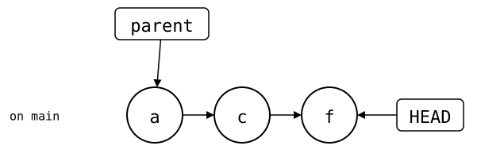
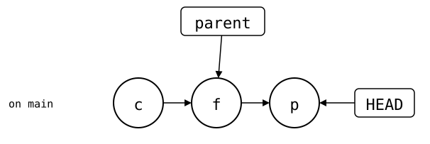
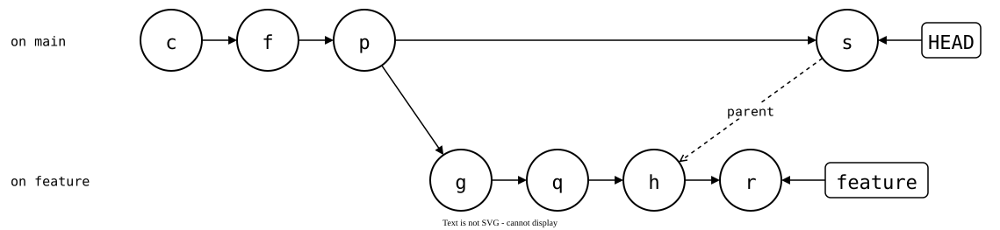
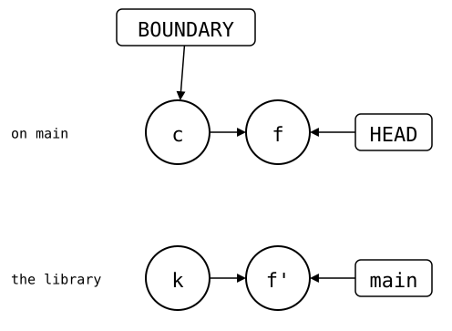
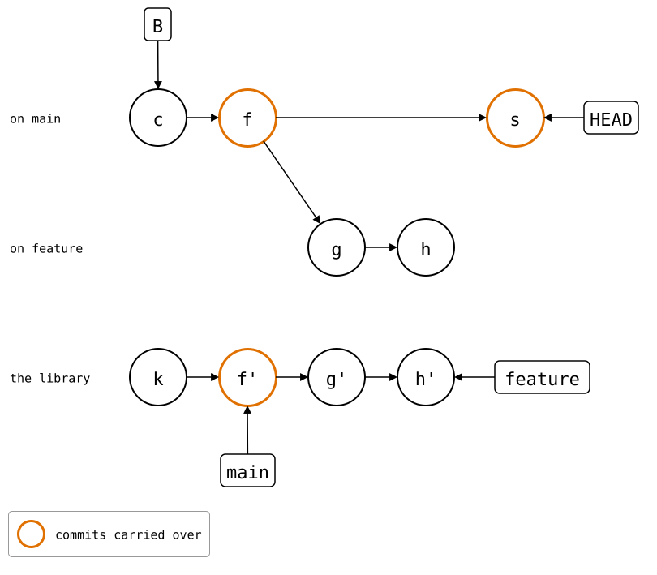

# `git-subrepo` compared

[`git-subrepo`](https://github.com/ingydotnet/git-subrepo) looks the most
like `git-splice`. The library's files are ordinary monorepo files, a
committed file in the folder, `.gitrepo`, names the library, every pull is
one commit, and `push` sends the folder's changes back.

The difference is what else `.gitrepo` records: one upstream branch for
every monorepo branch, and the monorepo commit the last push came from.
On a feature branch that ends in a squash merge, both get in the way.

The setup: `https://git.example.com/lib.git`, a library with 30 commits,
and a monorepo with an app. [How these pages run](../01-git/README.md).

<!--
```scrut {fail_fast: true, output_stream: combined}
$ source "$TESTDIR/../scrut-setup.sh"
```
-->

```scrut
$ git subrepo --version
0.4.9
```

## Like `git-splice`: one commit per pull

`clone` adds the library as one commit:

```scrut
$ git subrepo clone https://git.example.com/lib.git vendor/lib
Subrepo 'https://git.example.com/lib.git' (main) cloned into 'vendor/lib'.
```

```scrut
$ cat vendor/lib/.gitrepo
; DO NOT EDIT (unless you know what you are doing)
;
; This subdirectory is a git "subrepo", and this file is maintained by the
; git-subrepo command. See https://github.com/ingydotnet/git-subrepo#readme
;
[subrepo]
	remote = https://git.example.com/lib.git
	branch = main
	commit = bafd496b1f4512a95b69464604f3da428aa9e33b
	parent = 7de219808bfd601897cdad67aa5c90b5a2e9bce8
	method = merge
	cmdver = 0.4.9
```

You fix the library and use the fix in the app, in one commit, *f*.
`parent` in `.gitrepo` still names *a*, the commit before the clone *c*:

```scrut
$ echo "fix" >>vendor/lib/src/parse.txt &&
>   echo "call parse()" >>app/main.txt &&
>   git commit -q -a -m "fix parse() and call it"
```

<div align="center">



</div>

<!--
```scrut
$ check_drawing "$TESTDIR/git-subrepo-before-push.drawio.svg" --alias HEAD=H \
>   a=HEAD~2 c=HEAD~1 f=HEAD
ok   git-subrepo-before-push.drawio.svg: 3 commits, 4 arrows, 1 boxes
```
-->

Then you push it:

```scrut
$ git subrepo push vendor/lib
Subrepo 'vendor/lib' pushed to 'https://git.example.com/lib.git' (main).
```

The library gets the commit with only the folder's change:

```scrut
$ git -C "$COMPARISON/upstream/lib.git" show --stat --format=%s main
fix parse() and call it

 src/parse.txt | 1 +
 1 file changed, 1 insertion(+)
```

## Problem 1: every push is a commit in the monorepo

The monorepo's history is linear, but `push` added a commit of its own:

```scrut
$ git log --graph --format=%s -4
* git subrepo push vendor/lib
* fix parse() and call it
* git subrepo clone https://git.example.com/lib.git vendor/lib
* app commit 40
```

It's *p*, which records in `.gitrepo` the library commit it pushed, and
moves `parent` to the monorepo commit it pushed from, *f*:

<div align="center">



</div>

<!--
```scrut
$ check_drawing "$TESTDIR/git-subrepo-pushed.drawio.svg" --alias HEAD=H \
>   a=HEAD~3 c=HEAD~2 f=HEAD~1 p=HEAD
ok   git-subrepo-pushed.drawio.svg: 4 commits, 5 arrows, 1 boxes
```
-->

A squash merge or rebase can leave that commit behind, as problem 3
shows ([git-subrepo#464](https://github.com/ingydotnet/git-subrepo/issues/464),
[#600](https://github.com/ingydotnet/git-subrepo/issues/600)).

## Problem 2: a feature branch pushes to `main`

`.gitrepo` names one upstream branch, for every monorepo branch. A
second fix, on a feature branch:

```scrut
$ git switch -q -c feature &&
>   echo "fix 2" >>vendor/lib/src/parse.txt &&
>   git commit -q -a -m "fix 2"
```

`push` sends it to `main`, the branch in `.gitrepo`, with no pull request
to review it:

```scrut
$ git subrepo push vendor/lib
Subrepo 'vendor/lib' pushed to 'https://git.example.com/lib.git' (main).
```

The library's `main` has it now:

```scrut
$ git -C "$COMPARISON/upstream/lib.git" log --format=%s -3 main
fix 2
fix parse() and call it
lib commit 30
```

To push to another branch, `--branch` names it and `--update` writes it
into `.gitrepo`. After a push, that takes a `fetch` first, or it fails
with "Local repository does not contain" the commit it pushed:

```scrut
$ echo "fix 3" >>vendor/lib/src/parse.txt &&
>   git commit -q -a -m "fix 3" &&
>   git subrepo fetch vendor/lib
Fetched 'vendor/lib' from 'https://git.example.com/lib.git' (main).
```

```scrut
$ git subrepo push --branch feature --update vendor/lib
Subrepo 'vendor/lib' pushed to 'https://git.example.com/lib.git' (feature).
```

Now the feature branch syncs with `feature` (0.4.9 writes it even without
`--update`, [git-subrepo#313](https://github.com/ingydotnet/git-subrepo/issues/313)):

```scrut
$ git config --file vendor/lib/.gitrepo subrepo.branch
feature
```

## Problem 3: after a squash merge, the last sync is lost

The feature branch is squash-merged into `main`, as a pull request would
be:

```scrut
$ git switch -q main &&
>   git merge -q --squash feature &&
>   git commit -q -m "feature (squashed)"
Squash commit -- not updating HEAD
```

`.gitrepo` comes along with the merge: `main` now syncs with `feature`,
and `parent` names a commit `main` doesn't have:

```scrut
$ git config --file vendor/lib/.gitrepo subrepo.branch
feature
```

```scrut
$ parent="$(git config --file vendor/lib/.gitrepo subrepo.parent)" &&
>   git merge-base --is-ancestor "$parent" HEAD || echo "not in main"
not in main
```

*g* and *h* are `fix 2` and `fix 3`, *q* and *r* their push commits, and
*s* the squash merge. *s* has *h*'s changes, but not *h*:

<div align="center">



</div>

<!--
```scrut
$ check_drawing "$TESTDIR/git-subrepo-squash-merged.drawio.svg" --alias HEAD=H \
>   c=HEAD~3 f=HEAD~2 p=HEAD~1 s=HEAD g=feature~3 q=feature~2 h=feature~1 r=feature \
>   feature=feature
ok   git-subrepo-squash-merged.drawio.svg: 8 commits, 10 arrows, 2 boxes
```
-->

So the next push from `main` stops, and asks to set `parent` to *p* by
hand:

```scrut
$ echo "fix 4" >>vendor/lib/src/parse.txt &&
>   git commit -q -a -m "fix 4" &&
>   git subrepo push vendor/lib
git-subrepo: The last sync point (where upstream and the subrepo were equal) is not an ancestor. 
             This is usually caused by a rebase affecting that commit. 
             To recover set the subrepo parent in 'vendor/lib/.gitrepo'
             to '5bd8dcf5c365cbc7ca13e4e13e51c68260584d43' 
             and validate the subrepo by comparing with 'git subrepo branch vendor/lib'
[1]
```

A rebase does the same, as the message says: the pushed commit gets a new
hash, and `parent` names the old one.

## How `git-splice` avoids them

The library goes back to its 30 commits, without the pushes above:

```scrut
$ git -C "$COMPARISON/upstream/lib.git" branch -q -f main bafd496 &&
>   git -C "$COMPARISON/upstream/lib.git" branch -q -D feature
```

The same steps, in a copy of the monorepo from before the library.
`.splice` names the library and the synced commit, no branch and no
monorepo commit:

```scrut
$ cd ../splice-monorepo && git splice clone https://git.example.com/lib.git vendor/lib
===  vendor/lib: fetching https://git.example.com/lib.git
ok   vendor/lib: cloned bafd496 from main
```

```scrut
$ cat vendor/lib/.splice
[splice]
	id = f34fc447facba9d0
	commit = bafd496b1f4512a95b69464604f3da428aa9e33b
[upstream "origin"]
	url = https://git.example.com/lib.git
```

```scrut
$ echo "fix" >>vendor/lib/src/parse.txt &&
>   echo "call parse()" >>app/main.txt &&
>   git commit -q -a -m "fix parse() and call it"
```

```scrut
$ git splice push vendor/lib
ok   vendor/lib: pushed 5069701 to main
```

`push` records nothing in the monorepo. The library gets *f'*, a copy of
*f* with only the folder's change, and the last sync is still *c*: B, the
[boundary](../../03-concepts/02-sync-model.md#where-b-is):

<div align="center">



</div>

<!--
```scrut
$ check_drawing "$TESTDIR/git-subrepo-splice-pushed.drawio.svg" --alias HEAD=H \
>   c=HEAD~1 f=HEAD k=refs/splices/lib/heads/main~1
ok   git-subrepo-splice-pushed.drawio.svg: 4 commits, 5 arrows, 3 boxes
```
-->

On a feature branch, `push` goes to the upstream branch of the same name,
ready for a pull request:

```scrut
$ git switch -q -c feature &&
>   echo "fix 2" >>vendor/lib/src/parse.txt &&
>   git commit -q -a -m "fix 2" &&
>   git splice push vendor/lib
??   vendor/lib: upstream has no 'feature' branch yet -- this push creates it
ok   vendor/lib: pushed 6b3df25 to feature
```

```scrut
$ echo "fix 3" >>vendor/lib/src/parse.txt &&
>   git commit -q -a -m "fix 3" &&
>   git splice push vendor/lib
ok   vendor/lib: pushed 79da5cd to feature
```

The same squash merge:

```scrut
$ git switch -q main &&
>   git merge -q --squash feature &&
>   git commit -q -m "feature (squashed)"
Squash commit -- not updating HEAD
```

The same history, without push commits, and *g'* and *h'* on the
library's `feature`:

<div align="center">



</div>

<!--
```scrut
$ check_drawing "$TESTDIR/git-subrepo-splice.drawio.svg" --alias HEAD=H \
>   c=HEAD~2 f=HEAD~1 s=HEAD g=feature~1 h=feature k=refs/splices/lib/heads/main~1
ok   git-subrepo-splice.drawio.svg: 9 commits, 11 arrows, 4 boxes
```
-->

`main` syncs with `main` again. B is the newest commit that changed
`.splice`, here *c*: it comes from the history, not from a stored
commit, so a squash merge can't strand it. The next push sends the
squashed commit and the new one:

```scrut
$ echo "fix 4" >>vendor/lib/src/parse.txt &&
>   git commit -q -a -m "fix 4" &&
>   git splice push vendor/lib
ok   vendor/lib: pushed 940e7a2 to main
```

```scrut
$ git -C "$COMPARISON/upstream/lib.git" log --format=%s -4 main
fix 4
feature (squashed)
fix parse() and call it
lib commit 30
```

After a rebase of pushed commits, `status` shows the splice as diverged,
and `git splice push --force` replaces the upstream branch, as
`git push --force` would.

## Problem 4: fetched refs are keyed by folder

`git-subrepo` keeps what it fetched under the folder's path,
`refs/subrepo/<path>/`; `git-splice` under the upstream,
`refs/splices/<key>/heads/<branch>`. That matters when another branch
uses the folder for another library:

```scrut
$ git init -q -b main ../other &&
>   echo "other" >../other/README &&
>   git -C ../other add README &&
>   git -C ../other commit -q -m "other library" &&
>   git init -q --bare "$COMPARISON/upstream/other.git" &&
>   git -C ../other push -q https://git.example.com/other.git main
```

In `git-subrepo`'s monorepo, `vendor/lib/` was last fetched from
`lib.git`:

```scrut
$ cd ../monorepo && git log -1 --format=%s refs/subrepo/vendor/lib/fetch
fix 3
```

A branch from before the library clones the other one into the same
folder:

```scrut
$ git switch -q -c other ':/^app commit 40' &&
>   git subrepo clone https://git.example.com/other.git vendor/lib &&
>   git switch -q main
Subrepo 'https://git.example.com/other.git' (main) cloned into 'vendor/lib'.
```

Back on `main`, `vendor/lib/` still names `lib.git`, but its refs hold
the other library, and `status` shows that one's commit:

```scrut
$ git subrepo status vendor/lib | grep -E 'Remote URL|Upstream Ref'
  Remote URL:      https://git.example.com/lib.git
  Upstream Ref:    3ea1a83
```

```scrut
$ git log -1 --format=%s refs/subrepo/vendor/lib/fetch
other library
```

`pull` and `push` fetch first, so they still reach the right library;
`status` doesn't. With `git-splice`:

```scrut
$ cd ../splice-monorepo &&
>   git switch -q -c other ':/^app commit 40' &&
>   git splice clone https://git.example.com/other.git vendor/lib &&
>   git switch -q main
===  vendor/lib: fetching https://git.example.com/other.git
===  vendor/lib: upstream has no 'other' branch -- using 'main'; your first push creates 'other'
ok   vendor/lib: cloned 3ea1a83 from main
```

Each upstream has its own refs, so `main`'s stay as they were:

```scrut
$ git for-each-ref --format='%(refname) %(subject)' refs/splices
refs/splices/lib/heads/feature fix 3
refs/splices/lib/heads/main fix 4
refs/splices/other/heads/main other library
```

```scrut
$ git splice status
On branch main

  up to date  vendor/lib
```

### After `git mv`

In `git-subrepo`'s monorepo, a move changes the key too: the next fetch
starts new refs under the new path, and the old ones stay behind:

```scrut
$ cd ../monorepo &&
>   mkdir libs &&
>   git mv vendor/lib libs/lib &&
>   git commit -q -m "move the library" &&
>   git subrepo fetch libs/lib
Fetched 'libs/lib' from 'https://git.example.com/lib.git' (feature).
```

```scrut
$ git for-each-ref --format='%(refname)' refs/subrepo
refs/subrepo/libs/lib/fetch
refs/subrepo/vendor/lib/branch
refs/subrepo/vendor/lib/commit
refs/subrepo/vendor/lib/fetch
refs/subrepo/vendor/lib/push
```

In `git-splice`'s, the refs stay where they are:

```scrut
$ cd ../splice-monorepo &&
>   mkdir libs &&
>   git mv vendor/lib libs/lib &&
>   git commit -q -m "move the library" &&
>   git splice fetch libs/lib
ok   libs/lib fetched
```

```scrut
$ git for-each-ref --format='%(refname)' refs/splices
refs/splices/lib/heads/feature
refs/splices/lib/heads/main
refs/splices/other/heads/main
```

## In short

| | `git-subrepo` | `git-splice` |
| --- | --- | --- |
| Monorepo history | linear | linear |
| Commits per sync | one per pull, one per push | one per pull |
| Upstream branch | the one in `.gitrepo`, for every monorepo branch | the monorepo branch's name, `default-branch` in `.splice` on the default branch, or one kept with [`--track`](../../09-scenarios/03-branches-and-teamwork/07-tracked-branch/README.md) |
| Sync point, the upstream commit last synced | `commit` in `.gitrepo`, written on clone, pull and push | `commit` in `.splice`, written on clone and pull |
| Where the last sync is in the monorepo | `parent` in `.gitrepo`, a stored commit | derived: the newest commit that changed `.splice` |
| After a squash merge | push stops until `.gitrepo` is fixed by hand | push works |
| After rebasing pushed commits | push stops until `.gitrepo` is fixed by hand | diverged, `push --force` as with Git |
| Fetched refs keyed by | folder path | upstream URL |
