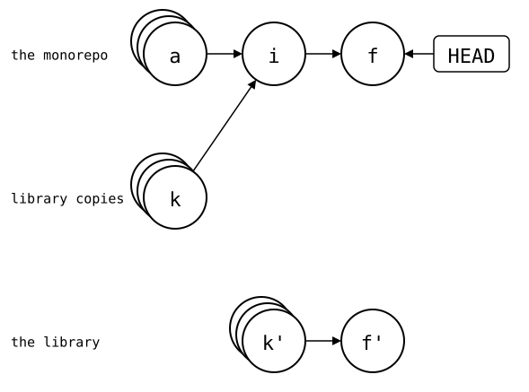
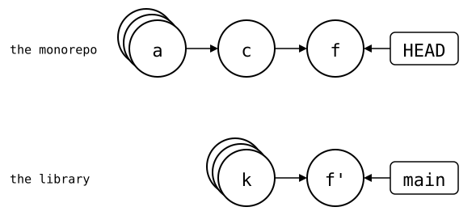
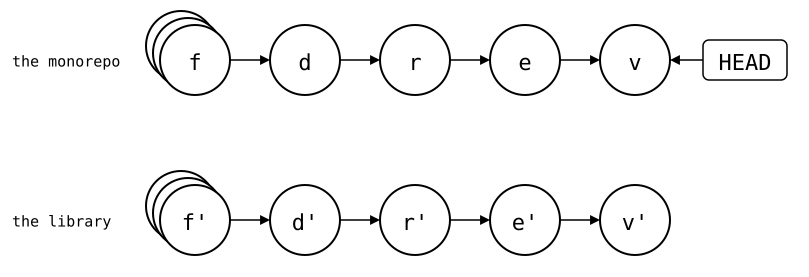
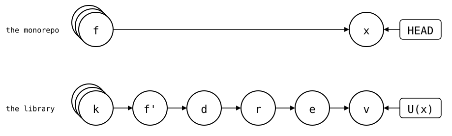
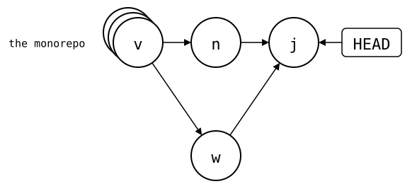
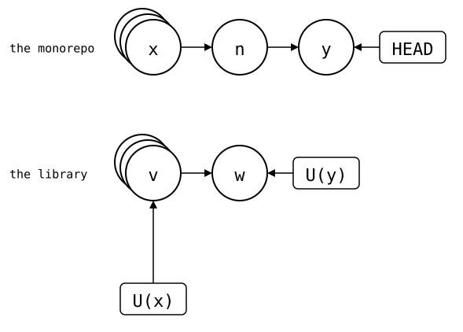
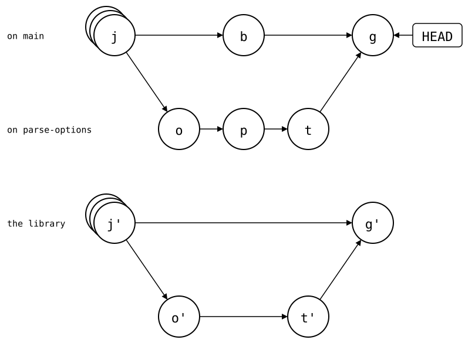
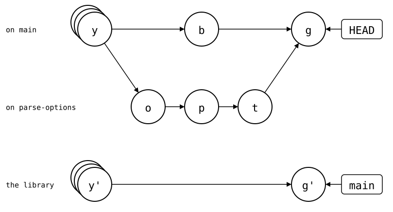

# Josh compared

[Josh](https://github.com/josh-project/josh), "Just One Single History",
shows a folder of a monorepo as a repository of its own, by filtering the
monorepo's history. Filtering a commit always gives the same commit, and
filtering back gives the original. So the library's repository and Josh's
view of the folder share commits, hash for hash, as long as the monorepo
holds copies of the library's whole history.

`git-splice` keeps the two histories apart. This page runs both, Josh
with `josh-filter` as its
[import guide](https://josh-project.github.io/josh/guide/importing.html)
does: the library gets the same commits from both, and the difference is
what the monorepo holds.

The setup: `https://git.example.com/lib.git`, a library with 30 commits,
and a monorepo with an app. [How these pages run](../01-git/README.md).

<!--
```scrut {fail_fast: true, output_stream: combined}
$ source "$TESTDIR/../scrut-setup.sh"
```
-->

```scrut
$ josh-filter --version
Version: r26.05.08
```

## Import the library

Josh rewrites the library's history as if it had always lived in
`vendor/lib/`, and merges it into the monorepo:

```scrut
$ git fetch -q https://git.example.com/lib.git main &&
>   josh-filter ':prefix=vendor/lib' FETCH_HEAD &&
>   git merge -q --allow-unrelated-histories -m "import vendor/lib" FILTERED_HEAD
aa49e1798265c0235945ab8c9597d4c5de166969
```

The monorepo now has a copy of each of the library's 30 commits, with
other hashes, since their files are under `vendor/lib/`:

```scrut
$ git log --oneline -2 FILTERED_HEAD
aa49e17 lib commit 30
7934fd0 lib commit 29
```

Filtering `vendor/lib/` out again gives back the library's own commits:

```scrut
$ josh-filter ':/vendor/lib' && git rev-parse FILTERED_HEAD
bafd496b1f4512a95b69464604f3da428aa9e33b
bafd496b1f4512a95b69464604f3da428aa9e33b
```

```scrut
$ git -C "$COMPARISON/upstream/lib.git" rev-parse main
bafd496b1f4512a95b69464604f3da428aa9e33b
```

### With `git-splice`: one commit

The clone, *c*, brings in the library's files, but none of its history:

```scrut
$ cd ../splice-monorepo && git splice clone https://git.example.com/lib.git vendor/lib
===  vendor/lib: fetching https://git.example.com/lib.git
ok   vendor/lib: cloned bafd496 from main
```

## Fix the library: the same commit

You fix the library and use the fix in the app, in one commit, *f*. It
sits on *i*, the import, which merged *k*, the copy of the library's
newest commit, with *a*, the app's:

```scrut
$ cd ../monorepo &&
>   echo "fix" >>vendor/lib/src/parse.txt &&
>   echo "call parse()" >>app/main.txt &&
>   git commit -q -a -m "fix parse() and call it"
```

<div align="center">



</div>

<!--
```scrut
$ check_drawing "$TESTDIR/josh-imported.drawio.svg" --alias HEAD=H \
>   a=HEAD~1^1 k=HEAD~1^2 i=HEAD~1 f=HEAD
ok   josh-imported.drawio.svg: 4 commits, 4 arrows, 1 boxes
```
-->

Filtered, it's a commit on top of the library's `main`, a fast-forward:

```scrut
$ josh-filter ':/vendor/lib' && git log --oneline -2 FILTERED_HEAD
50697019d17eb5ce5e06b61545e3947bb0c08f55
5069701 fix parse() and call it
bafd496 lib commit 30
```

### With `git-splice`: the same commit

The same fix, pushed:

```scrut
$ cd ../splice-monorepo &&
>   echo "fix" >>vendor/lib/src/parse.txt &&
>   echo "call parse()" >>app/main.txt &&
>   git commit -q -a -m "fix parse() and call it" &&
>   git splice push vendor/lib
ok   vendor/lib: pushed 5069701 to main
```

<div align="center">



</div>

<!--
```scrut
$ check_drawing "$TESTDIR/josh-splice-pushed.drawio.svg" --alias HEAD=H \
>   a=HEAD~2 c=HEAD~1 f=HEAD k=refs/splices/lib/heads/main~1
ok   josh-splice-pushed.drawio.svg: 5 commits, 5 arrows, 2 boxes
```
-->

The library gets 5069701 from both: both copy author, committer, dates
and message as `git subtree split` does, so the same change on the same
library commit is the same commit. That holds without a signature or
other extra header: Josh keeps those, and a signature then no longer
verifies; `git-splice` never signs. Neither remembers what it pushed: it
computes it again.

## A release breaks the app: `git bisect`

The app's test needs the fix in the library:

```scrut
$ cat >"$COMPARISON/test-app.sh" <<'EOF'
> grep -q "call parse()" app/main.txt && grep -qx fix vendor/lib/src/parse.txt
> EOF
```

```scrut
$ sh "$COMPARISON/test-app.sh" && echo pass
pass
```

The library gets four commits, *d*, *r*, *e* and *v*, and *r* renames the
line the app relies on:

```scrut
$ git clone -q https://git.example.com/lib.git ../lib-release &&
>   cd ../lib-release &&
>   echo "parse(text)" >README.md &&
>   git add README.md &&
>   git commit -q -m "docs: explain parse()" &&
>   sed -i 's/^fix$/fixed/' src/parse.txt &&
>   git commit -q -a -m "parse: rename fix to fixed"
```

```scrut
$ echo "example" >examples.txt &&
>   git add examples.txt &&
>   git commit -q -m "add examples" &&
>   echo "1.2" >VERSION &&
>   git add VERSION &&
>   git commit -q -m "release 1.2" &&
>   git push -q &&
>   cd ../splice-monorepo
```

The Josh monorepo hasn't changed the library since the fix, so
`--reverse` turns each of the library's commits into a monorepo commit,
on a ref that `main` fast-forwards to:

```scrut
$ cd ../monorepo &&
>   git fetch -q https://git.example.com/lib.git main &&
>   git update-ref FILTERED_HEAD FETCH_HEAD &&
>   git update-ref refs/josh/main main &&
>   josh-filter --reverse ':/vendor/lib' refs/josh/main &&
>   git merge -q --ff-only refs/josh/main
99943ffa60f0e666d7c9d14a1bcb1c556f6d9b98
```

```scrut
$ git log --oneline -5
99943ff release 1.2
372e8a6 add examples
092b6b1 parse: rename fix to fixed
0ea8b10 docs: explain parse()
95dc6e0 fix parse() and call it
```

<div align="center">



</div>

<!--
```scrut
$ check_drawing "$TESTDIR/josh-release.drawio.svg" --alias HEAD=H \
>   f=HEAD~4 d=HEAD~3 r=HEAD~2 e=HEAD~1 v=HEAD
ok   josh-release.drawio.svg: 5 commits, 5 arrows, 1 boxes
```
-->

The test fails now, and `git bisect` finds *r* among the monorepo's own
commits:

```scrut
$ git bisect start HEAD HEAD~4 >/dev/null &&
>   git bisect run sh "$COMPARISON/test-app.sh" >/dev/null &&
>   git bisect log | tail -1 &&
>   git bisect reset >/dev/null
# first 'bad' commit: [092b6b1e37d8035965e55a4856c921988c941e39] parse: rename fix to fixed
```

### With `git-splice`: the culprit is the pull

The pull *x* brings all four commits at once. They stay in the library's
history, between U(f) and U(x), the synced commits before and after:

```scrut
$ cd ../splice-monorepo && git splice pull vendor/lib
ok   vendor/lib fetched (main moved 5069701..612d462)
ok   vendor/lib: pulled 612d462
```

<div align="center">



</div>

<!--
```scrut
$ check_drawing "$TESTDIR/josh-splice-release.drawio.svg" --alias HEAD=H \
>   f=HEAD~1 x=HEAD k=refs/splices/lib/heads/main~5 \
>   d=refs/splices/lib/heads/main~3 r=refs/splices/lib/heads/main~2 \
>   e=refs/splices/lib/heads/main~1 v=refs/splices/lib/heads/main
ok   josh-splice-release.drawio.svg: 8 commits, 9 arrows, 3 boxes
```
-->

`git bisect` stops at the pull:

```scrut
$ git bisect start HEAD HEAD~1 >/dev/null &&
>   git bisect run sh "$COMPARISON/test-app.sh" >/dev/null &&
>   git bisect log | tail -1 &&
>   git bisect reset >/dev/null
# first 'bad' commit: [f85ff0501eca7cb3482ec7e84b7da5fd966724d5] splice: pull vendor/lib from main at 612d462
```

To go deeper, bisect the library's history from U(f) to U(x). Its commits
are fetched already, so a worktree can check them out, and a second,
throwaway one runs the app's test:

```scrut
$ git worktree add -q --detach ../app-bisect &&
>   git worktree add -q --detach ../lib-bisect &&
>   cd ../lib-bisect &&
>   bad="$(git config --blob HEAD:vendor/lib/.splice splice.commit)" &&
>   good="$(git config --blob HEAD~1:vendor/lib/.splice splice.commit)" &&
>   git bisect start "$bad" "$good" >/dev/null
```

The library alone can't run the app's test, so each step copies the
library's files into the throwaway worktree's folder:

```scrut
$ cat >"$COMPARISON/bisect-step.sh" <<'EOF'
> set -e
> rm -rf ../app-bisect/vendor/lib
> mkdir ../app-bisect/vendor/lib
> git archive HEAD | tar -x -C ../app-bisect/vendor/lib
> cd ../app-bisect
> sh "$COMPARISON/test-app.sh"
> EOF
```

```scrut
$ git bisect run sh "$COMPARISON/bisect-step.sh" >/dev/null &&
>   git bisect log | tail -1
# first 'bad' commit: [9c8481ced0e577e419cebdf1caa1d444e05944f7] parse: rename fix to fixed
```

```scrut
$ git bisect reset >/dev/null &&
>   cd ../splice-monorepo &&
>   git worktree remove ../lib-bisect &&
>   git worktree remove --force ../app-bisect
```

That's *r* itself, which Josh's `092b6b1` copies. Replacing the folder
works because it had no changes of its own since U(f); unpushed changes
would need to be merged in at each step.

## Both sides move on

The library gets a release, *w*:

```scrut
$ git clone -q https://git.example.com/lib.git ../lib-dev &&
>   echo "release 1.3" >>../lib-dev/src/parse.txt &&
>   git -C ../lib-dev commit -q -a -m "release 1.3" &&
>   git -C ../lib-dev push -q
```

Meanwhile, each monorepo adds notes to the library, *n*:

```scrut
$ echo "notes" >vendor/lib/NOTES &&
>   git add vendor/lib &&
>   git commit -q -m "add notes to lib"
```

```scrut
$ cd ../monorepo &&
>   echo "notes" >vendor/lib/NOTES &&
>   git add vendor/lib &&
>   git commit -q -m "add notes to lib"
```

Josh merges the two in the library's history, where both sides share
commits. A worktree of the filtered history stands in for Josh's view:

```scrut
$ git fetch -q https://git.example.com/lib.git main:refs/lib/main &&
>   josh-filter ':/vendor/lib' &&
>   git worktree add -q --detach ../lib-view FILTERED_HEAD &&
>   git -C ../lib-view merge -q -m "merge release 1.3" refs/lib/main
15560d75aab425a7d5cd9e9c4263dbd4c39412f3
```

`--reverse` carries the merge back into the monorepo:

```scrut
$ git update-ref FILTERED_HEAD "$(git -C ../lib-view rev-parse HEAD)" &&
>   git update-ref refs/josh/main main &&
>   josh-filter --reverse ':/vendor/lib' refs/josh/main &&
>   git merge -q --ff-only refs/josh/main
151bbf6389edb01576588e515121f0c4beeb2698
```

The release reaches the monorepo as a commit of its own, joined by the
merge *j*:

```scrut
$ git log --oneline --graph -4
*   151bbf6 merge release 1.3
|\  
| * 148e97c release 1.3
* | 64fc20e add notes to lib
|/  
* 99943ff release 1.2
```

<div align="center">



</div>

<!--
```scrut
$ check_drawing "$TESTDIR/josh-both-moved.drawio.svg" --alias HEAD=H \
>   v=HEAD~2 n=HEAD^1 w=HEAD^2 j=HEAD
ok   josh-both-moved.drawio.svg: 4 commits, 5 arrows, 1 boxes
```
-->

### With `git-splice`: one pull commit

```scrut
$ cd ../splice-monorepo && git splice pull vendor/lib
ok   vendor/lib fetched (main moved 612d462..bc443d9)
ok   vendor/lib: pulled bc443d9
```

```scrut
$ git log --oneline --graph -3
* 49407e9 splice: pull vendor/lib from main at bc443d9
* 5b9db00 add notes to lib
* f85ff05 splice: pull vendor/lib from main at 612d462
```

The pull *y* records *w*, which stays in the library's history:

<div align="center">



</div>

<!--
```scrut
$ check_drawing "$TESTDIR/josh-splice-both-moved.drawio.svg" --alias HEAD=H \
>   x=HEAD~2 n=HEAD~1 y=HEAD v=refs/splices/lib/heads/main~1 w=refs/splices/lib/heads/main
ok   josh-splice-both-moved.drawio.svg: 5 commits, 6 arrows, 3 boxes
```
-->

So the monorepo's history counts its own commits only:

```scrut
$ git rev-list --count HEAD
45
```

```scrut
$ git -C ../monorepo rev-list --count HEAD
79
```

## Whose history is it?

With Josh, the library's history is a view of the monorepo's: one
project, seen through a folder. With `git-splice`, the library has a
history of its own, which the monorepo integrates. It shows when a
branch changes the library, *o*, adapts the app, *p*, and fixes a typo
in the library change, *t*, while `main` bumps the app's dependencies,
*b*, and then merges the branch, *g*.

In the Josh monorepo:

```scrut
$ cd ../monorepo &&
>   git switch -q -c parse-options &&
>   echo "options" >vendor/lib/src/options.txt &&
>   git add vendor/lib &&
>   git commit -q -m "lib: add parse() options" &&
>   echo "parse(options)" >>app/main.txt &&
>   git commit -q -a -m "app: pass options to parse()" &&
>   echo "options, fixed" >vendor/lib/src/options.txt &&
>   git commit -q -a -m "lib: fix options typo"
```

```scrut
$ git switch -q main &&
>   echo "deps" >app/deps.txt &&
>   git add app &&
>   git commit -q -m "app: bump dependencies" &&
>   git merge -q --no-ff -m "Merge branch 'parse-options'" parse-options
```

Josh's view of the library gets the merge, with the branch's name, and
both library commits, the typo fix included; only *p* and *b* stay
behind:

```scrut
$ josh-filter ':/vendor/lib' && git log --oneline --graph -6 FILTERED_HEAD
27886715d65462c101ec16b7762e92b5efe4a121
*   2788671 Merge branch 'parse-options'
|\  
| * 3b58a7e lib: fix options typo
| * 0833578 lib: add parse() options
|/  
*   23ff56b merge release 1.3
|\  
| * bc443d9 release 1.3
* | 15560d7 add notes to lib
|/  
```

<div align="center">



</div>

<!--
```scrut
$ git branch -q -f josh/view FILTERED_HEAD &&
>   check_drawing "$TESTDIR/josh-view-merged.drawio.svg" \
>   m=josh/view^1 o=josh/view^2~1 t=josh/view^2 g=josh/view
ok   josh-view-merged.drawio.svg: 4 commits, 4 arrows, 0 boxes
```
-->

### With `git-splice`: the merge as one commit

The same branch and merge:

```scrut
$ cd ../splice-monorepo &&
>   git switch -q -c parse-options &&
>   echo "options" >vendor/lib/src/options.txt &&
>   git add vendor/lib &&
>   git commit -q -m "lib: add parse() options" &&
>   echo "parse(options)" >>app/main.txt &&
>   git commit -q -a -m "app: pass options to parse()" &&
>   echo "options, fixed" >vendor/lib/src/options.txt &&
>   git commit -q -a -m "lib: fix options typo"
```

```scrut
$ git switch -q main &&
>   echo "deps" >app/deps.txt &&
>   git add app &&
>   git commit -q -m "app: bump dependencies" &&
>   git merge -q --no-ff -m "Merge branch 'parse-options'" parse-options
```

A push follows the monorepo's first parents, so the merge reaches the
library as one commit, *g'*, with the library's half of the branch:

```scrut
$ git splice push vendor/lib
ok   vendor/lib: pushed ea668f6 to main
```

```scrut
$ git -C "$COMPARISON/upstream/lib.git" log --oneline --graph -6 main
* ea668f6 Merge branch 'parse-options'
*   ef0b95a splice: pull vendor/lib from main at bc443d9
|\  
| * bc443d9 release 1.3
* | 15560d7 add notes to lib
|/  
* 612d462 release 1.2
* efa30d9 add examples
```

<div align="center">



</div>

<!--
```scrut
$ check_drawing "$TESTDIR/josh-splice-merged.drawio.svg" --alias HEAD=H \
>   y=HEAD~2 b=HEAD^1 o=HEAD^2~2 p=HEAD^2~1 t=HEAD^2 g=HEAD
ok   josh-splice-merged.drawio.svg: 8 commits, 9 arrows, 2 boxes
```
-->

Below it, both libraries have the same merge of the earlier pull, *y'*
here, with the same parents and each tool's message: a merge that joins
the library's history with the monorepo's changes belongs to the
library, and both tools send it. A merge of the monorepo's branches is
integration, and only Josh sends it. *g'* still has the monorepo's
message, `Merge branch 'parse-options'`; a squash merge, or a message
written for the library, arrives as written.

## Where Josh is better

- **`git bisect`, `git blame` and `git log` reach the library's commits.**
  In the Josh monorepo, they're ancestors, so a
  [bisect](#a-release-breaks-the-app-git-bisect) lands on the library's
  commit, and blame names its author. In the `git-splice` monorepo, they
  stop at the pull that brought the commits in, and going further takes a
  second bisect, `git log`, or `git blame` on the library's history,
  between the synced commits.
- **Nothing to conflict on a pull.** Two monorepo branches that both pull a
  splice conflict in `.splice`, and you keep the newer synced commit. Josh
  stores no sync point, so there's nothing to resolve but the files.
- **Any slice of the monorepo can be a repository.** A view can combine
  folders, change on demand and be served to people who can't see the rest
  of the monorepo. A splice is one folder with one upstream, set up
  beforehand.
- **Built for large monorepos.** Josh filters whole histories quickly,
  with a cache that can be shared between machines.

## Where Josh is different

- **History, not a sync point.** A commit's filtered hash says where the
  two sides meet; `git-splice` records that point, the synced commit, in
  `.splice`, so it needs no shared history. For repositories Josh didn't
  import, such as `rust-lang/miri` next to `rust-lang/rust`, its own
  design lists that as an
  [open question](https://github.com/josh-project/josh/blob/master/rfcs/worktree.md#open-questions);
  today, [`rustc-josh-sync`](https://github.com/rust-lang/josh-sync) keeps
  the last synced commit in a `rust-version` file.
- **One project, or two owners.** With Josh, a monorepo branch reaches
  the library with its commits and merge, which suits one team working in
  one project. With `git-splice`, the library's maintainers review and
  release in their own repository, and each history keeps the other's
  commits out ([Whose history is it?](#whose-history-is-it)). miri has
  its own maintainers too, but synced through Josh, its history has
  copies of the Rust commits that changed it.
- **Git does less of the work.** Josh filters, walks and merges in Rust,
  on gitoxide, with a cache, and calls `git` to fetch and push.
  `git-splice` calls Git for every step, and walks history only since the
  boundary.
- **Links are unreleased, and go one way.** `josh link`, experimental on
  Josh's `master` since September 2026, publishes a folder to a
  repository of its own. Its id and upstream branch live in a ref,
  `refs/josh/links/<id>`, not in the folder, and nothing comes back
  through it. A splice's id and synced commit are committed in its
  folder, so they move with `git mv`.

## In short

| | Josh | `git-splice` |
| --- | --- | --- |
| Library history in the monorepo | whole, as copies under the folder | none, one commit per sync |
| Commits a push sends | the filtered history, the same as `git subtree split` for commits without a signature or extra headers | the first-parent commits since the boundary, otherwise the same as `git subtree split` |
| `git bisect` for a library bug | finds the monorepo's copy of the library's commit | finds the pull, then a second bisect between the synced commits does |
| A monorepo branch merged | a merge, with the branch's commits | one commit, with the merge's message |
| Where both sides meet | commits of the filtered view that the library has | the synced commit in `.splice` |
| An upstream commit pulled in | one monorepo commit for each, and a merge if both sides moved | one pull commit for all |
| Merges a sync adds to the monorepo | one when both sides moved | none |
| Implementation | Rust, gitoxide, a cache | Bash, the `git` command |
| Best for | a monorepo that is the source of truth, served in parts | a library with its own repository, changed in the monorepo |
