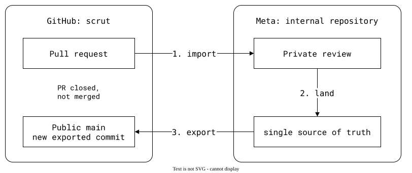

# Export tools compared

Copybara and Meta's ShipIt move changes between repositories while keeping
one source of truth. In the workflows below, that is an internal monorepo:
public contributions must land there before they are exported back to GitHub.

## Copybara

[Copybara requires one authoritative repository](https://github.com/google/copybara#readme).
XLA's [contribution notes](https://github.com/openxla/xla/blob/main/docs/copybara.md#pr-merge-status-and-diff-inconsistencies)
explain the consequence: a pull request is tested and submitted internally,
then exported as a separate commit. GitHub shows the PR as closed, not merged;
transformations can also change its diff.

## Meta's ShipIt

We use the [fork workflow](../../04-advanced-workflows/02-fork.md) to contribute
to [scrut](https://github.com/facebookincubator/scrut), which is spliced into
this repository's `scrut/` folder. In [PR #61](https://github.com/facebookincubator/scrut/pull/61#issuecomment-6579502219),
the maintainer explained that merging on GitHub before accepting the change internally could leave two
conflicting sources of truth. They accept it internally first and let
automation export the result.

<div align="center">



</div>

For contributors, the review link is private, and the result is a separate
public commit rather than a GitHub merge. Both
[#61](https://github.com/facebookincubator/scrut/pull/61) and
[#84](https://github.com/facebookincubator/scrut/pull/84) were closed this way,
with bot comments linking to the exported commits. Acceptance is visible;
the internal review is not. The
[exported commit for #84](https://github.com/facebookincubator/scrut/commit/929821d61933114c714b8ac2b2b51a38a6e161bf)
keeps the contributor as author and records `Differential Revision` and
`fbshipit-source-id` in its message: links back to the internal review and
source commit ([sync points as text](../../08-going-forward/05-weak-parents.md)).

The internal build also constrains public contributions. In
[#84](https://github.com/facebookincubator/scrut/pull/84#issuecomment-6630592515),
a crate upgrade needed Meta's internal dependency process and could affect
more than scrut. The maintainer initially doubted it could land, but
[ultimately accepted it](https://github.com/facebookincubator/scrut/pull/84#issuecomment-6637761960).
When the repositories drift, a separate
[re-sync PR](https://github.com/facebookincubator/scrut/pull/59) can require a
GitHub merge with exports paused.

## With git-splice

The public library can instead be authoritative for its own code. The
monorepo pulls a contributor's branch to test it with the app, without
publishing anything. Maintainers merge the PR on GitHub, then the monorepo
pulls the resulting `main`. Internal testing and dependency requirements
still apply; the library's acceptance happens in public.

The example below runs this workflow, not Copybara or ShipIt.

The setup: `https://git.example.com/lib.git`, a public library with 30
commits, and a monorepo with an app. [How these pages run](../01-git/README.md).

<!--
```scrut {fail_fast: true, output_stream: combined}
$ source "$TESTDIR/../scrut-setup.sh"
```
-->

The monorepo has the library as a splice:

```scrut
$ git splice clone https://git.example.com/lib.git vendor/lib
===  vendor/lib: fetching https://git.example.com/lib.git
ok   vendor/lib: cloned bafd496 from main
```

## An external contribution

A contributor opens a pull request in the public library, from a
`contribution` branch:

```scrut
$ git clone -q https://git.example.com/lib.git ../contributor &&
>   git -C ../contributor switch -q -c contribution &&
>   echo "external contribution" >>../contributor/src/parse.txt &&
>   git -C ../contributor commit -q -a -m "external contribution" &&
>   git -C ../contributor push -q origin contribution
```

## Test it in the monorepo

On a monorepo branch of the same name, `pull` brings the contribution in,
to test it together with the app:

```scrut
$ git switch -q -c contribution && git splice pull vendor/lib
ok   vendor/lib fetched
ok   vendor/lib: pulled 4085e21
```

```scrut
$ tail -n 1 vendor/lib/src/parse.txt
external contribution
```

Nothing is published: the public `main` is unchanged, and the monorepo's
`main` doesn't have the contribution.

```scrut
$ git -C "$COMPARISON/upstream/lib.git" log --format=%s -1 main
lib commit 30
```

```scrut
$ git show main:vendor/lib/src/parse.txt | tail -n 1
line 30
```

## Merge it in public

The maintainers merge the pull request in the public library, where the
contributor sees it as merged:

```scrut
$ git -C ../contributor switch -q main &&
>   git -C ../contributor merge -q --no-ff contribution -m "Merge external contribution" &&
>   git -C ../contributor push -q origin main
```

```scrut
$ git -C "$COMPARISON/upstream/lib.git" log --graph --format=%s -4 main
*   Merge external contribution
|\  
| * external contribution
|/  
* lib commit 30
* lib commit 29
```

The monorepo's `main` pulls the merge result:

```scrut
$ git switch -q main && git splice pull vendor/lib
ok   vendor/lib fetched (main moved bafd496..c174d0d)
ok   vendor/lib: pulled c174d0d
```

```scrut
$ git log -1 --format=%s
splice: pull vendor/lib from main at c174d0d
```

```scrut
$ tail -n 1 vendor/lib/src/parse.txt
external contribution
```
