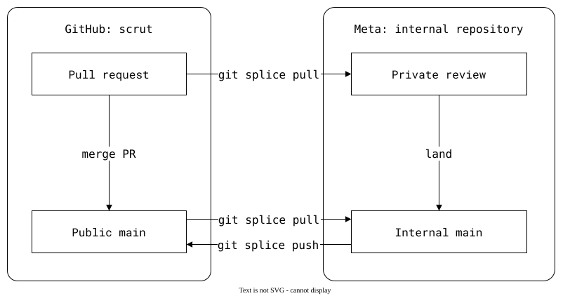

# Export tools compared

Copybara and Meta's ShipIt move changes between repositories while keeping
a single source of truth. In these export workflows, that is an internal monorepo:
public contributions must land there before they are exported back to GitHub.

They can run from the command line, but need an export pipeline configured
through [Copybara workflows](https://github.com/google/copybara#example) or
[FBShipIt manifests, phases and filters](https://github.com/facebookarchive/fbshipit#using-fbshipit).

## Copybara

[Copybara requires one authoritative repository](https://github.com/google/copybara#readme).
XLA's [contribution notes](https://github.com/openxla/xla/blob/main/docs/copybara.md#pr-merge-status-and-diff-inconsistencies)
explain the consequence: a pull request is tested and submitted internally,
then exported as a separate commit. GitHub shows the PR as closed, not merged;
transformations can also change its diff.

## Meta's ShipIt

ShipIt keeps the internal repository as its single source of truth:
changes are accepted there first to avoid accepting changes independently
in two places. See scrut's [origin](https://github.com/facebookincubator/scrut)
and [fork](https://github.com/roschaefer/scrut).

The result is public, but the internal review is private and GitHub
shows the PR as closed rather than merged.

## With git-splice

The PR can merge directly into public `main`. The monorepo can pull from
the PR branch to test it before the merge, or from `main` afterwards.
Public acceptance does not have to wait for the internal review.

For the commands, see [the fork workflow](../../04-advanced-workflows/02-fork.md).
