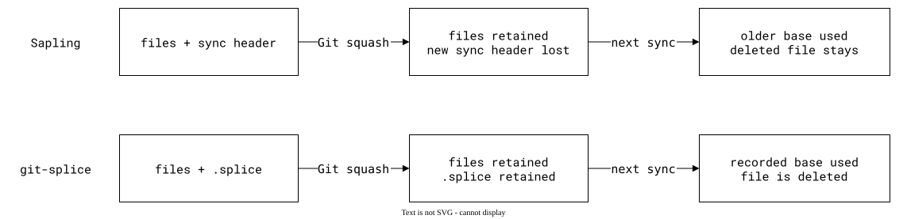

# Sapling compared

[Sapling](https://sapling-scm.com/) supports
[directory branching](https://engineering.fb.com/2025/10/16/developer-tools/branching-in-a-sapling-monorepo/):
`sl subtree` copies a folder or external repository into a folder and
merges later changes with a three-way merge. Each import or merge is one
monorepo commit; the external history stays separate.

The main distinction from `git-splice` is where the sync record lives:
Sapling stores it in commit metadata; `git-splice` stores it in `.splice`.
That choice matters when Git rewrites the monorepo's history.

## Where the sync record lives

Sapling records the source URL, revision and paths in an extra commit
header. Git can display it with `git cat-file`, but does not interpret it
as a subtree relationship. Sapling's own rewrites preserve the record;
a Git squash or rebase can discard it.

A file added in a squashed release and deleted upstream later can remain
in the monorepo: without the newer record, Sapling can mistake it for a
local addition. `.splice` keeps the new base, so `git-splice` applies the
deletion. The [checked scenario](../../09-scenarios/09-vcs-compatibility/01-sapling-metadata/README.md)
shows both outcomes.

| | Sapling `sl subtree` | `git-splice` |
| --- | --- | --- |
| Sync state | Commit metadata interpreted by Sapling | `.splice`, versioned with the files |
| After a Git squash | New record lost; an older record may be used | Sync point retained |
| Sending changes to the library | No subtree export command in the tested version | `git splice push` |
| History across imports | `sl log` and `sl blame` follow the metadata | Git commands on the fetched upstream history |
| Branching two folders of one repository | Supported | Requires a separate upstream repository |

## When Sapling is a better fit

Directory branching lets you maintain a stable copy of a folder and merge
changes into it without creating a separate repository. Its history tools
follow copies and imports, and there is no sync-state file to conflict on.
Code conflicts can still occur.

A splice fits a folder whose repository continues to develop independently,
with changes going both ways. In the tested Sapling version, `import`,
`merge` and `graft` bring changes in; sending a fix back needs a separate
patch workflow. External `merge --url` and `graft --url` are experimental.

## Using git-splice alongside Sapling

`git-splice` can run alongside `sl` in a Git working copy. In the tested
version, `sl commit` keeps Git on its branch, but `sl amend` leaves stale
contents in Git's index and `sl goto` can leave `HEAD` detached.
The [compatibility scenario](../../09-scenarios/09-vcs-compatibility/02-sapling-git-index/README.md)
shows these states and how to return to a named Git branch.

The scenarios use the version pinned in [`flake.nix`](../../../flake.nix).
A native Sapling clone without a Git working copy is outside `git-splice`'s
scope. Ideas for closer integration are under
[Going forward](../../07-design/07-going-forward/04-sapling.md).
