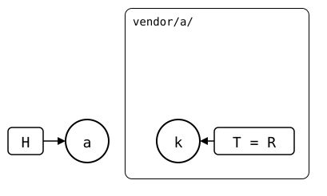
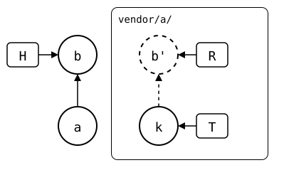
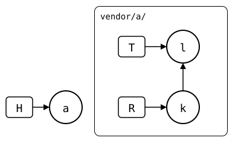
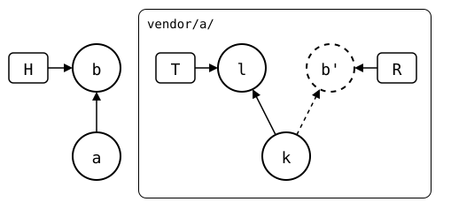
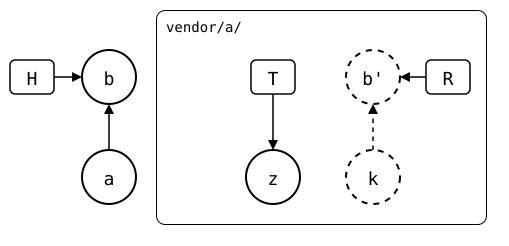
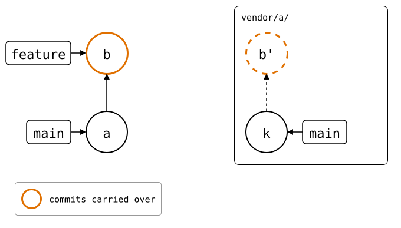

# status

Command defaults and inherited hooks can be committed in
[`.spliceconfig`](12-configuration.md).
Flags used by several commands have a [shared reference](13-shared-options/README.md),
including [execution hooks and their JSON payload](13-shared-options/01-exec/README.md).

<!-- Builds a fresh sandbox; see `just docs-check`.
```scrut {fail_fast: true, output_stream: combined}
$ source "$TESTDIR/../tests/walkthrough/scrut-setup.sh"
```
-->

```scrut
$ git splice status -h | check-help preamble
NAME
    git-splice-status - Show each splice's sync state

SYNOPSIS
    git splice status [--upstream <name>] [path...]
```
## Description

```scrut
$ git splice status -h | check-help section description
    Shows the sync state of every splice. Purely local -- run 'git splice
    fetch' first for up-to-date results. Like every command, status reads
    splices from the last commit. It warns about uncommitted changes in a
    splice's folder, which push leaves out.
```

In the [walkthrough's repositories](../01-getting-started/02-walkthrough.md), `vendor/pkg-a/`'s upstream
has one commit the monorepo doesn't have yet:

```scrut
$ git splice status
On branch main

  behind 1  vendor/pkg-a
```

What `status` compares to tell the states apart: the
[sync model](../03-concepts/02-sync-model.md).

## Options

### `<path>...`

```scrut
$ git splice status -h | check-help option path
        Shows only these splices, by their folders. Without paths, every
        splice.
```

```scrut
$ git splice status vendor/pkg-a
On branch main

  behind 1  vendor/pkg-a
```

### `--upstream`

```scrut
$ git splice status -h | check-help option --upstream
        Compares with this one of the upstreams the splice's .splice names,
        instead of its default upstream. A splice without the named
        upstream stops the command before it starts. A splice with several
        upstreams shows its upstream branch as <name>/<branch>.
```

A splice with a fork and the original as upstreams shows which one each
line compares with
([scenario](../09-scenarios/04-upstreams/02-several-upstreams/README.md)).

## Output

```scrut
$ git splice status -h | check-help section output
    Every splice gets a line: the splices that need something come first,
    most urgent first -- "!!" and "??" mark problems -- and those that are
    up to date or unchanged come last.

    Like 'git status' against its upstream branch, it counts commits:
    "ahead" is how many 'git splice push' would publish, "behind" how many
    'git splice pull' would bring in. 'git splice diff --stat' shows the
    files.
```

Each state comes with a small, tested scenario, and `merge`, `pull` and
`push` act on it. In the drawings, H is `HEAD`, R the rebuild `push`
would send, and T the fetched upstream branch; dashed commits are on no
upstream branch yet ([sync model](../03-concepts/02-sync-model.md)).

| `status` shows | Meaning | What to do |
| --- | --- | --- |
| `?? never fetched` | The upstream wasn't fetched in this clone yet. ([example](../09-scenarios/01-everyday-sync/04-never-fetched/README.md)) | Run `git splice fetch`. |
| `?? synced commit X isn't here` | `.splice` names an upstream commit this clone doesn't have, e.g. after `git pull` brought in a teammate's `git splice pull`. ([example](../09-scenarios/03-branches-and-teamwork/06-teammate-pulled/README.md)) | Run `git splice fetch`. If upstream doesn't have the commit any more, `pull` and `push` print the ways to pick a side. |
| `up to date` | Both sides are the same. ([example](../09-scenarios/01-everyday-sync/02-up-to-date/README.md))<br/> | Nothing to do. |
| `ahead N` | Only your side changed. ([example](../09-scenarios/01-everyday-sync/02-up-to-date/02-push-ahead/README.md))<br/> | Run `git splice push`. |
| `behind N` | Only the upstream changed. ([example](../09-scenarios/01-everyday-sync/02-up-to-date/01-pull-ahead/README.md))<br/> | Run `git splice pull`. |
| `ahead N, behind M` | Both sides changed since they last matched. ([example](../09-scenarios/01-everyday-sync/02-up-to-date/02-push-ahead/03-diverged-common-ancestor/README.md))<br/> | Run `git splice pull`, then `push`. On a conflict, resolve it and `git commit` first. |
| `!! unrelated history` | Both sides changed and share no history, e.g. the upstream was rebuilt from scratch. ([example](../09-scenarios/06-rewritten-history/03-diverged-unrelated-history/README.md))<br/> | Pick a side. `merge`, `pull` and `push` refuse to guess and print the commands to keep either side, or both. |

## No upstream branch

```scrut
$ git splice status -h | check-help section no-upstream-branch
    For a splice whose upstream has no branch named like the current one,
    the comparison is with upstream's default branch, as for a PR: "new"
    counts the commits the push that creates the branch would publish, and
    how many the default branch has that this one lacks. "unchanged" means
    a PR from the branch would show no changes: the default branch has
    every commit, or the others change no files, e.g. a change and its
    revert.
```

On a branch the upstream doesn't have, the splice is compared with
upstream's default branch, as a PR would be. Here `feature` has *b*,
which upstream's `main` lacks, so the splice is `new, ahead 1`, and a
push would create `feature` upstream with *b'*:

<div align="center">



</div>

`unchanged, no upstream branch` means the PR would show no changes;
`new, ahead N` that the default branch lacks N commits, also ones from
the branch yours was cut from. `git splice push` creates the branch only
in that case
([unchanged](../09-scenarios/03-branches-and-teamwork/01-feature-branch-unchanged/README.md),
[changed](../09-scenarios/03-branches-and-teamwork/01-feature-branch-unchanged/01-feature-branch-changed/README.md),
[from `main`](../09-scenarios/03-branches-and-teamwork/02-feature-branch-from-main/README.md),
[stacked](../09-scenarios/03-branches-and-teamwork/01-feature-branch-unchanged/01-feature-branch-changed/01-stacked-branch/README.md)).

## Tracked branches

```scrut
$ git splice status -h | check-help section tracked-branches
    A splice that tracks an upstream branch on the current branch, by
    'git splice fetch --track' (or push, pull, merge), says so: "tracked on
    <branch>, local". It's in this repository's config only, so another
    clone of the monorepo shows the usual branch there.
```

A splice that syncs with another branch than the one named like yours
names it, with `tracked on <branch>, local`
([scenario](../09-scenarios/03-branches-and-teamwork/07-tracked-branch/README.md)).

<!-- Checks that every linked help section appears above, in order.
```scrut
$ git splice status -h | check-help document "$TESTDIR/$TESTFILE"
```
-->
