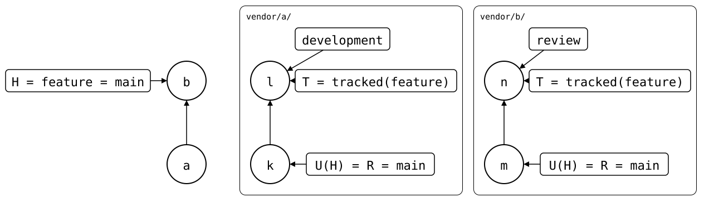
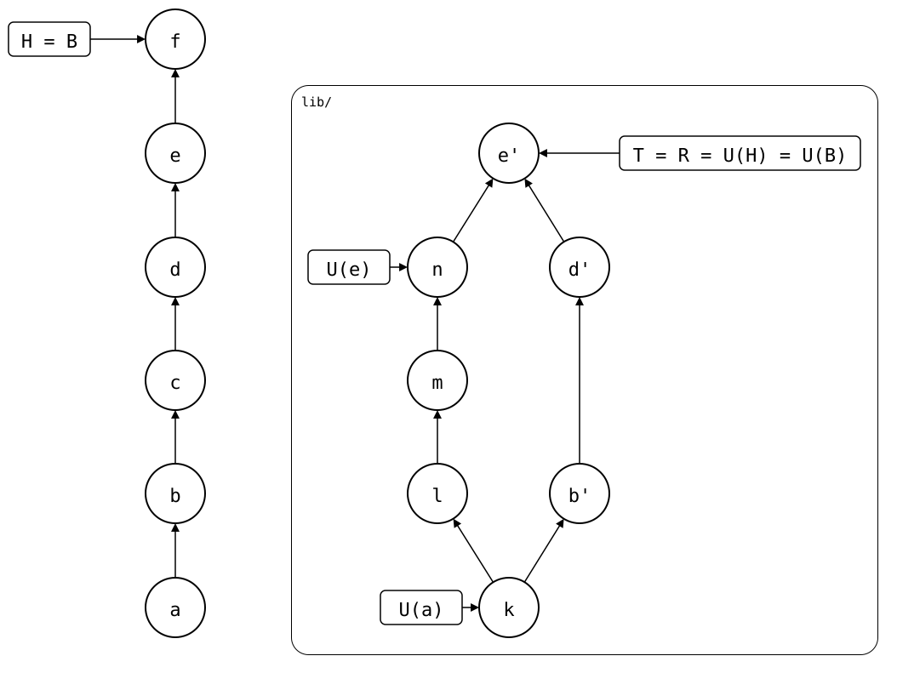
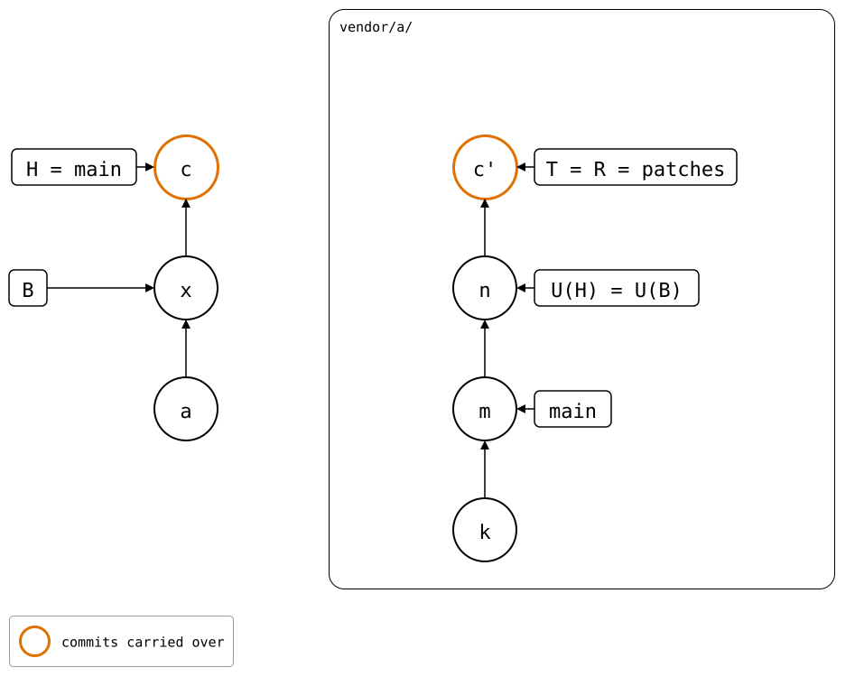
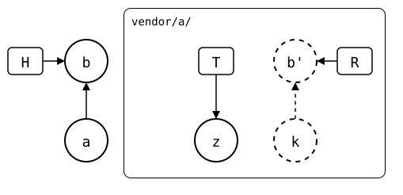
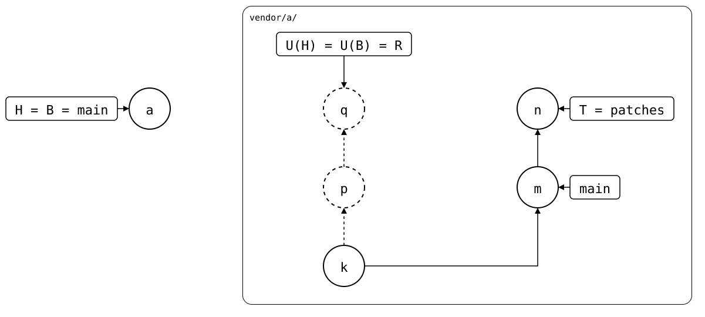

# merge

<!-- Builds a fresh sandbox; see `just docs-check`.
```scrut {fail_fast: true, output_stream: combined}
$ source "$TESTDIR/../tests/walkthrough/scrut-setup.sh"
```
-->

```scrut
$ git splice merge -h | check-help preamble
NAME
    git-splice-merge - Splice in fetched upstream changes

SYNOPSIS
    git splice merge [--upstream <name>] [--branch <name> [--track]] [--bump | --rebase] [--no-fork-point] (<path>... | --all)
    git splice merge [<option>...] -m <message> <path>
    git splice merge [-m <message>] --rebuilt-commit <commit> <path>
```

## Description

```scrut
$ git splice merge -h | check-help section description
    Splices already-fetched upstream changes into each splice, as one ordinary
    commit per splice. Never touches the network: run 'git splice fetch'
    first, or 'git splice pull' to do both.
```

In the [walkthrough's repositories](../01-getting-started/walkthrough.md), `vendor/pkg-a/`'s upstream
has a commit the monorepo doesn't have yet, and it's already fetched:

```scrut
$ git splice merge vendor/pkg-a
ok   vendor/pkg-a: merged 703b936
```

The commit `merge` made records the fetched branch, T, as the new synced
commit, U(H). Nothing was waiting to be pushed, so its folder is U(H), and
it's `vendor/pkg-a/`'s new [boundary](boundary.md), B:

```scrut
$ git log -1 --stat --format=%s
splice: merge vendor/pkg-a from main at 703b936

 vendor/pkg-a/.splice  | 2 +-
 vendor/pkg-a/file.txt | 1 +
 2 files changed, 2 insertions(+), 1 deletion(-)
```

```scrut
$ git config --file vendor/pkg-a/.splice splice.commit
703b9360f7ac335a1134e9b5771a90a7c09ba39a
```

The upstream's commits stay upstream, and in `refs/splices/`. The
monorepo's history stays linear.

## Options

```scrut
$ git splice merge -h | check-help section options
    <path>...
        The splices to merge, by their folders.

    --all
        Merges every splice.
```

### `--upstream`

```scrut
$ git splice merge -h | check-help option --upstream
        Merges from this one of the upstreams the splice's .splice names,
        instead of its default upstream. A splice without the named upstream
        stops the command before it starts.
```

For a splice with a fork and the original as upstreams: merge the
original's fix without switching the default
([upstreams](../03-concepts/upstreams/README.md#a-fork-and-the-original),
[scenario](../09-scenarios/04-upstreams/02-several-upstreams/README.md)).

### Branch tracking

```scrut
$ git splice merge -h | check-help option branch-tracking
    --branch <name>
        Merges this upstream branch instead of the usual one (see UPSTREAM
        BRANCH), e.g. the one the default branch follows, on a pull
        request's branch the upstream has none for. It doesn't change
        .splice, and the splices below keep theirs.

    --track
        With --branch, also tracks that branch on the monorepo's current
        branch, as 'git push -u' does: from then on, every command syncs the
        splice with it there, until --track names another. It's kept in the
        repository's config, as branch.<branch>.splice = <key>:<name>, by
        the upstream's key ('git splice key'), so it stays in this clone, and
        'git splice status' marks the splices that track one. 'git splice
        fetch --branch <name> --track' tracks one without a merge, and 'git
        splice fetch --no-track' stops tracking it.
```

`vendor/a/` syncs with `development` on the monorepo's `feature`, because
`--track` recorded it; `vendor/b/` follows `review` the same way:

<div align="center">



</div>

[Tracked branches](../03-concepts/upstreams/README.md) explains them, and
the [scenario](../09-scenarios/03-branches-and-teamwork/07-tracked-branch/README.md)
sets and unsets one.

### `--bump`

```scrut
$ git splice merge -h | check-help option --bump
        Also moves the synced commit up to the upstream branch when there's
        nothing to merge, e.g. right after a push, in a commit that only
        changes the splice's .splice, like a submodule bump. Later rebuilds
        then start there, instead of rebuilding every pushed commit again.
```

Right after a push, the upstream branch has the pushed commits and the
folder has their files, so there's nothing to merge. `--bump` records the
upstream branch anyway:

<div align="center">



</div>

Use it sparingly: on a feature branch, a bump can conflict
([bumping the sync point](../04-advanced-workflows/bump.md#when-not-to-bump)).

### `--rebase`

```scrut
$ git splice merge -h | check-help option --rebase
        Rebases instead, like 'git pull --rebase': takes the upstream branch
        in on top of the newest commit whose folder has exactly the synced
        commit's files, and rebases the monorepo branch's commits since then
        onto that, with 'git rebase'. The next push then sends the folder's
        changes as commits on top of the upstream branch, also after the
        upstream rewrote it.

        It rewrites the branch, so it refuses when a remote-tracking branch
        has any of those commits, and when one of them is a merge, whose own
        changes a rebase would drop. It also refuses when the upstream branch
        lacks the synced commit, and its reflog here doesn't show it ever had
        it: the folder would lose that commit's changes. The branch may never
        have had it, e.g. after 'git rebase main' on a feature branch, or had
        it before a rewrite this clone didn't see, e.g. in a fresh clone.

        rebase.autoStash and rebase.updateRefs don't apply: it neither
        stashes nor moves other branches. On a conflict, resolve it and run
        'git rebase --continue' (or 'git rebase --abort' to give up).
```

The local commit *c* is redone on top of the upstream's rebased patches,
instead of being merged with them:

<div align="center">



</div>

[Rebasing a feature branch](../04-advanced-workflows/rebase-feature-branch/README.md) compares it
with the other ways to get there.

### `--no-fork-point`

```scrut
$ git splice merge -h | check-help option --no-fork-point
        Merges from Git's merge base instead of the fork point (see
        REWRITTEN UPSTREAM BRANCHES).
```

See [rewritten upstream branches](#rewritten-upstream-branches).

### `--rebuilt-commit`

```scrut
$ git splice merge -h | check-help option --rebuilt-commit
        Merges <commit> instead of an upstream branch: one made on top of
        'git splice rebuild <path>', e.g. in a worktree of it, where the
        splice is the whole repository and a splice inside it is one level
        down. It's a three-way merge of the folder from where <commit> left
        the rebuild, so changes the monorepo made since then are kept, and a
        conflict lands in the working tree. The synced commit stays: <commit>
        is local work, not the upstream's, and 'git splice push <path>'
        sends it. The commit takes <commit>'s message if it's one commit on
        top of the rebuild. It's the way back for 'git splice push
        --rebuilt-commit', which sends an edited rebuild the other way.

        Like 'git merge --squash', it takes <commit>'s changes, not the
        commit, and records nothing: before a branch merged that way goes
        on, rebase it onto the new 'git splice rebuild <path>', or the next
        merge starts from the old one, and keeps what the branch deleted
        since.

        It refuses a <commit> with a commit of the splice's upstream, as
        fetched, that the rebuild lacks, e.g. from a pull in the worktree:
        that would come in as a local change, and the next push would
        publish it again. 'git splice pull <path>' takes the upstream's
        commits in instead. Upstream commits no fetched branch has, not
        fetched yet or rewritten away since, look like local work to it.
```

The [scenario](../09-scenarios/01-everyday-sync/02-up-to-date/worked-on-in-a-worktree.md)
works on `vendor/a/` in a worktree of its rebuild and merges the result
back, and [another](../09-scenarios/01-everyday-sync/02-up-to-date/upstream-pulled-in-a-worktree.md)
shows the refusal of a pull made there.

### `-m`

```scrut
$ git splice merge -h | check-help option -m
        Gives the commit this message instead of the default one, which
        names the upstream branch and commit; with --rebase, the commit the
        rebased ones go on top of. It takes one splice: each gets a commit
        of its own. Nothing reads the message back: .splice records the
        synced commit. On a conflict, 'git commit' keeps the message.
```

<!--
```scrut
$ git reset -q --hard HEAD~1
```
-->

```scrut
$ git splice merge -m "pkg-a: take the second commit" vendor/pkg-a
ok   vendor/pkg-a: merged 703b936
```

```scrut
$ git log -1 --format=%s
pkg-a: take the second commit
```

## Upstream branch

```scrut
$ git splice merge -h | check-help section upstream-branch
    The upstream branch is the one named like the current branch; on the
    monorepo's default branch, the upstream's default-branch if it has one,
    or the tag or commit its default-pin names. On a branch the upstream
    doesn't have, there's nothing to merge. --branch names another.
```

On a feature branch the upstream doesn't have, there's nothing to merge:

```scrut
$ git switch -q -c feature &&
>   git splice merge vendor/pkg-a
ok   vendor/pkg-a: upstream has no 'feature' branch -- nothing to merge
```

`--branch main` would merge the default branch there. `status` and
`push` compare such a branch with the default branch, like a pull
request ([feature branches](../02-using-git-splice/feature-branches.md)).

## Order

```scrut
$ git splice merge -h | check-help section order
    Top-down: a splice is merged before the ones below it, since its merge
    can move their synced commits, and a failure stops them.
```

Pulling `vendor/a/` can move the synced commit of `vendor/a/b/`, nested
in it, so `vendor/a/` goes first ([nesting](../03-concepts/nesting/README.md)).

## Conflicts

```scrut
$ git splice merge -h | check-help section conflicts
    On a conflict, resolve it and run 'git commit' (or 'git cherry-pick
    --abort' to give up), then re-run merge for any splices left. When the
    two sides share no history at all, merge doesn't guess: it prints the
    commands to keep either side.
```

When the upstream branch no longer has anything the folder's history
has, `merge` stops and prints the commands to keep either side:

<div align="center">



</div>

The [scenario](../09-scenarios/06-rewritten-history/03-diverged-unrelated-history/README.md)
shows the message.

## Rewritten upstream branches

```scrut
$ git splice merge -h | check-help section rewritten-upstream-branches
    When the upstream rewrote its branch, e.g. a fork rebased its patch
    branch onto a new release, merge starts at the branch's fork point, like
    'git pull --rebase': the newest commit the fetched branch pointed at, by
    its reflog, that the folder's history has. Merge then takes the
    rewritten branch as it is. If the folder has changes that branch lacks,
    it refuses: the next push would publish the rewritten-away commits
    again, under them. --rebase redoes them on top instead.
```

A fork rebased its patches onto a new release. The monorepo still
records the old patches, *q*, while T is the rebased one, *n*:

<div align="center">



</div>

`merge` starts at the fork point and takes the rebased branch as it is
([scenario](../09-scenarios/06-rewritten-history/04-patch-branch-rebased/README.md)).

<!-- Checks that every linked help section appears above, in order.
```scrut
$ git splice merge -h | check-help document "$TESTDIR/$TESTFILE"
```
-->
