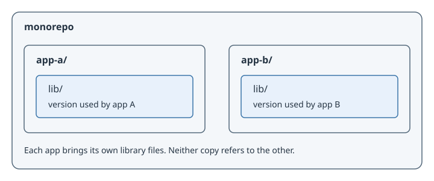

# Mirrors

Mirrors are folders with the same splice
[id](../../03-concepts/03-splice-identity.md), meant to have the same
files. `git-splice` syncs each path independently today.

The proposed [mirror check](README.md#extensions-to-syncing) would report
violations of those semantics. Nesting limits what it could enforce.
A different upstream URL could also be flagged, though it can mean the
repository moved.

## Nested mirrors can lag behind

Mirrors arise from copying a folder, or from two upstreams bringing in
the same nested `.splice`. Separate clones get separate ids, even when
they use the same URL.

If the apps inherited the library's id, those copies are mirrors. One
app may still use an older library. Updating its nested copy changes the
app too; the monorepo cannot make that decision for the app's upstream.

A pull could update copies owned directly by the monorepo together.
It cannot promise that every nested mirror will match.

## Shared storage does not mean a shared folder

Git already stores identical files and trees once. Its checkout writes
every copy. A filesystem with copy-on-write can share disk blocks while
keeping separate files.

A symlink would change the meaning: the app's repository would contain
a link outside itself instead of the library's files. It would also stop
copies from differing while work is in progress.

## Meanwhile: discipline

Edit one copy, push it, then pull the others. Clone a copy that should
have its own history. The [mirrors scenario](../../09-scenarios/07-moved-folders/03-mirrors/README.md)
shows how to compare copies and resolve drift, and why
[swapping their paths](../../09-scenarios/07-moved-folders/03-mirrors/README.md#mirrors-that-swap-paths)
can send unexpected history upstream.
