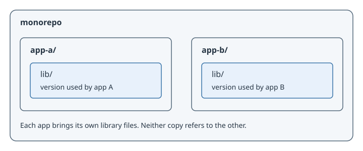

# Package managers

Nested splices form a dependency graph, with familiar package-manager
problems: versions, shared dependencies, cycles and drift. `git-splice`
doesn't resolve version constraints today. Package managers offer
approaches to learn from; dependency management could eventually build
on splice commands or on the VCS itself.

## Copies belong to their paths

A package manager can resolve a shared dependency once. A nested splice
is part of its parent's files, so each path contains a copy. The copies
can be at different versions:

That keeps each upstream complete: anyone can clone an app without
`git-splice`. It also means a cycle would nest forever. See the
[diamond](../../09-scenarios/05-nested-splices/03-diamond/README.md) and
[cycle](../../09-scenarios/05-nested-splices/04-cycle/README.md) scenarios.
Cycles aren't supported or prevented yet. Skipping a repeated dependency
would require a reference where today there are files.

## Versions and identity

| Package manager | Splice |
| --- | --- |
| Requested version or range | Upstream branch |
| Exact version in a lockfile | Synced commit U(H) |
| A package's dependencies | Nested `.splice` files |
| Separate versions of one package | Independent splices of one upstream |
| One dependency shared by several users | [Mirrors](01-mirrors.md), with a copy at each path |

A splice's [id](../../03-concepts/03-splice-identity.md) ties copies to
one history. A URL is a location, not that identity; see
[upstreams](../../03-concepts/01-upstreams.md).

## Dependencies in the repository: zero installs

With npm, a project normally commits dependency declarations and a
lockfile; `npm install` populates the ignored `node_modules/` folder.
Yarn's [zero installs](https://yarnpkg.com/features/caching#zero-installs)
instead commits package archives and the Plug'n'Play loader, so a
checkout supplies the dependencies.

Splices likewise commit dependency content, as editable source files.
A clone has the upstream content needed to build the app. Fetching
upstream commits may be needed for provenance through `blame`, `bisect`
or `log`, but not to build from the checked-in files.
