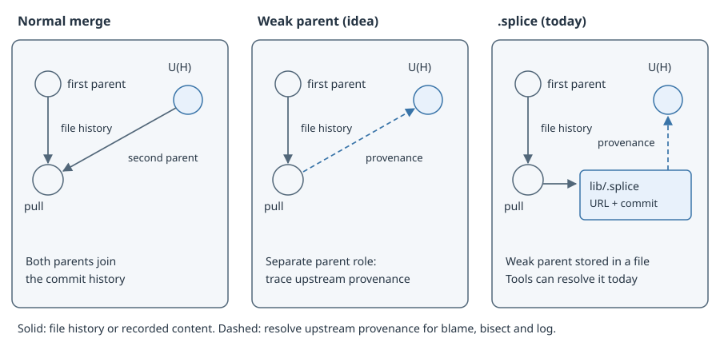

# Going forward

`git-splice` could support more workflows across repositories, both
through extensions and through tools built on top. Some possibilities
need features the VCS doesn't provide today. These are open design
questions, guided by the [design principles](../README.md#principles).

## Tools built on top

A tool could coordinate pull requests across the repositories touched by
one monorepo change. Another could choose dependency versions and use
splice commands to apply updates. The existing sync commands could
provide a basis for either tool, or for dependency management built
into the VCS itself.
[Package managers](02-package-managers.md) explores the dependency model
and its limits.

## Extensions to syncing

- **Choose an upstream branch explicitly**, with a branch in `.splice`
  or a `--branch` option. The current Git branch could remain the default.
  This would also help [Jujutsu](03-jj.md) and [Sapling](04-sapling.md),
  where Git's `HEAD` can be detached.
- **Check mirror semantics.** Copies with the same splice id should have
  the same files. `git-splice` cannot enforce this today; it could report
  when those semantics are violated. [Mirrors](01-mirrors.md) explains
  the limits of enforcement, particularly for nested copies.

Neither extension is implemented.

## What the VCS could provide

A *weak parent* records upstream provenance without joining ordinary
ancestry. The first parent carries file history; tools can follow the
weak parent to trace where changes came from. Today, `.splice` represents
the weak parent in a file in the working tree.

Tools can already resolve the link for `blame`, `bisect` and `log`; the
[bisect scenario](../../09-scenarios/03-branches-and-teamwork/05-bisect-into-a-pull/README.md)
shows how to continue into an upstream's history. A dedicated
[weak parent](05-weak-parents.md) in the VCS would express this distinction
directly. It would need the upstream URL, commit and destination folder,
and survive rebases and squash merges, as the file does today.
