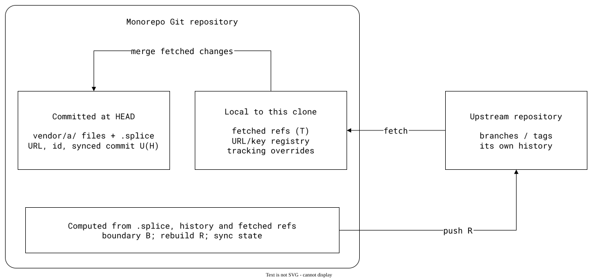

# Design

A handful of principles explain why `git-splice` behaves the way it
does, and they decide what it does next: a
[change](../08-contributing/README.md#pull-requests) that needs a
different tradeoff revisits the principle it departs from.

## Principles

- **Keep each repository's history relevant to its users.** Importing a
  library does not require importing its entire history into the monorepo;
  publishing a library change does not require exposing the monorepo's
  unrelated work. This is why changes cross the splice while the histories
  stay separate. A folder's earlier history may never have been intended
  for that upstream, so publication must follow the splice's identity
  rather than include everything that once occupied its path.
- **Store as little state as possible.** A `.splice` file records one
  upstream commit, the last sync. Everything else, like which monorepo
  commits the next push sends, is worked out from history each time, so
  no second record can fall out of step. `git-subrepo` shows the cost:
  every push commits a record to the monorepo, and
  [a squash merge loses it](../05-comparisons/02-third-party/01-git-subrepo.md#problem-3-after-a-squash-merge-the-last-sync-is-lost)
  ([state rationale](02-state.md#derive-state-instead-of-storing-redundant-records)).
- **Nesting should not change a splice's meaning.** Given equivalent
  history, upstream state and settings, syncing `vendor/a/b/` should produce
  the same result for that splice as syncing `b/` in a standalone clone
  of `vendor/a`'s repository. A project should not need a different dependency workflow
  because it is embedded in another repository. This requires
  [portable state and defaults](02-state.md#sync-state-belongs-in-versioned-files)
  and recovering inner history hidden by an enclosing squash
  ([scenario](../09-scenarios/05-nested-splices/01-nested-splices/pushed-and-made-above.md)).
  It's also why the rebuild of a splice records each splice inside it at
  that splice's own rebuild, the commit its upstream gets with the same
  push: the enclosing upstream then records what the inner one has, and a
  clone of it rebuilds the inner splice as the monorepo does
  ([scenario](../09-scenarios/05-nested-splices/01-nested-splices/rebuilt-in-layers.md)).
- **Rebuild deterministically.** The same committed history produces the
  same upstream commits, so a later push can fast-forward without a
  monorepo commit recording the earlier push. Using original metadata
  rather than the current time or user, and leaving rebuilt commits unsigned,
  avoids inputs that would change their IDs between runs
  ([sync model](../03-concepts/02-sync-model.md#r-is-computed-not-stored)).
- **Keep repeated syncs scalable.** An advancing sync point lets rebuilds
  skip history already accounted for, rather than revisit an ever-growing
  history on every sync. [`git subtree split --squash`](../05-comparisons/01-git/02-git-subtree.md#problem-2-with---squash-split-walks-everything)
  demonstrates that scaling problem. Advancing the sync point costs a
  recording commit; an explicit [bump](../04-advanced-workflows/03-bump.md)
  lets the user choose that tradeoff rather than impose it on every push.
- **Preserving monorepo commit topology is a non-goal.** First-parent
  ancestry is enough for current use cases; the original history remains
  available in the monorepo. The lesson from
  [`git subtree`](../05-comparisons/01-git/02-git-subtree.md) and
  [Josh](../05-comparisons/02-third-party/02-josh.md) was that equivalent
  history mapping adds complexity with little benefit. More faithful
  topology can be reconsidered when a use case justifies it.
- **Inspection must predict publication.** `status`, `diff` and `log`
  look at the same rebuilt commits that `push` sends, so what they show
  is what the upstream gets
  ([sync model](../03-concepts/02-sync-model.md#how-r-and-t-determine-the-status)).
- **Ask “what would Git do?”** Git has much more experience solving
  version-control problems. Where its solution works well, implement the
  closest equivalent:
  [local branch-tracking settings](../09-scenarios/03-branches-and-teamwork/07-tracked-branch/README.md)
  and [reflogs](../09-scenarios/06-rewritten-history/04-patch-branch-rebased/README.md)
  are examples. Problems and bugs caused by a Git design are reasons not
  to adopt it: examples are the global tag namespace and Git submodules
  ([upstream choices](03-upstreams.md),
  [submodule comparison](../05-comparisons/01-git/01-git-submodule.md)).
- **Git's words keep Git's meaning.** Users bring expectations from Git,
  so an existing Git term must name an equivalent operation or concept.
  If the meaning differs, invent a word Git has not taken, as with
  [splice](01-name.md#noun-and-verb).
- **Take advantage of Git's full power.** Git already provides flexible
  tools to shape history, such as [rebasing](../04-advanced-workflows/README.md)
  and [editing rebuilt commits in a worktree](../09-scenarios/06-rewritten-history/01-edited-before-push/README.md).
  Reimplementing those workflows would duplicate a problem Git solves
  better and unnecessarily restrict the user's choices. History editing
  stays with Git; `git-splice`'s contribution is to streamline work across
  multiple repositories from one monorepo. Prefer composing ordinary Git
  operations with splice commands over adding another history editor.
- **Use the user's Git so repository operations remain observable.**
  Running the installed `git` uses the user's version and lets them follow
  and log the commands executed on their machine. Replacing it with a
  library such as gitoxide would substitute another implementation and
  lose that direct Git command trace. Using Git also avoids maintaining
  another implementation of repository operations
  ([tracing scenario](../09-scenarios/01-everyday-sync/05-git-trace/README.md)).
- **Make information easy to discover and side effects deliberate.**
  Without a path, `status`, `diff`, `log` and `fetch` cover every
  splice, so a change in a splice you forgot about still shows up.
  `pull`, `merge` and `push` need a path or `--all`, so they never
  change or publish a splice you didn't name.
- **Design for pull requests across repositories.** A monorepo feature
  branch represents work to submit upstream, so matching branch names
  connect its changes to the corresponding upstream PRs. The upstream
  default branch supplies the comparison target before a feature branch
  exists; create that branch only when there are commits to submit
  ([branch rationale](03-upstreams.md#matching-branch-names-keep-a-feature-together)).
- **Refuse rather than guess.** Ambiguous history, targets or inputs need
  an explicit decision. Guessing can discard changes or publish to the
  wrong place; refusing with an explanation lets the user resolve the
  ambiguity before anything changes.
- **Weigh every fix against its complexity.** A fix can introduce more
  failure modes than it removes. Prefer simple, safe fixes; weigh the
  benefit and frequency of a case against the complexity it adds to every
  future change. Rare cases can be documented or tracked as
  [edge cases](https://github.com/roschaefer/git-splice/issues?q=label%3A%22edge+case%22)
  instead of complicating the ordinary workflow.

## Architecture

## Read more

- [Why the name "splice"](01-name.md), including "splicing in" and
  "splicing out"
- Why [state](02-state.md) and [upstreams](03-upstreams.md) work the way
  they do
- [Going forward](07-going-forward/README.md): ideas and open questions,
  not released behaviour
