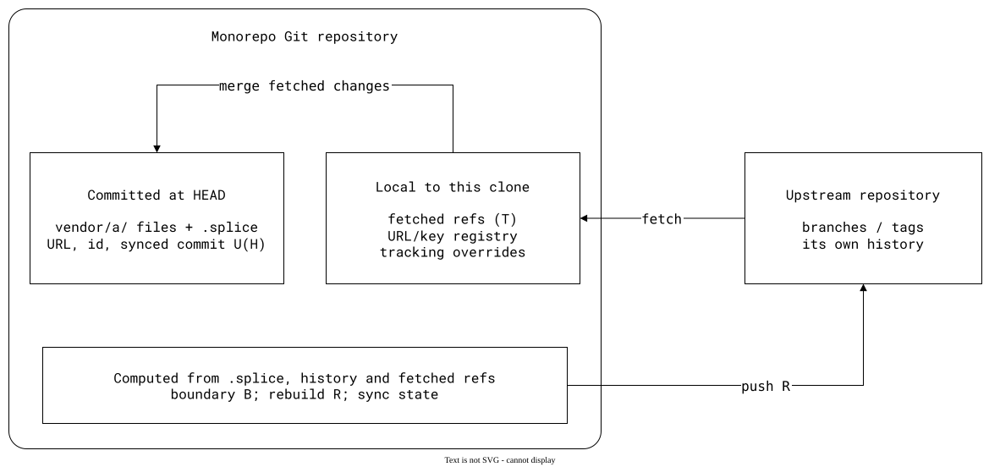

# Design

The other documentation chapters explain what `git-splice` does and how
to use it: [getting started](../01-getting-started/README.md),
[concepts](../03-concepts/README.md),
[workflows](../04-advanced-workflows/README.md),
comparisons with [Git's tools](../05-comparisons/01-git/README.md),
[third-party tools](../05-comparisons/02-third-party/README.md) and
[other VCS tools](../05-comparisons/03-vcs/README.md),
[the command reference](../06-command-reference/README.md) and
[scenarios](../09-scenarios/README.md). Design explains why: the principles, tradeoffs
and constraints behind that behaviour. Mechanisms appear here where they
explain a choice; behaviour and usage belong in the relevant chapters.

These principles also guide future features. Contributors, including AI
agents, should use them to evaluate proposed behaviour, not just to describe
the current implementation. A change that needs a different tradeoff should
explicitly reconsider the affected principle and its rationale.

## Principles

- **Keep each repository's history relevant to its users.** Importing a
  library does not require importing its entire history into the monorepo;
  publishing a library change does not require exposing the monorepo's
  unrelated work. This is why changes cross the splice while the histories
  stay separate.
- **Store as little state as possible.** Redundant records can disagree,
  and every update becomes another opportunity to leave them inconsistent.
  Derive what existing history and configuration already tell us instead
  of storing it again. This avoids the redundant bookkeeping that motivated
  the departure from `git-subrepo`
  ([state rationale](01-state-and-upstreams.md#derive-state-instead-of-storing-redundant-records)).
- **Nesting should not change a splice's meaning.** Given equivalent
  history, upstream state and settings, syncing `vendor/a/b/` should produce
  the same result for that splice as syncing `b/` in a standalone clone
  of `vendor/a`'s repository. A project should not need a different dependency workflow
  because it is embedded in another repository. This governs
  [portable state and defaults](01-state-and-upstreams.md#sync-state-belongs-in-versioned-files)
  and [inherited history](03-splicing-out.md#history-inherited-through-nesting).
- **Rebuild deterministically.** The same committed history produces the
  same upstream commits, so a later push can fast-forward without a
  monorepo commit recording the earlier push
  ([rebuild rationale](03-splicing-out.md#deterministic-metadata)).
- **Keep repeated syncs scalable.** An advancing sync point lets rebuilds
  skip history already accounted for, rather than revisit an ever-growing
  history on every sync
  ([rebuild cost](03-splicing-out.md#advancing-sync-points-bounds-repeated-work)).
- **Ask “what would Git do?”** Git has much more experience solving
  version-control problems. Where its solution works well, implement the
  closest equivalent:
  [local branch-tracking settings](../09-scenarios/03-branches-and-teamwork/07-tracked-branch/README.md)
  and [reflogs](../09-scenarios/06-rewritten-history/04-patch-branch-rebased/README.md)
  are examples. This is a starting point for design decisions, not a reason to
  repeat known problems such as mixing unrelated repositories' tags in one
  namespace or adopting the submodule model
  ([state choices](01-state-and-upstreams.md),
  [submodule comparison](../05-comparisons/01-git/01-git-submodule.md)).
- **Take advantage of Git's full power.** Git already provides flexible
  tools to shape history, such as [rebasing](../04-advanced-workflows/README.md)
  and [editing rebuilt commits in a worktree](../09-scenarios/06-rewritten-history/01-edited-before-push/README.md).
  Reimplementing those workflows would duplicate a problem Git solves
  better and unnecessarily restrict the user's choices. History editing
  stays with Git; `git-splice`'s contribution is to streamline work across
  multiple repositories from one monorepo. Prefer composing ordinary Git
  operations with splice commands over adding another history editor.
- **Use the user's Git so repository operations remain observable.**
  Running the installed `git` uses the user's version and lets them follow
  and log the commands executed on their machine. Replacing it with a
  library such as gitoxide would substitute another implementation and
  lose that direct Git command trace. This is a deliberate design choice,
  not merely a debugging convenience
  ([rationale and tracing examples](05-git-trace.md)).
- **Make information easy to discover and side effects deliberate.**
  Requiring users to enumerate splices before inspecting them can hide the
  very changes they need to discover. Applying that same broad default to
  writes risks changing or publishing unrelated work. This difference in
  the cost of a wrong scope motivates broad inspection and explicit write
  targets.
- **Design for pull requests across repositories.** A monorepo feature
  branch represents work to submit upstream, so matching branch names
  connect its changes to the corresponding upstream PRs. The upstream
  default branch supplies the comparison target before a feature branch
  exists; create that branch only when there are commits to submit
  ([branch rationale](01-state-and-upstreams.md#matching-branch-names-keep-a-feature-together)).
- **Prefer a visible refusal to a guess that can lose work.** When the
  history or target is ambiguous, guessing can discard changes or publish
  to the wrong place. Supporting every rare case also adds complexity to
  ordinary syncs; explicit [limits](04-safety-and-limits.md#limits) keep
  those tradeoffs visible rather than hiding them behind automatic choices.

## Architecture

The subchapters develop the rationale for [state and upstreams](01-state-and-upstreams.md),
[splicing in](02-splicing-in.md), [splicing out](03-splicing-out.md),
[safety and limits](04-safety-and-limits.md), and
[using the user's Git](05-git-trace.md).
[Why the name "splice"](06-name.md) explains the terminology and naming
motivations. [Going forward](07-going-forward/README.md) explores potential
features and open questions, including directions that are out of scope;
these proposals do not describe released behaviour or promise an implementation.
