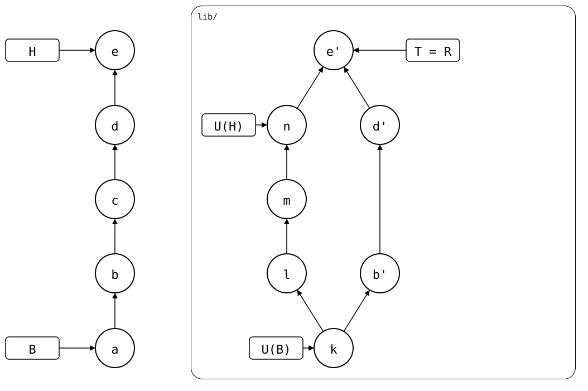
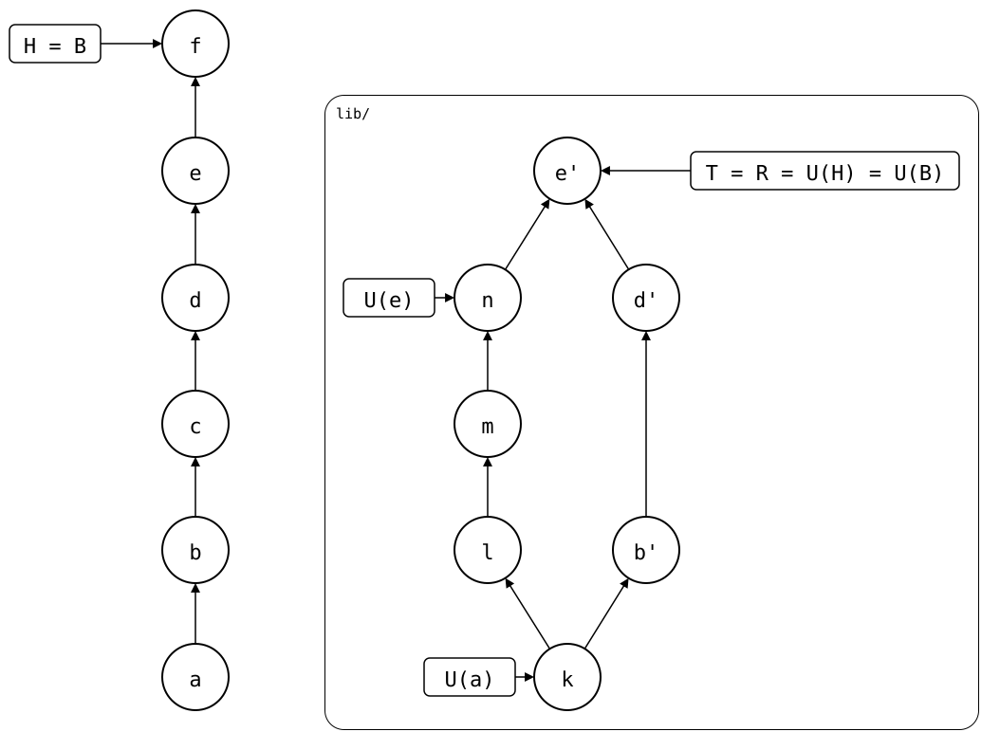

# Scenario: pushed

The [parent scenario](../README.md) after `git splice push`, before and
after a `git splice pull --bump`. The commits are named as in the
drawings below.

## Output

<!--
```scrut {fail_fast: true, output_stream: combined}
$ source "$TESTDIR/../../../../readme-setup.sh"
```
-->

[`setup.bash`](setup.bash) builds this state:

```scrut
$ build_scenario scenario_pushed
```

<div align="center">



</div>

After the push, `.splice` still records *n*, so B stays at *a* and every
rebuild copies *b*, *d* and *e* again.

<!--
```scrut
$ check_drawing "$TESTDIR/pushed.drawio.svg"
ok   pushed.drawio.svg: 12 commits, 16 arrows, 5 boxes, 1 lanes
```
-->

B is still *a*:

```scrut
$ git log -1 --format=%s "$(git splice boundary lib)"
a
```

The bump:

```scrut
$ git splice pull --bump -m f lib
ok   lib fetched
ok   lib: bumped the synced commit to 8430dba
```

<div align="center">



</div>

The bump, *f*, records *e'* in `.splice` and changes nothing else. Its
folder is *e'*, the commit it records, so it's the new B, and the
rebuild has nothing to add.

<!--
```scrut
$ check_drawing "$TESTDIR/pushed-and-bumped.drawio.svg"
ok   pushed-and-bumped.drawio.svg: 13 commits, 16 arrows, 4 boxes, 1 lanes
```
-->

The monorepo:

```scrut
$ git log --format=%s
f
e
d
c
b
a
initial commit
```

The upstream has the pushed commits, with the messages of *b*, *d* and *e*:

```scrut
$ git -C "$UPSTREAM" log --graph --format=%s main
*   e
|\  
| * n
| * m
| * l
* | d
* | b
|/  
* k
```

*f* is B:

```scrut
$ git log -1 --format=%s "$(git splice boundary lib)"
f
```

And the splice is up to date:

```scrut
$ git splice status
On branch main

  up to date  lib
```
