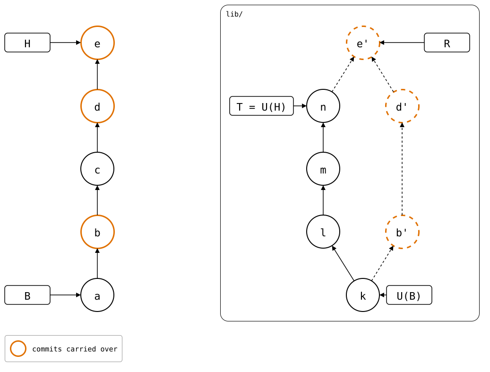
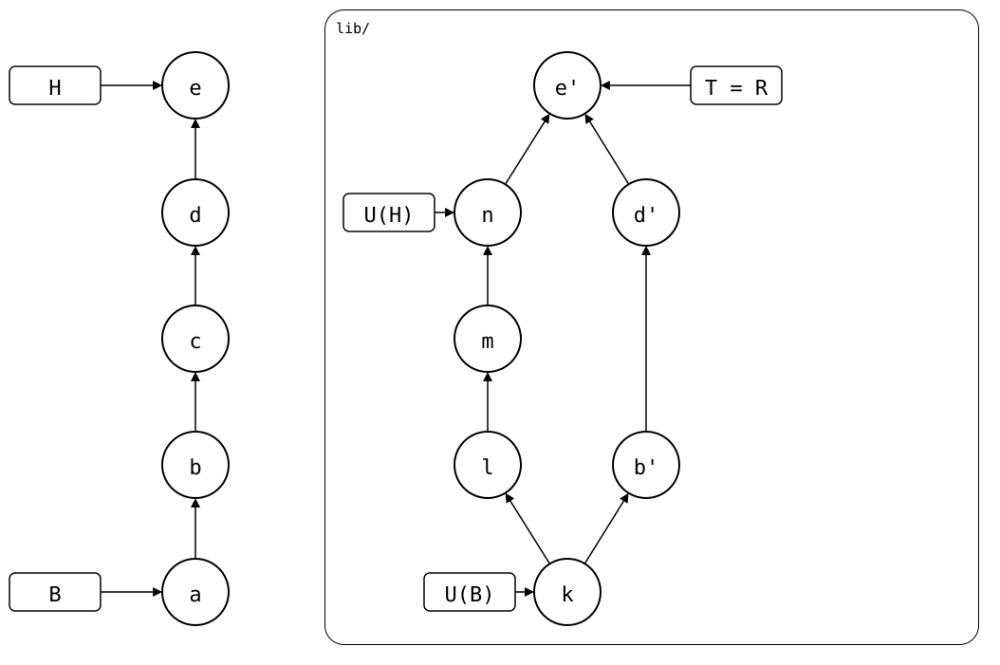

# Check a drawing during push

`--exec` lets a scenario inspect an intermediate state before the command
continues. Here the hook checks a drawing after rebuilding, before publication,
and another after publication. Both checks run inside one push invocation.

## Output

<!--
```scrut {fail_fast: true, output_stream: combined}
$ source "$TESTDIR/../../../readme-setup.sh"
```
-->

[`setup.bash`](setup.bash) builds the same state as the [parent page](README.md):

```scrut
$ build_scenario scenario_after_pull
```

The prepared commit exists locally, but the upstream still has its old tip.
The first hook checks this drawing:



After that check succeeds, push publishes the commit. The second hook checks
the resulting graph:



The [hook script](check-push.sh) selects each drawing using `GIT_SPLICE_EVENT`.
It also checks the splice path and verifies that `GIT_SPLICE_COMMIT` names a
real commit. The command runs it from the monorepo root:

```scrut
$ export EXEC_DRAWINGS="$TESTDIR" CHECK_DRAWING_TOOL
```

```scrut
$ git splice push --exec 'sh "$EXEC_DRAWINGS/check-push.sh"' lib
Prepared, before publication:
ok   after-pull.drawio.svg: 12 commits, 16 arrows, 5 boxes, 1 lanes
ok   lib: pushed 8430dba to main
Published:
ok   pushed.drawio.svg: 12 commits, 16 arrows, 5 boxes, 1 lanes
```

Each drawing is checked against the real repositories at that moment. A failed
check returns nonzero and stops push before its next step. Once a publication
has succeeded, a later hook failure leaves it applied.

Execution stays in memory while the hook runs, then continues automatically.
No serialized continuation or second command is involved.
