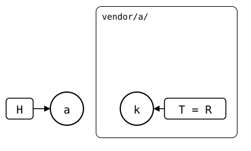
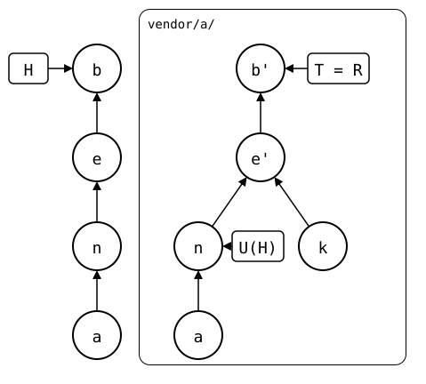

# A monorepo commit as the synced commit

> **Known bug, [#7](https://github.com/roschaefer/git-splice/issues/7).** This page shows what `git-splice` does today, bug included. See [known bugs and limitations](../../99-known-bugs.md#known-bugs).

`.splice` records the synced commit, the upstream commit the next push
builds on. When an edit of `.splice` names a monorepo commit there
instead, the push builds on that commit and publishes the monorepo's
history with it, files outside the splice included. No check stops it
today.

## Output

<!--
```scrut {fail_fast: true, output_stream: combined}
$ source "$TESTDIR/../../readme-setup.sh" && export GIT_CONFIG_COUNT=1 GIT_CONFIG_KEY_0="url.$UPSTREAM.insteadOf" GIT_CONFIG_VALUE_0=https://git.example.com/a.git
```
-->

[`setup.bash`](setup.bash) builds this state:

```scrut
$ build_scenario scenario_up_to_date https://git.example.com/a.git
```

<div align="center">



</div>

<!--
```scrut
$ k="$(git config --file vendor/a/.splice splice.commit)" &&
>   check_drawing "$TESTDIR/up-to-date.drawio.svg" k="$k" a=HEAD
ok   up-to-date.drawio.svg: 2 commits, 2 arrows, 2 boxes, 1 lanes
```
-->

A monorepo commit adds a file outside the splice:

```scrut
$ echo "monorepo only" >notes.txt &&
>   git add notes.txt &&
>   git commit -q -m "n: add notes.txt"
```

Then `.splice` names *n* as the synced commit:

```scrut
$ n="$(git rev-parse HEAD)" &&
>   git config --file vendor/a/.splice splice.commit "$n" &&
>   git commit -q -a -m "e: name n in vendor/a/.splice"
```

```scrut
$ cat vendor/a/.splice
[splice]
	commit = 530224f0c1b086d8cfb7f123eb2790f418286460
	id = 224f2c2563d3b6f7
[upstream "origin"]
	url = https://git.example.com/a.git
```

A change in the splice gives the next push something to send:

```scrut
$ echo "b" >>vendor/a/file.txt &&
>   git commit -q -a -m "b: change vendor/a"
```

```scrut
$ git splice push vendor/a
ok   vendor/a: pushed 4ee8c36 to main
```

The upstream now has the monorepo's commits, *n* among them:

```scrut
$ git -C "$UPSTREAM" log --graph --format=%s main
* b: change vendor/a
*   e: name n in vendor/a/.splice
|\  
| * n: add notes.txt
| * add vendor/a
| * initial commit
* seed
```

<div align="center">



</div>

<!--
```scrut
$ k="$(git config --blob HEAD~3:vendor/a/.splice splice.commit)" &&
>   check_drawing "$TESTDIR/monorepo-history-pushed.drawio.svg" a=HEAD~3 k="$k"
ok   monorepo-history-pushed.drawio.svg: 9 commits, 10 arrows, 3 boxes, 1 lanes
```
-->

With *n* come its files, the ones outside the splice too:

```scrut
$ git -C "$UPSTREAM" ls-tree -r --name-only main~1^2
notes.txt
vendor/a/.splice
vendor/a/file.txt
```
