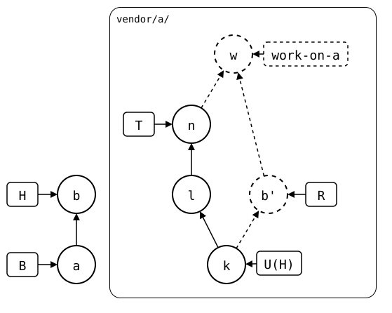
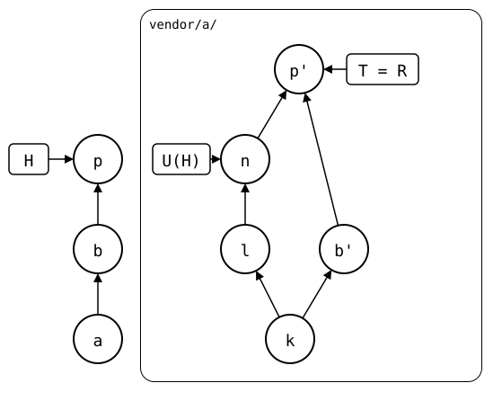

# Scenario: up-to-date, the upstream pulled in a worktree of the rebuild

[Worked on in a worktree](worked-on-in-a-worktree.md) checks out the
rebuild of `vendor/a/` in a worktree, and `git splice merge
--rebuilt-commit` brings a commit made there back. That merge keeps the
synced commit where it was: whatever the worktree adds counts as the
monorepo's own work, to push.

The worktree looks and works like a clone of the upstream, and in a
clone, `git pull` when the upstream moved is a reflex: to stay current
while working there, to test against the upstream's latest, or while
resolving a conflict in it. Here, the worktree pulls `vendor/a/`'s own
upstream that way, while the monorepo has a change of its own. That pull
isn't the monorepo's own work: brought back that way, the upstream's
changes would count as local ones, and the next push would publish them
a second time. So the merge refuses it, and `git splice pull vendor/a`
in the monorepo takes the upstream's commits in, as the synced commit.

## Output

<!--
```scrut {fail_fast: true, output_stream: combined}
$ source "$TESTDIR/../../readme-setup.sh" && export GIT_CONFIG_COUNT=2 GIT_CONFIG_KEY_0=user.name GIT_CONFIG_VALUE_0=Test GIT_CONFIG_KEY_1=user.email GIT_CONFIG_VALUE_1=test@example.com
```
-->

[`setup.bash`](setup.bash) builds this state:

```scrut
$ build_scenario scenario_up_to_date
```

The upstream gets two commits, *l* and *n*, and the monorepo fetches
them:

```scrut
$ git clone -q "$UPSTREAM" ../a-clone &&
>   echo "first" >>../a-clone/file.txt &&
>   git -C ../a-clone commit -q -am "l: upstream first" &&
>   echo "second" >>../a-clone/file.txt &&
>   git -C ../a-clone commit -q -am "n: upstream second" &&
>   git -C ../a-clone push -q origin main
```

```scrut
$ git splice fetch vendor/a
ok   vendor/a fetched (main moved bde4164..d2c4626)
```

The monorepo changes `vendor/a/`:

```scrut
$ echo "local" >vendor/a/local.txt &&
>   git add vendor/a/local.txt &&
>   git commit -q -m "b: local change"
```

## Pulled in the worktree

```scrut
$ git worktree add -q -b work-on-a ../a-work "$(git splice rebuild vendor/a)"
```

```scrut
$ git -C ../a-work pull -q --no-rebase --no-edit "$UPSTREAM" main
```

The pull merges *n* and the rebuild's copy of *b*, *b'*, in a merge
commit of its own, *w*. Both are on the worktree's branch, `work-on-a`,
a branch of the monorepo that no upstream has, so they're dashed, and so
is its box:

<div align="center">



</div>

<!--
```scrut
$ check_drawing "$TESTDIR/upstream-pulled-in-the-worktree.drawio.svg" \
>   a=HEAD~1 k="$(git config --file vendor/a/.splice splice.commit)" w=work-on-a
ok   upstream-pulled-in-the-worktree.drawio.svg: 7 commits, 12 arrows, 6 boxes, 1 lanes
```
-->

```scrut
$ git -C ../a-work log --graph --format=%s
*   Merge branch 'main' of $UPSTREAM into work-on-a
|\  
| * n: upstream second
| * l: upstream first
* | b: local change
|/  
* seed
```

## Refused

```scrut
$ git splice merge --rebuilt-commit work-on-a vendor/a
!!   vendor/a: [0-9a-f]{7} has d2c4626, a commit of its upstream that the rebuild lacks, which would come in as a local change -- 'git splice pull vendor/a' takes the upstream's commits in instead (regex)
[1]
```

The monorepo is as it was:

```scrut
$ git log --format=%s -1
b: local change
```

## Pulled in the monorepo instead

The worktree isn't needed:

```scrut
$ git worktree remove ../a-work &&
>   git branch -q -D work-on-a
```

```scrut
$ git splice pull vendor/a -m "p: pull vendor/a"
ok   vendor/a fetched
ok   vendor/a: pulled d2c4626
```

```scrut
$ git splice push vendor/a
ok   vendor/a: pushed a43c292 to main
```

The upstream has *l* and *n* once, and *b'* and the pull's *p'* on top:

<div align="center">



</div>

<!--
```scrut
$ check_drawing "$TESTDIR/upstream-pulled-instead.drawio.svg" \
>   a=HEAD~2 k="$(git -C "$UPSTREAM" rev-list --max-parents=0 main)"
ok   upstream-pulled-instead.drawio.svg: 8 commits, 10 arrows, 3 boxes, 1 lanes
```
-->

```scrut
$ git -C "$UPSTREAM" log --graph --format=%s main
*   p: pull vendor/a
|\  
| * n: upstream second
| * l: upstream first
* | b: local change
|/  
* seed
```
