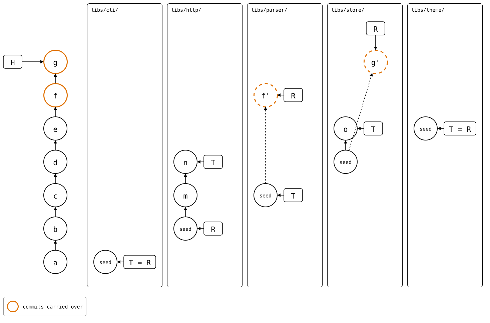
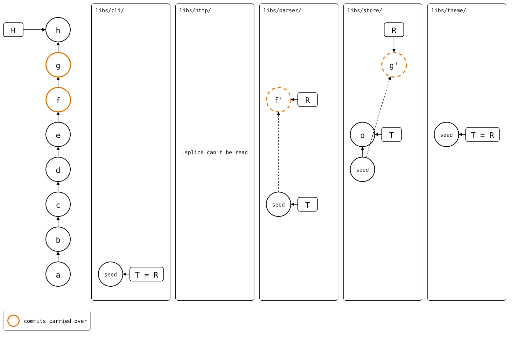

# One `.splice` can't be read

`git-splice` reads each splice's `.splice` with `git config`. A typo, a
committed conflict marker or a `.splice` that `git-crypt` encrypted
([#56](https://github.com/roschaefer/git-splice/issues/56)) leave one it
can't read. A command that names that splice stops. The other splices
work as before, and a command over every splice reports the one it left
out and fails.

## Output

<!--
```scrut {fail_fast: true, output_stream: combined}
$ source "$TESTDIR/../../readme-setup.sh"
```
-->

[`setup.bash`](setup.bash) builds this state:

```scrut
$ build_scenario scenario_many_splices
```

<div align="center">



</div>

<!--
```scrut
$ check_drawing "$TESTDIR/many-splices.drawio.svg" \
>   a=HEAD~6 b=HEAD~5 c=HEAD~4 d=HEAD~3 e=HEAD~2 f=HEAD~1 g=HEAD \
>   m=refs/splices/upstream-http/heads/main~1 n=refs/splices/upstream-http/heads/main \
>   o=refs/splices/upstream-store/heads/main
ok   many-splices.drawio.svg: 17 commits, 20 arrows, 9 boxes, 5 lanes
```
-->

A hand edit of `libs/http/.splice` gives a key a space, which `git config`
doesn't allow:

```scrut
$ echo "  default branch = main" >>libs/http/.splice &&
>   git commit -q -am "h: set the default branch by hand"
```

<div align="center">



</div>

<!--
```scrut
$ check_drawing "$TESTDIR/unreadable-splice.drawio.svg" \
>   a=HEAD~7 b=HEAD~6 c=HEAD~5 d=HEAD~4 e=HEAD~3 f=HEAD~2 g=HEAD~1 \
>   o=refs/splices/upstream-store/heads/main
ok   unreadable-splice.drawio.svg: 15 commits, 17 arrows, 7 boxes, 5 lanes
```
-->

`status` shows it first, with why:

```scrut
$ git splice status
On branch main

  !! can't use .splice  libs/http  libs/http/.splice can't be read (bad config line 6 in blob HEAD:libs/http/.splice); fix it and commit it
  ahead 1, behind 1     libs/store
  ahead 1               libs/parser

  up to date            libs/cli
  up to date            libs/theme -> master
[1]
```

A command over every splice does the others:

```scrut
$ git splice fetch
!!   libs/http/.splice can't be read (bad config line 6 in blob HEAD:libs/http/.splice) -- fix it and commit it
ok   libs/cli fetched
ok   libs/parser fetched
ok   libs/store fetched
ok   libs/theme fetched
[1]
```

A command that names another splice works as before:

```scrut
$ git splice diff libs/parser
===  libs/parser
diff --git a/file.txt b/file.txt
index e31de1f..d939bfa 100644
--- a/file.txt
+++ b/file.txt
@@ -1 +1,2 @@
 seed
+local change
```

A command that names it stops:

```scrut
$ git splice push libs/http
!!   libs/http/.splice can't be read (bad config line 6 in blob HEAD:libs/http/.splice) -- fix it and commit it
[1]
```
