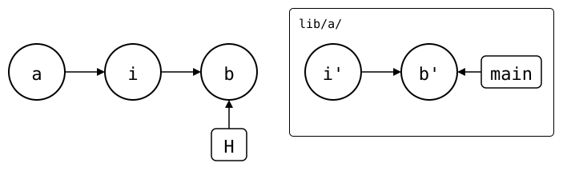
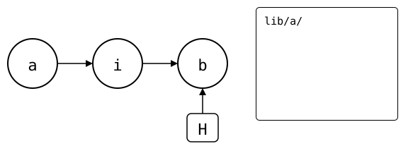

# Scenario: init-then-cloned

A splice made by `init` was published, and a colleague clones the
monorepo. Until the clone fetches, commands say the upstream was never
fetched, as for a splice made by `clone`.

- **Monorepo (`lib/a/`)**: a fresh clone of a monorepo in which `lib/a/` was
  made a splice with `init` and pushed twice.
- **Upstream** (`$UPSTREAM`, reached as `https://git.example.com/a.git`):
  the two pushed commits, `splice: init lib/a` and
  `second version`.

A splice made by `init` records no synced commit, and `push` doesn't write
one. `init` records the upstream's key instead, as a fetch does, so the
monorepo it ran in knows the upstream is empty. A fresh clone has neither
the key nor fetched refs, so it [hasn't
fetched](../../01-everyday-sync/04-never-fetched/README.md) the upstream
yet. [A push before the fetch](push-before-fetch.md) refuses too.

## Output

<!--
```scrut {fail_fast: true, output_stream: combined}
$ source "$TESTDIR/../../readme-setup.sh" && export GIT_CONFIG_COUNT=1 GIT_CONFIG_KEY_0="url.$UPSTREAM.insteadOf" GIT_CONFIG_VALUE_0=https://git.example.com/a.git
```
-->

[`setup.bash`](setup.bash) builds this state:

```scrut
$ build_scenario scenario_init_then_cloned https://git.example.com/a.git
```

In the monorepo where `init` ran, *i* made `lib/a/` a splice, and the
pushes published it and *b* as *i'* and *b'*, which that monorepo has
fetched as `main`:

<div align="center">



</div>

<!--
```scrut
$ (cd ../monorepo-original &&
>   check_drawing "$TESTDIR/init-then-published.drawio.svg" a=HEAD~2 i=HEAD~1 b=HEAD)
ok   init-then-published.drawio.svg: 5 commits, 5 arrows, 2 boxes, 1 lanes
```
-->

The fresh clone has the same monorepo commits, and nothing fetched from
the upstream of `lib/a/`:

<div align="center">



</div>

<!--
```scrut
$ check_drawing "$TESTDIR/init-then-cloned.drawio.svg" a=HEAD~2 i=HEAD~1 b=HEAD
ok   init-then-cloned.drawio.svg: 3 commits, 3 arrows, 1 boxes, 1 lanes
```
-->

`.splice` has no synced commit:

```scrut
$ cat lib/a/.splice
[splice]
	id = a11f5cf4ef8965e5
[upstream "origin"]
	url = https://git.example.com/a.git
```

`status` says the upstream wasn't fetched here:

```scrut
$ git splice status
On branch main

  ?? never fetched  lib/a  run 'git splice fetch lib/a'
```

```scrut
$ git -C "$UPSTREAM" log --format=%s main
second version
splice: init lib/a
```

`log` and `diff` say so too:

```scrut
$ git splice log
??   lib/a: not fetched -- run 'git splice fetch lib/a' first
!!   Failed: lib/a
[1]
```

```scrut
$ git splice diff
??   lib/a: not fetched -- run 'git splice fetch lib/a' first
!!   Failed: lib/a
[1]
```

`merge` never fetches, so it says the same, even after a
[failed first fetch](first-fetch-failed.md):

```scrut
$ git splice merge lib/a
??   lib/a: not fetched yet -- run 'git splice fetch lib/a' first
!!   Failed: lib/a
[1]
```

After a fetch, the clone sees the upstream as it is:

```scrut
$ git splice fetch
ok   lib/a fetched
```

It has what the monorepo where `init` ran has:

<div align="center">


</div>

<!--
```scrut
$ check_drawing "$TESTDIR/init-then-published.drawio.svg" a=HEAD~2 i=HEAD~1 b=HEAD
ok   init-then-published.drawio.svg: 5 commits, 5 arrows, 2 boxes, 1 lanes
```
-->

```scrut
$ git splice status
On branch main

  up to date  lib/a
```
