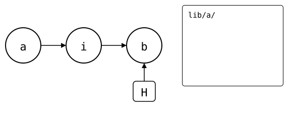

# Push before the fetch

In the [same state](README.md), a fresh clone after `init`, a push before
the first fetch refuses: it can't tell what the upstream has.

## Output

<!--
```scrut {fail_fast: true, output_stream: combined}
$ source "$TESTDIR/../../readme-setup.sh"
```
-->

[`setup.bash`](setup.bash) builds this state:

```scrut
$ build_scenario scenario_init_then_cloned
```

```scrut
$ git splice push lib/a
??   lib/a: not fetched -- run 'git splice fetch lib/a' first
!!   Failed: lib/a
[1]
```

```scrut
$ git -C "$UPSTREAM" log --format=%s main
second version
splice: init lib/a
```

The clone still has fetched nothing, as before the push: *a*, *i* and
*b* are the monorepo's own commits, and `lib/a/` is empty:

<div align="center">



</div>

<!--
```scrut
$ check_drawing "$TESTDIR/init-then-cloned.drawio.svg" a=HEAD~2 i=HEAD~1 b=HEAD
ok   init-then-cloned.drawio.svg: 3 commits, 3 arrows, 1 boxes, 1 lanes
```
-->
