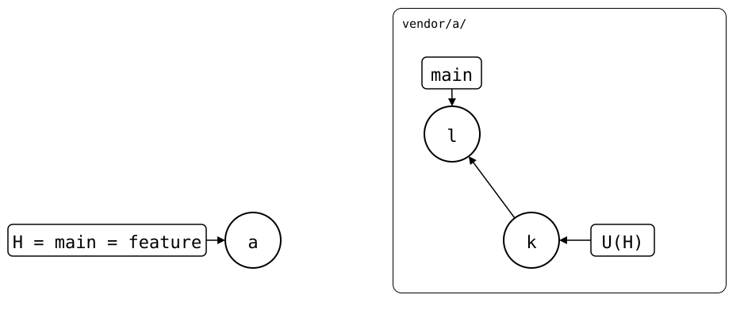
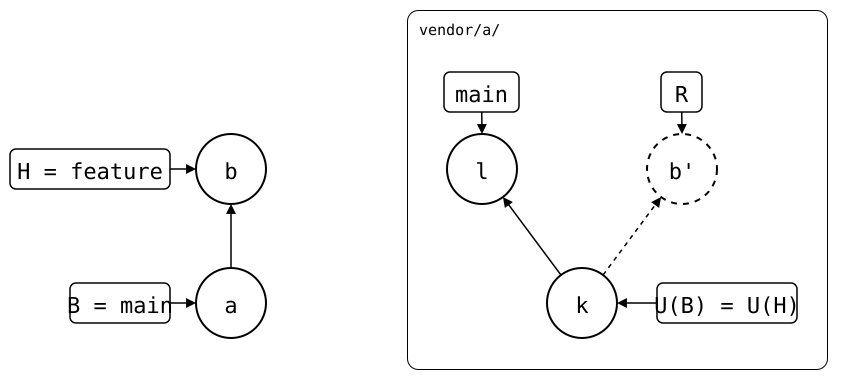

# Scenario: default-branch-moved

The monorepo is on a branch upstream doesn't have, and upstream's
default branch moved on since the splice's synced commit.

- **Monorepo (`vendor/a/`)**: cloned at *k* on `main`, then the branch
  `feature`.
- **Upstream**: only `main`, with *l* on top of *k*, fetched.

Without a `feature` branch upstream, `git-splice` compares with
upstream's default branch, `main`, as a PR would. `pull` and `merge`
take only the branch named like the monorepo's, `feature`, so they
don't bring *l* in.

## Output

<!--
```scrut {fail_fast: true, output_stream: combined}
$ source "$TESTDIR/../../../readme-setup.sh"
```
-->

[`setup.bash`](setup.bash) builds this state:

```scrut
$ build_scenario scenario_default_branch_moved
```

<div align="center">



</div>

<!--
```scrut
$ check_drawing "$TESTDIR/default-branch-moved.drawio.svg" \
>   a=HEAD k=refs/splices/upstream/heads/main~1 l=refs/splices/upstream/heads/main
ok   default-branch-moved.drawio.svg: 3 commits, 4 arrows, 3 boxes, 1 lanes
```
-->

```scrut
$ git splice status
On branch feature

  unchanged, behind 1 on main  vendor/a
```

```scrut
$ git splice pull vendor/a
ok   vendor/a fetched
ok   vendor/a: upstream has no 'feature' branch -- nothing to pull ('main' has 1 commit this splice lacks)
```

### A change on the feature branch

```scrut
$ echo "b" >>vendor/a/file.txt &&
>   git commit -q -am "b: local change"
```

<div align="center">



</div>

<!--
```scrut
$ check_drawing "$TESTDIR/changed-on-feature.drawio.svg" \
>   a=HEAD~1 k=refs/splices/upstream/heads/main~1 l=refs/splices/upstream/heads/main
ok   changed-on-feature.drawio.svg: 5 commits, 8 arrows, 5 boxes, 1 lanes
```
-->

```scrut
$ git splice status
On branch feature

  new, ahead 1, behind 1 on main  vendor/a  push creates the branch
```

```scrut
$ git splice pull vendor/a
ok   vendor/a fetched
ok   vendor/a: upstream has no 'feature' branch -- nothing to pull ('main' has 1 commit this splice lacks)
```
