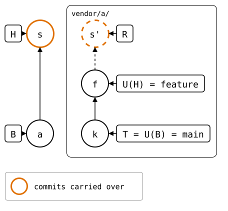
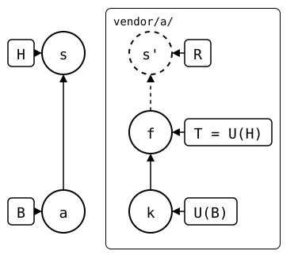

# Scenario: local-edit-in-the-squash

The [parent scenario's](../README.md) squash merge, but the feature
branch also edited the folder. So one commit, *s*, does two things: it
records the pulled upstream commit *f* in `.splice`, and it holds a local
edit that the upstream doesn't have, `local.txt`.

## Output

<!--
```scrut {fail_fast: true, output_stream: combined}
$ source "$TESTDIR/../../../readme-setup.sh"
```
-->

[`setup.bash`](setup.bash) builds this state:

```scrut
$ build_scenario scenario_local_edit_in_the_squash
```

<div align="center">



</div>

<!--
```scrut
$ check_drawing "$TESTDIR/local-edit-in-the-squash.drawio.svg" \
>   a=HEAD~1 s=HEAD k=refs/splices/upstream/heads/main \
>   f=refs/splices/upstream/heads/feature
ok   local-edit-in-the-squash.drawio.svg: 5 commits, 8 arrows, 5 boxes, 1 lanes
```

```scrut
$ k="$(git rev-parse refs/splices/upstream/heads/main)" &&
> f="$(git rev-parse refs/splices/upstream/heads/feature)" &&
> git update-ref refs/splices/upstream/heads/main "$f" &&
> check_drawing "$TESTDIR/../../../../03-concepts/synced-commit-contains-rebuilt-tip.drawio.svg" \
>   a=HEAD~1 s=HEAD k="$k" f=refs/splices/upstream/heads/main &&
> git update-ref refs/splices/upstream/heads/main "$k"
ok   synced-commit-contains-rebuilt-tip.drawio.svg: 5 commits, 8 arrows, 5 boxes, 1 lanes
```
-->

The [sync model's table](../../../../03-concepts/02-sync-model.md) draws
the same commits for this case, with the upstream's `main` at *f*:

<div align="center">



</div>

*s* is the last commit, and the only one since the clone *a*:

```scrut
$ git log --format=%s
feature (squash-merged)
add vendor/a
initial commit
```

### What the squash merge records, and what it holds

*s*'s `.splice` records *f*, U(H):

```scrut
$ git -C "$UPSTREAM" log -1 --format=%s "$(git config --file vendor/a/.splice splice.commit)"
upstream feature work
```

But its folder isn't *f*: it has the local edit too.

```scrut
$ synced="$(git config --file vendor/a/.splice splice.commit)" &&
>   git diff --name-only "$synced" HEAD:vendor/a -- ':!.splice'
local.txt
```

### Where the rebuild starts

So *s* can't be B, the newest commit that changed
`.splice` and whose folder is the commit it recorded
([sync model](../../../../03-concepts/02-sync-model.md)). The rebuild
copies *s*, and starts where it would have before *s*, at the clone, *a*:

```scrut
$ git log -1 --format=%s "$(git splice boundary vendor/a)"
add vendor/a
```

The rebuild copies the commits after B:

```scrut
$ git log --format=%s "$(git splice boundary vendor/a)..HEAD" -- vendor/a
feature (squash-merged)
```

R is that copy, *s'*, on top of *f*:

```scrut
$ git log --format=%s "$(git splice rebuild vendor/a)"
feature (squash-merged)
upstream feature work
seed
```

Before, B was *s* itself, because its `.splice` changed.
Then `git log B..HEAD` was empty, while a push still sent the local edit.

### Push

The upstream's `main` gets both: *f*, and *s'* with the local edit, under
*s*'s message.

```scrut
$ git splice push vendor/a
ok   vendor/a: pushed 0461d52 to main
```

```scrut
$ git -C "$UPSTREAM" log --format=%s main
feature (squash-merged)
upstream feature work
seed
```
