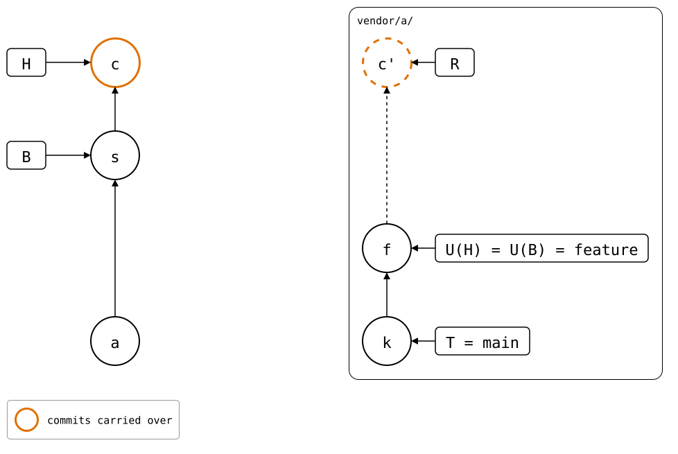
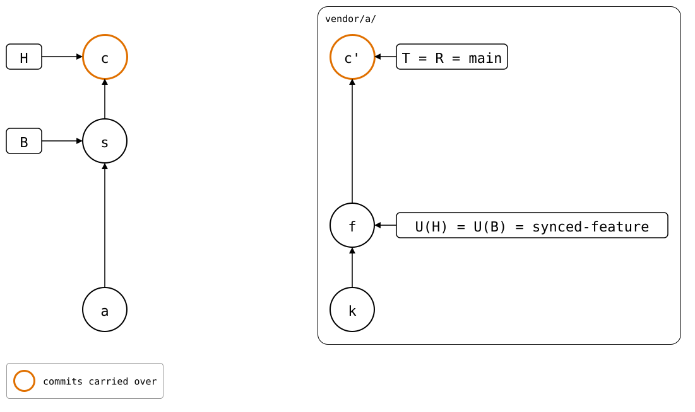

# squash-merged-pull: feature branch deleted upstream

> **Limitation.** This page shows behaviour `git-splice` keeps on purpose, and the way out. See [known bugs and limitations](../../99-known-bugs.md#limitations).

As in [the README](README.md), *s* records the upstream's *f* in
`.splice`, and only the upstream's `feature` branch has *f*. Here the
upstream deletes `feature` before the next push. `fetch` prunes the
splice's ref of it, and then no ref reaches *f*: `.splice` names it by
hash, in a file, which `git gc` doesn't read. `git gc` deletes *f*, and
every command that needs the synced commit stops. A fetch brings *f*
back while the upstream still has it. `git-splice` keeps no ref of its
own for it; a ref you keep, such as a tag, keeps it.

## Output

<!--
```scrut {fail_fast: true, output_stream: combined}
$ source "$TESTDIR/../../readme-setup.sh"
```
-->

[`setup.bash`](setup.bash) builds this state:

```scrut
$ build_scenario scenario_squash_merged_pull &&
>   MONOREPO="$PWD" &&
>   f="$(git rev-parse --short refs/splices/upstream/heads/feature)"
```

<div align="center">



</div>

<!--
```scrut
$ check_drawing "$TESTDIR/squash-merged-pull.drawio.svg" \
>   a=HEAD~2 k=refs/splices/upstream/heads/main
ok   squash-merged-pull.drawio.svg: 6 commits, 9 arrows, 5 boxes, 1 lanes
```
-->

### `fetch` prunes the ref of `feature`

The upstream deletes `feature`, e.g. because it merged it:

```scrut
$ git -C "$UPSTREAM" branch -q -D feature
```

```scrut
$ git splice fetch
ok   vendor/a fetched
```

```scrut
$ git for-each-ref --format='%(objectname:short) %(refname)' refs/splices
bde4164 refs/splices/upstream/heads/main
```

### `git gc` deletes *f*

No ref reaches *f* any more. `git gc` deletes such commits once
`gc.pruneExpire` (two weeks) has passed, and the reflogs that still
name it once `gc.reflogExpireUnreachable` (30 days) has. Both are set
to now here:

```scrut
$ git reflog expire --expire-unreachable=now --all &&
>   git gc -q --prune=now &&
>   git cat-file -t "$f"
fatal: Not a valid object name 1ee7bf7
[128]
```

Every command that needs the synced commit stops:

```scrut
$ git splice status
On branch main

  ?? synced commit 1ee7bf7 isn't here  vendor/a  run 'git splice fetch vendor/a', or check that upstream has it
```

```scrut
$ git splice push vendor/a
??   vendor/a: synced commit 1ee7bf7 isn't here -- run 'git splice fetch vendor/a', or check that upstream has it
!!   Failed: vendor/a
[1]
```

### A fetch brings it back

The upstream deleted only the branch, and still has *f*. `fetch` asks
for the synced commit by its hash:

```scrut
$ git splice fetch vendor/a
ok   vendor/a fetched
```

```scrut
$ git splice status
On branch main

  ahead 2  vendor/a
```

It writes no ref for it, so nothing keeps *f* from the next `git gc`:

```scrut
$ git for-each-ref --contains "$f"
```

### What's left when the upstream lost it too

The upstream's own `git gc` deletes *f* there. The monorepo still has
it, unreferenced, but a clone of the monorepo doesn't: a clone gets
only what branches and tags reach.

```scrut
$ git -C "$UPSTREAM" gc -q --prune=now
```

```scrut
$ git clone -q --no-local . ../colleague && cd ../colleague
```

A fetch can't bring *f* back from anywhere now:

```scrut
$ git splice fetch vendor/a
ok   vendor/a fetched
```

```scrut
$ git splice status
On branch main

  ?? synced commit 1ee7bf7 isn't here  vendor/a  run 'git splice fetch vendor/a', or check that upstream has it
```

```scrut
$ git splice push vendor/a
??   vendor/a: synced commit 1ee7bf7 isn't here -- run 'git splice fetch vendor/a', or check that upstream has it
!!   Failed: vendor/a
[1]
```

### A tag keeps it

Back in the monorepo, a tag on *f* is a ref that reaches it, so
`git gc` keeps it:

```scrut
$ cd "$MONOREPO" && git tag synced-feature "$f"
```

```scrut
$ git reflog expire --expire-unreachable=now --all &&
>   git gc -q --prune=now &&
>   git cat-file -t "$f"
commit
```

```scrut
$ git splice push vendor/a
ok   vendor/a: pushed 2b23025 to main
```

```scrut
$ git -C "$UPSTREAM" log --format=%s main
c: local change
f: upstream feature work
seed
```

The upstream's `main` has *f* again, under *c'*, and so has the
splice's ref of it:

<div align="center">



</div>

<!--
```scrut
$ check_drawing "$TESTDIR/feature-branch-deleted.drawio.svg" \
>   a=HEAD~2 k=refs/splices/upstream/heads/main~2 \
>   synced-feature=refs/tags/synced-feature
ok   feature-branch-deleted.drawio.svg: 6 commits, 8 arrows, 4 boxes, 1 lanes
```
-->
