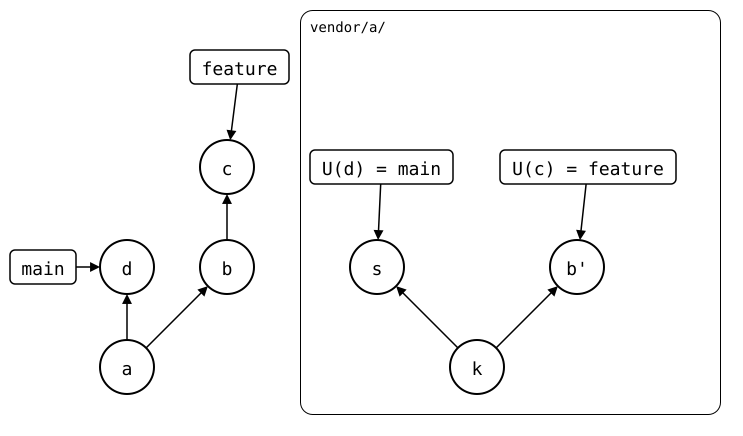
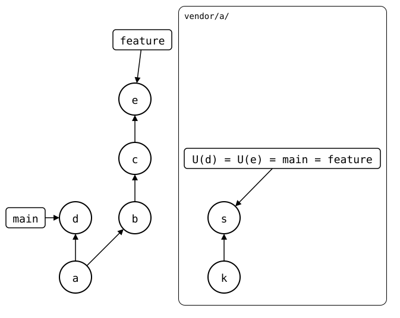

# Scenario: bumped-on-a-feature-branch

[Bumping the sync point](../../../04-advanced-workflows/05-bump.md#when-not-to-bump)
says not to bump on a feature branch. This shows why, when the library
squash-merges its pull requests: a bump on a feature branch that's merged
after the library's merge conflicts, and one merged before leaves `main`
naming a commit that disappears.

It starts after a push on `main` and a bump there, *a*. The push sent
*k* (`local change`).

## Output

<!--
```scrut {fail_fast: true, output_stream: combined}
$ source "$TESTDIR/../../readme-setup.sh"
```
-->

[`setup.bash`](setup.bash) builds this state:

```scrut
$ build_scenario scenario_bumped_on_a_feature_branch &&
>   MONOREPO="$PWD" && MAINTAINER="$(dirname "$PWD")/maintainer"
```

### Merged after the library: a conflict

A feature that changes the library and the monorepo's code that uses it:

```scrut
$ git switch -q -c feature
```

```scrut
$ echo "an option" >>vendor/a/file.txt &&
>   mkdir -p app &&
>   echo "uses the option" >app/main.txt &&
>   git add app &&
>   git commit -qam "b: an option in vendor/a, and the app uses it"
```

The push creates the upstream's `feature` branch, the library's pull
request. A bump then records it on the monorepo's `feature`:

```scrut
$ git splice push vendor/a
??   vendor/a: upstream has no 'feature' branch yet -- this push creates it
ok   vendor/a: pushed 72ab783 to feature
```

```scrut
$ git splice pull --bump -m "c: bump vendor/a to the pull request" vendor/a
ok   vendor/a fetched
ok   vendor/a: bumped the synced commit to 72ab783
```

The library squash-merges the pull request: its `main` gets the same
change as a new commit. Here in a clone of the upstream, as its
maintainer would:

```scrut
$ git clone -q "$UPSTREAM" "$MAINTAINER" &&
>   cd "$MAINTAINER" &&
>   git config user.name "Maintainer" &&
>   git config user.email "maintainer@example.com"
```

```scrut
$ git merge -q --squash origin/feature &&
>   git commit -q -m "s: an option (#1)" &&
>   git push -q origin main
Squash commit -- not updating HEAD
```

Back in the monorepo, `main` pulls it:

```scrut
$ cd "$MONOREPO" && git switch -q main
```

```scrut
$ git splice pull -m "d: pull the squashed option" vendor/a
ok   vendor/a fetched (main moved e859a6b..2380a33)
ok   vendor/a: pulled 2380a33
```

*b'* is *b* as pushed:

<div align="center">



</div>

<!--
```scrut
$ check_drawing "$TESTDIR/bump-conflict.drawio.svg" \
>   b=feature~1 c=feature k=refs/splices/upstream/heads/main~1
ok   bump-conflict.drawio.svg: 7 commits, 9 arrows, 4 boxes, 1 lanes
```
-->

`main` has the library's change now, but not the app's. So the monorepo's
`feature` still needs merging, and that conflicts: *d*'s `.splice`
records *s*, and *c*'s the same line as *b'*. A squash merge computes its
files like any merge, so it conflicts too:

```scrut
$ git merge --squash feature
Auto-merging vendor/a/.splice
CONFLICT (content): Merge conflict in vendor/a/.splice
Squash commit -- not updating HEAD
Automatic merge failed; fix conflicts and then commit the result.
[1]
```

```scrut
$ git reset -q --hard
```

Without the bump, `feature` wouldn't have changed `.splice`, and the merge
would take `main`'s.

### The way out: rebase the library's branch

Rebase the library's `feature` onto its `main`. The squashed commit
already has the change, so the rebase drops it, and `feature` becomes the
library's `main`:

```scrut
$ cd "$MAINTAINER" &&
>   git switch -q feature &&
>   git -c advice.skippedCherryPicks=false rebase -q main &&
>   git push -q -f origin feature
```

```scrut
$ git log -1 --format=%s feature
s: an option (#1)
```

The monorepo's `feature` pulls it. The folder already has its files, so
`pull` records it, without the need for `--bump`:

```scrut
$ cd "$MONOREPO" && git switch -q feature
```

```scrut
$ git splice pull -m "e: record the squashed option" vendor/a
ok   vendor/a fetched (feature moved 72ab783..2380a33)
ok   vendor/a: recorded 2380a33 as the synced commit -- the folder already has its files
```

*e* names *s*, as `main`'s *d* does:

<div align="center">



</div>

<!--
```scrut
$ check_drawing "$TESTDIR/bump-way-out.drawio.svg" \
>   d=main b=feature~2 c=feature~1 e=feature k=refs/splices/upstream/heads/main~1
ok   bump-way-out.drawio.svg: 7 commits, 8 arrows, 3 boxes, 1 lanes
```
-->

Now both branches name the same commit in `.splice`, and the merge only
brings in the app:

```scrut
$ git switch -q main && git merge --squash feature
Automatic merge went well; stopped before committing as requested
Squash commit -- not updating HEAD
```

```scrut
$ git status --short
A  app/main.txt
```

```scrut
$ git commit -q -m "app: use vendor/a's option" && git splice status
On branch main

  up to date  vendor/a
```

If the library deleted its `feature` branch after the merge, there's
nothing to pull. Merge `main` into the monorepo's `feature` instead, and
resolve `.splice` to `main`'s version.

### Merged before the library: a commit that disappears

Another feature, with a bump on its branch. This time, `main` merges it
before the library merges its pull request:

```scrut
$ git switch -q -c feature-2 &&
>   echo "a second option" >>vendor/a/file.txt &&
>   git commit -qam "vendor/a: a second option"
```

```scrut
$ git splice push vendor/a >/dev/null && git splice pull --bump vendor/a
ok   vendor/a fetched
ok   vendor/a: bumped the synced commit to 52ca126
```

```scrut
$ git switch -q main && git merge -q --no-ff -m "Merge branch 'feature-2'" feature-2
```

`main`'s `.splice` now names a commit of the library's `feature-2`:

```scrut
$ git log -1 --format=%s "$(git config --file vendor/a/.splice splice.commit)"
vendor/a: a second option
```

The library squash-merges the pull request and deletes its branch, as
many hosts do:

```scrut
$ cd "$MAINTAINER" &&
>   git fetch -q &&
>   git switch -q main &&
>   git merge -q --squash origin/feature-2 &&
>   git commit -q -m "a second option (#2)" &&
>   git push -q origin main :feature-2
Squash commit -- not updating HEAD
```

Then it goes on with a change of its own:

```scrut
$ echo "a third option" >>file.txt &&
>   git commit -qam "a third option" &&
>   git push -q origin main
```

Nothing refers to the pull request's commit any more, and the library's
`gc` removes it:

```scrut
$ git -C "$UPSTREAM" gc -q --prune=now &&
>   synced="$(git -C "$MONOREPO" config --file vendor/a/.splice splice.commit)" &&
>   git -C "$UPSTREAM" cat-file -t "$synced"
fatal: git cat-file: could not get object info
[128]
```

The monorepo that bumped still has the commit, but a fresh clone of it
can't fetch it:

```scrut
$ cd "$(dirname "$MONOREPO")" &&
>   git clone -q "file://$MONOREPO" colleague &&
>   cd colleague
```

```scrut
$ git splice fetch vendor/a
ok   vendor/a fetched
```

```scrut
$ git splice status vendor/a
On branch main

  ?? synced commit 52ca126 isn't here  vendor/a  run 'git splice fetch vendor/a', or check that upstream has it
```

Without the bump, `main`'s `.splice` would name a commit on the
library's `main`, which it keeps, and a pull would bring in
`a third option`.
