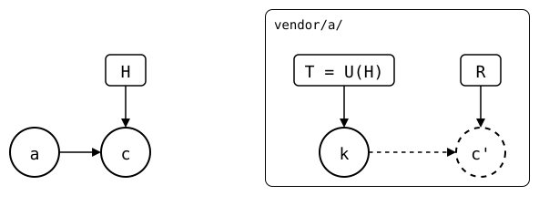
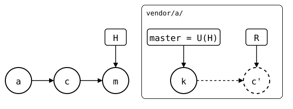

# Scenario: default-branch, misspelled

The state of the [README](README.md), with `default-branch` misspelled
in `.splice`. Git's config format lets a file have any key, so
`git-splice` reads the file without the misspelled key, and each command
names the key it doesn't know.

## Output

<!--
```scrut {fail_fast: true, output_stream: combined}
$ source "$TESTDIR/../../readme-setup.sh" && export GIT_CONFIG_COUNT=1 GIT_CONFIG_KEY_0="url.$UPSTREAM.insteadOf" GIT_CONFIG_VALUE_0=https://git.example.com/a.git
```
-->

[`setup.bash`](setup.bash) builds the state of the README:

```scrut
$ build_scenario scenario_default_branch https://git.example.com/a.git
```

Before the typo, the splice syncs with `master`, T:

<div align="center">



</div>

<!--
```scrut
$ k="$(git config --file vendor/a/.splice splice.commit)" &&
>   check_drawing "$TESTDIR/misspelled-key-before.drawio.svg" k="$k" a=HEAD~1 c=HEAD
ok   misspelled-key-before.drawio.svg: 4 commits, 5 arrows, 3 boxes, 1 lanes
```
-->

The commit *m* misspells the key:

```scrut
$ git config --file vendor/a/.splice --unset upstream.origin.default-branch &&
>   git config --file vendor/a/.splice upstream.origin.defualt-branch master &&
>   git commit -q -m "m: misspell default-branch" vendor/a/.splice
```

```scrut
$ cat vendor/a/.splice
[splice]
	id = 224f2c2563d3b6f7
	commit = bde416459fbcc09c9b585f3b65a94cab3f68bfcd
[upstream "origin"]
	url = https://git.example.com/a.git
	defualt-branch = master
```

Without `default-branch`, the splice follows the monorepo's `main`,
which the upstream doesn't have, so the splice has no T:

<div align="center">



</div>

<!--
```scrut
$ k="$(git config --file vendor/a/.splice splice.commit)" &&
>   check_drawing "$TESTDIR/misspelled-key-after.drawio.svg" k="$k" a=HEAD~2 c=HEAD~1
ok   misspelled-key-after.drawio.svg: 5 commits, 6 arrows, 3 boxes, 1 lanes
```
-->

```scrut
$ git splice status
??   vendor/a/.splice: unknown key upstream.origin.defualt-branch -- the keys are splice.id, splice.commit, splice.default-upstream, upstream.<name>.url, upstream.<name>.default-branch, upstream.<name>.default-pin
On branch main

  new, ahead 2  vendor/a  push creates the branch
```
