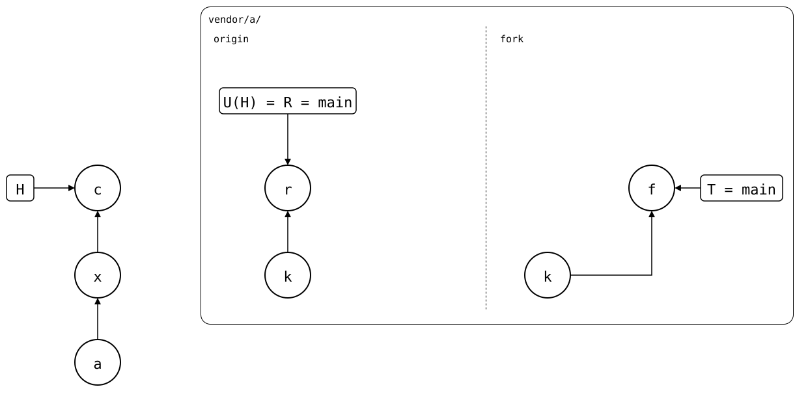

# Synced commit on the other upstream

A pull merges from the synced commit, so it needs that commit. In a
fresh clone it has only what the pull fetches. Here the monorepo last
pulled a release from the original, then made the company fork its
default upstream, and the fork doesn't have the release. A pull that
fetched only the fork found no synced commit, and said the two
histories were [unrelated](../../06-rewritten-history/03-diverged-unrelated-history/README.md),
though they share the seed. So a pull whose synced commit isn't here
fetches every upstream of the splice, and finds it on the original.

<div align="center">



</div>

*a* (`add vendor/a`) cloned *k* (`seed`) from the original, *x* pulled
the release *r* (`original release`), and *c* (`vendor/a: work with the
company fork`) made the fork the default upstream. The fork's `main`, T,
is *f* (`fork patch`) on top of *k*. The synced commit U(H) is *r*, the
original's `main`, on its side only.

## Output

<!--
```scrut {fail_fast: true, output_stream: combined}
$ source "$TESTDIR/../../readme-setup.sh" &&
>   export GIT_CONFIG_COUNT=2 \
>     GIT_CONFIG_KEY_0="url.$UPSTREAM.insteadOf" \
>     GIT_CONFIG_VALUE_0=https://git.example.com/lib.git \
>     GIT_CONFIG_KEY_1="url.$UPSTREAM-fork.git.insteadOf" \
>     GIT_CONFIG_VALUE_1=https://git.example.com/company/lib.git
```
-->

[`setup.bash`](setup.bash) builds this state:

```scrut
$ build_scenario scenario_several_upstreams https://git.example.com/lib.git
```

The original moves on, and the monorepo pulls the release *r*:

```scrut
$ seed_bare_repo "$UPSTREAM" "original release" main release.txt
```

```scrut
$ git splice pull vendor/a
ok   vendor/a fetched (main moved bde4164..3fd09f0)
ok   vendor/a: pulled 3fd09f0
```

Then it works with the fork:

```scrut
$ git config --file vendor/a/.splice upstream.fork.url \
>   https://git.example.com/company/lib.git
```

```scrut
$ git config --file vendor/a/.splice splice.default-upstream fork
```

```scrut
$ git commit -q -m "vendor/a: work with the company fork" -- vendor/a/.splice
```

<!--
```scrut
$ git splice fetch >/dev/null &&
>   check_drawing "$TESTDIR/synced-commit-on-the-other-upstream.drawio.svg" \
>     a=HEAD~2 x=HEAD~1 c=HEAD \
>     k=refs/splices/lib/heads/main~1 r=refs/splices/lib/heads/main \
>     f=refs/splices/company-lib/heads/main
ok   synced-commit-on-the-other-upstream.drawio.svg: 7 commits, 7 arrows, 3 boxes, 1 lanes, 2 upstreams
```
-->

### In a fresh clone

```scrut
$ git clone -q --no-local . ../fresh
```

```scrut
$ cd ../fresh &&
>   git config user.name Test &&
>   git config user.email test@example.com
```

The clone doesn't have the synced commit *r*:

```scrut
$ git cat-file -e "$(git config --file vendor/a/.splice splice.commit)"
[1]
```

The pull fetches the original too, finds *r* there, and joins the fork's
patch with it:

```scrut
$ git splice pull vendor/a
ok   vendor/a fetched from origin
ok   vendor/a fetched from fork
ok   vendor/a: pulled 9bf41c7
```
