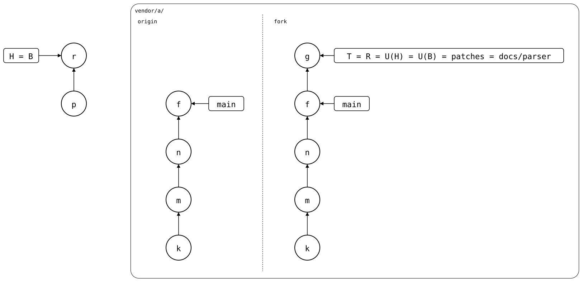

# Scenario: contributing-through-a-fork

The whole [contributing through a fork](../../../04-advanced-workflows/fork.md)
workflow, step by step: the monorepo pushes two changes to the fork's
`patches`, the fork gives each its own pull request branch, the original
moves on, and then takes one of the pull requests.

- **Original** (`$UPSTREAM`, reached as `https://git.example.com/lib.git`):
  *k* (`k: seed`) and *m* (`m: a second commit`).
- **Fork** (`$UPSTREAM-fork.git`, reached as
  `https://git.example.com/lib-fork.git`): a copy of the original.
- **Monorepo**: `vendor/a/`, cloned from the original, then switched to
  the fork's `patches`.

## Output

<!--
```scrut {fail_fast: true, output_stream: combined}
$ source "$TESTDIR/../../readme-setup.sh" && export GIT_CONFIG_COUNT=2 GIT_CONFIG_KEY_0="url.$UPSTREAM.insteadOf" GIT_CONFIG_VALUE_0=https://git.example.com/lib.git GIT_CONFIG_KEY_1="url.$UPSTREAM-fork.git.insteadOf" GIT_CONFIG_VALUE_1=https://git.example.com/lib-fork.git
```
-->

[`setup.bash`](setup.bash) builds this state:

```scrut
$ build_scenario scenario_contributing_through_a_fork \
>     https://git.example.com/lib.git https://git.example.com/lib-fork.git &&
>   MONOREPO="$PWD" FORK="$UPSTREAM-fork.git" &&
>   FORK_CLONE="$(dirname "$PWD")/fork-clone" ORIGINAL_CLONE="$(dirname "$PWD")/original-clone"
```

The splice has the fork as a second upstream, and uses it by default.
Its `default-branch` makes the monorepo's `main` follow `patches`
instead of the fork's `main`:

```scrut
$ cat vendor/a/.splice
[splice]
	commit = 149d2b9981bc9567c6dfcce070c9194d88586b07
	id = 131f9f6e525d4ba7
	default-upstream = fork
[upstream "origin"]
	url = https://git.example.com/lib.git
[upstream "fork"]
	url = https://git.example.com/lib-fork.git
	default-branch = patches
```

### The monorepo pushes two changes

```scrut
$ echo "a parser fix" >>vendor/a/file.txt &&
>   git commit -qam "fix the parser"
```

```scrut
$ echo "how the parser works" >vendor/a/parser.md &&
>   git add vendor/a/parser.md &&
>   git commit -q -m "document the parser"
```

The fork has no `patches` yet, so the first push creates it:

```scrut
$ git splice push vendor/a
??   vendor/a: upstream has no 'fork/patches' branch yet -- this push creates it
ok   vendor/a: pushed 62ed92f to fork/patches
```

### One branch per pull request

In a clone of the fork, each change gets a branch of its own, with only
that change on top of the fork's `main`:

```scrut
$ git clone -q "$FORK" "$FORK_CLONE" &&
>   cd "$FORK_CLONE" &&
>   git config user.name "Forker" &&
>   git config user.email "forker@example.com" &&
>   git remote add original "$UPSTREAM"
```

```scrut
$ git switch -q -c fix/parser origin/main &&
>   git cherry-pick origin/patches~1
[fix/parser c27d958] fix the parser
 Author: Test <test@example.com>
 Date: Thu Jan 1 00:00:00 2026 +0000
 1 file changed, 1 insertion(+)
```

```scrut
$ git switch -q -c docs/parser origin/main &&
>   git cherry-pick origin/patches
[docs/parser e0887c9] document the parser
 Author: Test <test@example.com>
 Date: Thu Jan 1 00:00:00 2026 +0000
 1 file changed, 1 insertion(+)
 create mode 100644 parser.md
```

```scrut
$ git push -q origin fix/parser docs/parser
```

### The original moves on

The original's maintainer commits something else:

```scrut
$ git clone -q "$UPSTREAM" "$ORIGINAL_CLONE" &&
>   cd "$ORIGINAL_CLONE" &&
>   git config user.name "Maintainer" &&
>   git config user.email "maintainer@example.com" &&
>   echo "a new feature" >feature.txt &&
>   git add feature.txt &&
>   git commit -q -m "n: add a feature" &&
>   git push -q origin main
```

The fork's `main` catches up. It never has commits of its own, so that's
a fast-forward. Then the branches are rebased onto it and force-pushed,
each with a lease on where it was:

```scrut
$ cd "$FORK_CLONE" &&
>   git fetch -q original &&
>   git push -q origin original/main:main &&
>   git fetch -q origin &&
>   git rebase -q origin/main fix/parser &&
>   git rebase -q origin/main docs/parser &&
>   git switch -q -c patches origin/patches &&
>   git rebase -q origin/main &&
>   git push -q --force-with-lease origin fix/parser docs/parser patches
```

```scrut
$ git log --format=%s origin/patches
document the parser
fix the parser
n: add a feature
m: a second commit
k: seed
```

The monorepo pulls the rebased `patches`. The commit it synced last is
still in its history, so this is an ordinary pull:

```scrut
$ cd "$MONOREPO" && git splice pull -m "p: pull the rebased patches" vendor/a
ok   vendor/a fetched from fork (patches moved 62ed92f..91d70da)
ok   vendor/a: pulled 91d70da
```

`pull` fetched the fork only. `fetch` fetches both upstreams:

```scrut
$ git splice fetch vendor/a
ok   vendor/a fetched from origin (main moved 149d2b9..8ba6f4c)
ok   vendor/a fetched from fork
```

The monorepo made the changes as *x* and *y*. The fork has *q* on
`fix/parser` and *e* on `docs/parser`, each on top of *n*, and
`patches` stacks both, with *d*, the same change as *e*, on top of *q*:

<div align="center">


</div>

<!--
```scrut
$ check_drawing "$TESTDIR/fork.drawio.svg" \
>     x=HEAD~2 y=HEAD~1 \
>     q=refs/splices/lib-fork/heads/fix/parser e=refs/splices/lib-fork/heads/docs/parser \
>     d=refs/splices/lib-fork/heads/patches
ok   fork.drawio.svg: 12 commits, 15 arrows, 6 boxes, 1 lanes, 2 upstreams
```
-->

### The original takes a pull request

The maintainer merges `fix/parser` as a new commit on `main`: same
change, new message, new parent, as a squash merge would.

```scrut
$ cd "$ORIGINAL_CLONE" &&
>   git fetch -q "$FORK" fix/parser &&
>   git cherry-pick --no-commit FETCH_HEAD &&
>   git commit -q -m "f: Fix the parser (#1)" &&
>   git push -q origin main
```

The fork's `main` catches up again, and `docs/parser` and `patches`
are rebased onto it. The rebase finds the fix already on `main` and
drops it from `patches`. `fix/parser` has done its job, and goes:

```scrut
$ cd "$FORK_CLONE" &&
>   git fetch -q original &&
>   git push -q origin original/main:main &&
>   git fetch -q origin &&
>   git rebase -q origin/main docs/parser &&
>   git -c advice.skippedCherryPicks=false rebase -q origin/main patches &&
>   git push -q --force-with-lease origin docs/parser patches :fix/parser
```

```scrut
$ git log --format=%s origin/patches
document the parser
f: Fix the parser (#1)
n: add a feature
m: a second commit
k: seed
```

The rebase rewrote the monorepo's last synced commit, *d*, away. But
the folder already has the files of the new `patches`, so the pull only
records it:

```scrut
$ cd "$MONOREPO" && git splice pull -m "r: record the merged fix" vendor/a
ok   vendor/a fetched from fork (patches moved 91d70da..f87adc5)
ok   vendor/a: recorded f87adc5 as the synced commit -- the folder already has its files
```

```scrut
$ git splice fetch vendor/a
ok   vendor/a fetched from origin (main moved 8ba6f4c..4467412)
ok   vendor/a fetched from fork
```

`patches` and `docs/parser` are now one commit, *g*, on top of the
original's *f*. *r* recorded *g*:

<div align="center">



</div>

<!--
```scrut
$ check_drawing "$TESTDIR/fork-merged.drawio.svg" \
>     g=refs/splices/lib-fork/heads/patches
ok   fork-merged.drawio.svg: 11 commits, 12 arrows, 4 boxes, 1 lanes, 2 upstreams
```
-->

The folder has both changes, the fix now as the original's:

```scrut
$ cat vendor/a/file.txt vendor/a/parser.md
k: seed
m: a second commit
a parser fix
how the parser works
```
