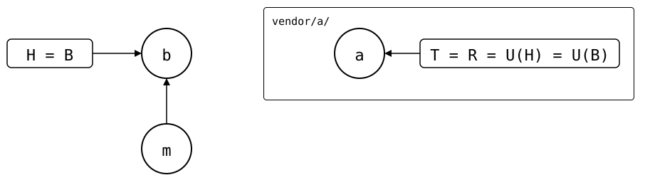
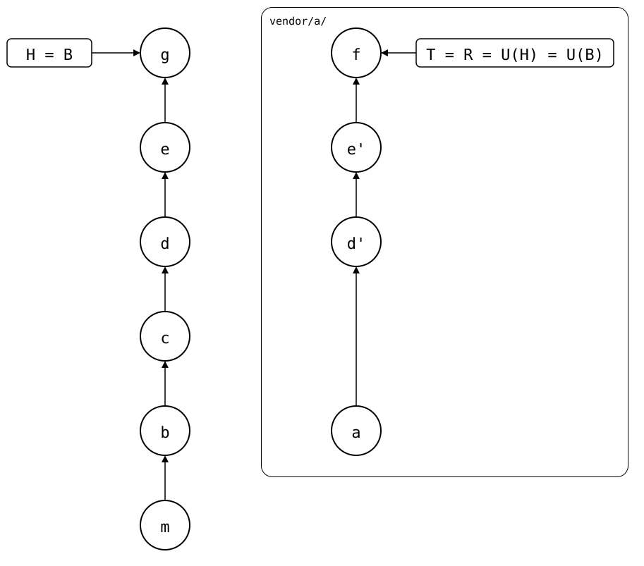

# Scenario: encrypted-upstream

The upstream encrypts its files with [git-crypt](https://github.com/AGWA/git-crypt),
a clean and smudge filter that its `.gitattributes` applies to every
file. In the monorepo, that line matches the splice's `.splice` too.
Once a commit stores the `.splice` encrypted, `git-splice` can't read it
and refuses. With the `.splice` left out of the filter, like the
`.gitattributes` itself, clone, push and pull work.

- **Monorepo**, on `main`: one commit, unlocked with the key
  `../git-crypt.key`.
- **Upstream** (`$UPSTREAM`, reached as `https://git.example.com/a.git`):
  `secret.txt`, encrypted with the same key.

## Output

<!--
```scrut {fail_fast: true, output_stream: combined}
$ source "$TESTDIR/../../readme-setup.sh" && export GIT_CONFIG_COUNT=1 GIT_CONFIG_KEY_0="url.$UPSTREAM.insteadOf" GIT_CONFIG_VALUE_0=https://git.example.com/a.git
```
-->

[`setup.bash`](setup.bash) builds this state:

```scrut
$ build_scenario scenario_encrypted_upstream
```

The upstream's `.gitattributes` encrypts every file but itself:

```scrut
$ git -C "$UPSTREAM" show main:.gitattributes
** filter=git-crypt diff=git-crypt
.gitattributes !filter !diff
```

### An encrypted `.splice`

`clone` writes the `.splice` and commits it unencrypted:

```scrut
$ git splice clone -m "b: clone vendor/a" https://git.example.com/a.git vendor/a
===  vendor/a: fetching https://git.example.com/a.git
ok   vendor/a: cloned df2d9fc from main
```

<div align="center">



</div>

<!--
```scrut
$ check_drawing "$TESTDIR/cloned.drawio.svg" m=HEAD~1
ok   cloned.drawio.svg: 3 commits, 3 arrows, 2 boxes, 1 lanes
```
-->

But the filter applies to it, so Git sees it as changed: stored again,
it would be encrypted.

```scrut
$ git status --short
 M vendor/a/.splice
```

A commit of everything stores it encrypted:

```scrut
$ git commit -q -a -m "c: commit everything"
```

and every command refuses:

```scrut
$ git splice status
!!   vendor/a/.splice can't be read (bad config line 1 in blob HEAD:vendor/a/.splice) -- fix it and commit it
[1]
```

### Keeping the `.splice` in plaintext

The line `.splice !filter !diff` leaves the `.splice` out of the
filter. The `.splice` then needs storing again, unencrypted: Git
doesn't store a file again for an attribute change alone.

```scrut
$ echo '.splice !filter !diff' >>vendor/a/.gitattributes &&
>   git rm -q --cached vendor/a/.splice &&
>   git add vendor/a/.gitattributes vendor/a/.splice &&
>   git commit -q -m "d: keep .splice in plaintext"
```

```scrut
$ git splice status
On branch main

  ahead 1  vendor/a
```

### Push and pull

A change to the encrypted file:

```scrut
$ echo "secret, version 2" >vendor/a/secret.txt &&
>   git commit -q -a -m "e: change secret.txt"
```

goes upstream with the new line in `.gitattributes`:

```scrut
$ git splice push vendor/a
ok   vendor/a: pushed 2e5c97b to main
```

`git-splice` moves the encrypted blob as it is, without the key. The
upstream has the same one as the monorepo:

```scrut
$ git rev-parse HEAD:vendor/a/secret.txt
c72d24e72f6a7142d6e21a7847061c0ea1acd74e
```

```scrut
$ git -C "$UPSTREAM" rev-parse main:secret.txt
c72d24e72f6a7142d6e21a7847061c0ea1acd74e
```

A change made upstream, by someone with the key:

```scrut
$ git clone -q https://git.example.com/a.git ../a-dev &&
>   git -C ../a-dev crypt unlock ../git-crypt.key &&
>   echo "secret, version 3" >../a-dev/secret.txt &&
>   git -C ../a-dev -c user.name=Test -c user.email=test@example.com commit -q -a -m "f: change secret.txt upstream" &&
>   git -C ../a-dev push -q
```

comes in with `pull`, and the checkout decrypts it:

```scrut
$ git splice pull -m "g: pull vendor/a" vendor/a
ok   vendor/a fetched (main moved 2e5c97b..d150047)
ok   vendor/a: pulled d150047
```

```scrut
$ cat vendor/a/secret.txt
secret, version 3
```

<div align="center">



</div>

<!--
```scrut
$ check_drawing "$TESTDIR/pulled.drawio.svg" m=HEAD~5
ok   pulled.drawio.svg: 10 commits, 10 arrows, 2 boxes, 1 lanes
```
-->

## Limits

- **Changes to one encrypted file on both sides conflict as binary**,
  as with plain Git and git-crypt.
- **The upstream must encrypt with the same key and attributes.**
  git-crypt encrypts deterministically, so the same file gives the same
  blob only with the same key.
- **The `.splice` is unencrypted**, upstream URL included.
