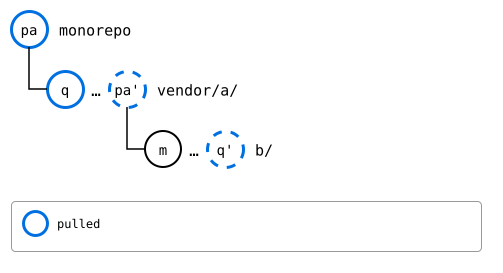
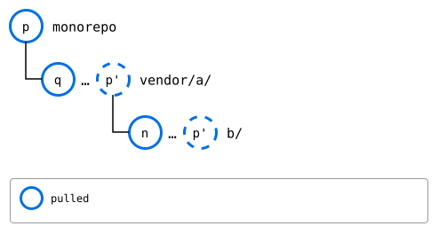

# The same name above and below

Both splices name an upstream `fork`, each its company's fork of its own
upstream. Names are unique only within one `.splice`, so
`--upstream fork` means the outer fork for `vendor/a/` and the inner
fork for `vendor/a/b/`
([#107](https://github.com/roschaefer/git-splice/issues/107)).

[`setup.bash`](setup.bash) builds the state of [outer-fork](README.md).

## Output

<!--
```scrut {fail_fast: true, output_stream: combined}
$ source "$TESTDIR/../../../readme-setup.sh" && export GIT_CONFIG_COUNT=3 GIT_CONFIG_KEY_0="url.$UPSTREAM-b.git.insteadOf" GIT_CONFIG_VALUE_0=https://git.example.com/b.git GIT_CONFIG_KEY_1="url.$UPSTREAM-fork.git.insteadOf" GIT_CONFIG_VALUE_1=https://git.example.com/company/a.git GIT_CONFIG_KEY_2="url.$UPSTREAM-b-fork.git.insteadOf" GIT_CONFIG_VALUE_2=https://git.example.com/company/b.git
```
-->

```scrut
$ build_scenario scenario_outer_fork https://git.example.com/b.git
```

Each `.splice` gets its own fork, and keeps its upstream as the default:

```scrut
$ git config --file vendor/a/.splice upstream.fork.url https://git.example.com/company/a.git &&
>   git config --file vendor/a/.splice splice.default-upstream origin
```

```scrut
$ git config --file vendor/a/b/.splice upstream.fork.url https://git.example.com/company/b.git &&
>   git config --file vendor/a/b/.splice splice.default-upstream origin
```

```scrut
$ git commit -q -m "add the company forks" -- vendor/a/.splice vendor/a/b/.splice
```

```scrut
$ git splice fetch
ok   vendor/a fetched from origin
ok   vendor/a fetched from fork
ok   vendor/a/b fetched from origin
ok   vendor/a/b fetched from fork
```

```scrut
$ git splice status --upstream fork
On branch main

  ahead 1, behind 1  vendor/a -> fork/main
  behind 1           vendor/a/b -> fork/main
```

Both lanes are split, and each has a `fork` side, of a different fork.
The outer fork has *q* (`a fork patch to b`) on top of *k* (`a seed`)
and *l* (`add b`); the inner fork has *n* (`b fork patch`) on top of *m*
(`b seed`). *c* (`add the company forks`) changed `vendor/a/b/.splice`,
a file of `vendor/a/` too, so R of `vendor/a/` is *c'*, its copy on top
of *l*, which no upstream has yet. R goes to every upstream, so it's on
both sides: on the fork side, *c'* is what `status` counts as ahead, and
*q* as behind. In `b/`, R is *m*, which the inner fork is one commit
past:

<div align="center">


</div>

<!--
```scrut
$ check_drawing "$TESTDIR/same-name-below.drawio.svg" \
>   a=HEAD~1 c=HEAD k=refs/splices/upstream/heads/main~1 l=refs/splices/upstream/heads/main \
>   q=refs/splices/a/heads/main m=refs/splices/b/heads/main n=refs/splices/company-b/heads/main
ok   same-name-below.drawio.svg: 12 commits, 15 arrows, 8 boxes, 2 lanes, 4 upstreams
```
-->

### Pulling each from its fork

Top-down, as every pull: the outer fork's patch to `b/` first, then the
inner fork's patch. Since `vendor/a/b/` is selected too, its `fork` is
the inner fork, and it pulls from that one. It's fetched from both of
its upstreams, as when it isn't selected: the outer fork may move its
synced commit to one only the inner upstream has. A hook stops the pull
after `vendor/a/`'s merge:

```scrut
$ git splice pull --upstream fork --all --exec 'test "$GIT_SPLICE_EVENT" != after-merge'
ok   vendor/a fetched from fork
ok   vendor/a/b fetched from origin
ok   vendor/a/b fetched from fork
ok   vendor/a: pulled 1b1cea6
!!   --exec stopped pull at after-merge of vendor/a, what it did so far stays -- re-run pull to go on
[1]
```

`vendor/a/` is at *q*, from the outer fork. Its patch to `b/` is `b/`'s
own commit for now, *q'* on top of *m*: `b/` hasn't pulled from its fork
yet.



<!--
```scrut
$ check_drawing "$TESTDIR/same-name-below-stop.drawio.svg" pa=HEAD q=refs/splices/a/heads/main m=refs/splices/b/heads/main q\'=$(git splice rebuild vendor/a/b)
ok   same-name-below-stop.drawio.svg: a tree of 3 rows
```
-->

Run again, `b/` pulls from the inner fork, and the two pulls make one
commit, *p*:

```scrut
$ git splice pull --upstream fork --all
ok   vendor/a fetched from fork
ok   vendor/a/b fetched from origin
ok   vendor/a/b fetched from fork
ok   vendor/a: nothing to pull
ok   vendor/a/b: pulled d5d5b62
ok   vendor/a: 2 pulls made one commit, [0-9a-f]{7} (regex)
```

`b/` is at *n*, from the inner fork, and each splice has the copy *p'*
of the one commit:



<!--
```scrut
$ check_drawing "$TESTDIR/same-name-below-end.drawio.svg" p=HEAD q=refs/splices/a/heads/main n=refs/splices/company-b/heads/main
ok   same-name-below-end.drawio.svg: a tree of 3 rows
```
-->

As lanes: each splice is at its fork's commit now, *q* and *n*, and R
builds on it. In `vendor/a/`, R is *p'*, which merges *c'*, still on
*l*, with *q*. R goes to every upstream, so it's drawn on both sides,
dashed where that side's upstream doesn't have it yet. The origin
branches stay where they were, so on the origin side *q* and *n* are
dashed too: the pull went to the forks.

![The monorepo's a, c and p, H at p; c and p outlined orange. The lane vendor/a/, split: origin with k and l, l being T and U(B), and on l the dashed q and c', merged by the dashed p', R; fork with k, l and q, q being main and U(H), and the dashed c' on l; p', dashed, merges c' and q and is R. Inside it, vendor/a/b/, split: origin with m, T and U(B), the dashed n on m and the dashed p' on n, R; fork with m and n, n being main and U(H), and the dashed p' on n, R. Every c' and p' and the monorepo's c and p are outlined orange](same-name-below-pulled.drawio.svg)

<!--
```scrut
$ check_drawing "$TESTDIR/same-name-below-pulled.drawio.svg" \
>   a=HEAD~2 c=HEAD~1 p=HEAD k=refs/splices/upstream/heads/main~1 l=refs/splices/upstream/heads/main \
>   q=refs/splices/a/heads/main m=refs/splices/b/heads/main n=refs/splices/company-b/heads/main \
>   vendor/a/p\'=$(git splice rebuild vendor/a) vendor/a/b/p\'=$(git splice rebuild vendor/a/b)
ok   same-name-below-pulled.drawio.svg: 19 commits, 25 arrows, 9 boxes, 2 lanes, 4 upstreams
```
-->

Counted from each side's branch, the dashed commits are what `status`
reports as ahead: in `vendor/a/`, *c'* and *p'* on the fork side, *q*
too on the origin side; in `b/`, *p'*, and *n* too on the origin side.

```scrut
$ git splice status --upstream fork
On branch main

  ahead 2  vendor/a -> fork/main
  ahead 1  vendor/a/b -> fork/main
```

```scrut
$ git splice status
On branch main

  ahead 3  vendor/a -> origin/main
  ahead 2  vendor/a/b -> origin/main
```

### The default travels with the `.splice`

The push of `vendor/a/` publishes `vendor/a/b/.splice` with the rest of
its folder. Its `default-upstream` goes along, so in the outer upstream,
`b/` pulls and pushes by default where it does in the monorepo:

```scrut
$ git splice push vendor/a
ok   vendor/a: pushed 71a9326 to origin/main
```

```scrut
$ git -C "$UPSTREAM" show main:b/.splice
[splice]
\tcommit = c819ad9d7bd5f546a2ba1485e9f4c89e74159f58 (escaped)
	id = 548ac82ad47ea22d
	default-upstream = origin
[upstream "origin"]
	url = https://git.example.com/b.git
[upstream "fork"]
	url = https://git.example.com/company/b.git
```
