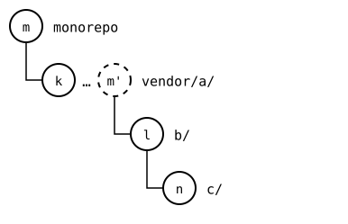
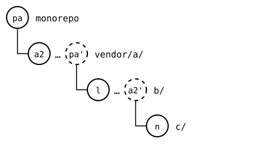
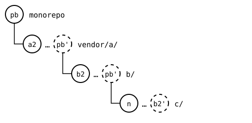
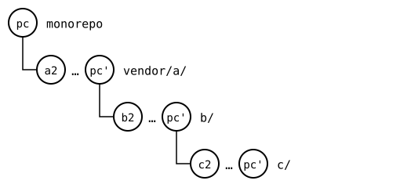

# Scenario: nested-splices, three levels: every level conflicts

The worst case for a pull through nested splices: every upstream moved
on, and changed the folder of the splice inside it too, the same lines
as that splice's own upstream. Each pair of a splice and the one inside
it then conflicts once, so three levels conflict three times: once per
edge of the tree, never more.

This page pulls all three by hand, top-down, as if each splice's
upstream were cloned on its own: a parent takes its own upstream in
before the splices inside it, so each of them starts from what the
parent's upstream recorded for it. Each conflict comes up in the parent
of the two, and is resolved there, once. The results then go up, level
by level, and can't conflict any more: nothing above changed in the
meantime.

## Output

<!--
```scrut {fail_fast: true, output_stream: combined}
$ source "$TESTDIR/../../../readme-setup.sh" && export GIT_CONFIG_COUNT=5 GIT_CONFIG_KEY_0="url.$UPSTREAM-b.git.insteadOf" GIT_CONFIG_VALUE_0=https://git.example.com/b.git GIT_CONFIG_KEY_1="url.$UPSTREAM-c.git.insteadOf" GIT_CONFIG_VALUE_1=https://git.example.com/c.git GIT_CONFIG_KEY_2=user.name GIT_CONFIG_VALUE_2=Test GIT_CONFIG_KEY_3=user.email GIT_CONFIG_VALUE_3=test@example.com GIT_CONFIG_KEY_4=core.editor GIT_CONFIG_VALUE_4=true
```
-->

[`setup.bash`](setup.bash) builds this state:

```scrut
$ build_scenario scenario_three_levels https://git.example.com/b.git https://git.example.com/c.git
```

Each upstream changes its own `file.txt`. The two outer ones change the
`file.txt` of the splice inside them too:

```scrut
$ git clone -q https://git.example.com/c.git ../c-work &&
>   echo "c upstream" >>../c-work/file.txt &&
>   git -C ../c-work commit -q -am "c upstream" &&
>   git -C ../c-work push -q origin main
```

```scrut
$ git clone -q https://git.example.com/b.git ../b-work &&
>   echo "b upstream" >>../b-work/file.txt &&
>   echo "c in b's upstream" >>../b-work/c/file.txt &&
>   git -C ../b-work commit -q -am "b upstream" &&
>   git -C ../b-work push -q origin main
```

```scrut
$ git clone -q "$UPSTREAM" ../a-work &&
>   echo "a upstream" >>../a-work/file.txt &&
>   echo "b in a's upstream" >>../a-work/b/file.txt &&
>   git -C ../a-work commit -q -am "a upstream" &&
>   git -C ../a-work push -q origin main
```

The monorepo, the root, has no upstream. Its own change to `vendor/a/`
plays that part:

```scrut
$ echo "a in the monorepo" >>vendor/a/file.txt &&
>   git commit -q -am "a in the monorepo"
```

Before: the monorepo at *m*, `a in the monorepo`, and each splice at its synced commit, *k*, *l* and *n*. *m*'s copy *m'* is in `vendor/a/`'s rebuild:



<!--
```scrut
$ check_drawing "$TESTDIR/every-before.drawio.svg" m=HEAD k=$(git config --file vendor/a/.splice splice.commit) l=$(git config --file vendor/a/b/.splice splice.commit) n=$(git config --file vendor/a/b/c/.splice splice.commit)
ok   every-before.drawio.svg: a tree of 4 rows
```
-->

## 1. The monorepo and `vendor/a/`

```scrut
$ git splice pull vendor/a
ok   vendor/a fetched (main moved 5bbd8de..e5dbfa5)
ok   vendor/a/b fetched (main moved 8333d5f..c26acde)
ok   vendor/a/b/c fetched (main moved 0bfc154..68ea527)
Auto-merging vendor/a/file.txt
CONFLICT (content): Merge conflict in vendor/a/file.txt
!!   vendor/a: conflict -- resolve it, then 'git commit' (or 'git cherry-pick --abort' to give up)
!!   vendor/a: pull failed
!!   Failed: vendor/a
[1]
```

```scrut
$ printf 'a seed\na in the monorepo\na upstream\n' >vendor/a/file.txt &&
>   git add vendor/a/file.txt &&
>   git commit -q --no-edit
```

After the pull of `vendor/a/`, *pa*: `vendor/a/` is at *a2*, its upstream's commit, and `b/` has *a2'*, the change `a`'s upstream made in `b/`, as its own:



<!--
```scrut
$ check_drawing "$TESTDIR/every-a.drawio.svg" pa=HEAD a2=$(git config --file vendor/a/.splice splice.commit) l=$(git config --file vendor/a/b/.splice splice.commit) n=$(git config --file vendor/a/b/c/.splice splice.commit) a2\'=$(git splice rebuild vendor/a/b)
ok   every-a.drawio.svg: a tree of 4 rows
```
-->

## 2. `a` and `b/`

The rebuild of `vendor/a/`, with its pull, checked out in a worktree:
the outer upstream's repository, as the monorepo has it now:

```scrut
$ git worktree add -q -b layer/a ../a-layer "$(git splice rebuild vendor/a)" &&
>   cd ../a-layer
```

```scrut
$ git splice pull --branch main b
ok   b fetched
ok   b/c fetched
Auto-merging b/file.txt
CONFLICT (content): Merge conflict in b/file.txt
!!   b: conflict -- resolve it, then 'git commit' (or 'git cherry-pick --abort' to give up)
!!   b: pull failed
!!   Failed: b
[1]
```

```scrut
$ printf "b seed\nb in a's upstream\nb upstream\n" >b/file.txt &&
>   git add b/file.txt &&
>   git commit -q --no-edit
```

The new commit goes up into the monorepo right away. `vendor/a/` hasn't
changed since its rebuild was checked out, so nothing conflicts:

```scrut
$ cd ../monorepo &&
>   git splice merge --rebuilt-commit layer/a vendor/a
ok   vendor/a: merged 7a981f0
```

After `b/`'s pull came up, *pb*: `b/` is at *b2*, and `c/` has *b2'*, the change `b`'s upstream made in `c/`, as its own:



<!--
```scrut
$ check_drawing "$TESTDIR/every-b.drawio.svg" pb=HEAD a2=$(git config --file vendor/a/.splice splice.commit) b2=$(git config --file vendor/a/b/.splice splice.commit) n=$(git config --file vendor/a/b/c/.splice splice.commit) b2\'=$(git splice rebuild vendor/a/b/c)
ok   every-b.drawio.svg: a tree of 4 rows
```
-->

```scrut
$ git worktree remove ../a-layer &&
>   git branch -q -D layer/a
```

## 3. `b` and `c/`

The rebuilds of `vendor/a/` and, in it, of `b/`, checked out the same
way, one inside the other:

```scrut
$ git worktree add -q -b layer/a ../a-layer "$(git splice rebuild vendor/a)" &&
>   cd ../a-layer &&
>   git worktree add -q -b layer/b ../b-layer "$(git splice rebuild b)" &&
>   cd ../b-layer
```

```scrut
$ git splice pull --branch main c
ok   c fetched
Auto-merging c/file.txt
CONFLICT (content): Merge conflict in c/file.txt
!!   c: conflict -- resolve it, then 'git commit' (or 'git cherry-pick --abort' to give up)
!!   c: pull failed
!!   Failed: c
[1]
```

```scrut
$ printf "c seed\nc in b's upstream\nc upstream\n" >c/file.txt &&
>   git add c/file.txt &&
>   git commit -q --no-edit
```

The new commit goes up, one level at a time, again without a conflict:

```scrut
$ cd ../a-layer &&
>   git splice merge --rebuilt-commit layer/b b
ok   b: merged 988f424
```

```scrut
$ cd ../monorepo &&
>   git splice merge --rebuilt-commit layer/a vendor/a
ok   vendor/a: merged f09023f
```

## 4. Every level up to date

```scrut
$ git log --format=%s
splice: pull c from main at 68ea527
splice: pull b from main at c26acde
splice: pull vendor/a from main at e5dbfa5
a in the monorepo
add vendor/a
initial commit
```

```scrut
$ git splice status
On branch main

  ahead 4  vendor/a
  ahead 3  vendor/a/b
  ahead 2  vendor/a/b/c
```

## 5. Pushed

```scrut
$ git splice push vendor/a/b/c vendor/a/b vendor/a
ok   vendor/a/b/c: pushed b33f7a9 to main
ok   vendor/a/b: pushed 1a51fd8 to main
ok   vendor/a: pushed 0f14077 to main
```

After `c/`'s pull, *pc*, and the push: each splice at its upstream's commit, *a2*, *b2* and *c2*, with *pc'* on top, which each upstream has now:



<!--
```scrut
$ check_drawing "$TESTDIR/every-pushed.drawio.svg" pc=HEAD a2=$(git config --file vendor/a/.splice splice.commit) b2=$(git config --file vendor/a/b/.splice splice.commit) c2=$(git config --file vendor/a/b/c/.splice splice.commit)
ok   every-pushed.drawio.svg: a tree of 4 rows
```
-->

```scrut
$ git -C "$UPSTREAM-c.git" show main:file.txt
c seed
c in b's upstream
c upstream
```

```scrut
$ git -C "$UPSTREAM-b.git" show main:c/file.txt
c seed
c in b's upstream
c upstream
```
