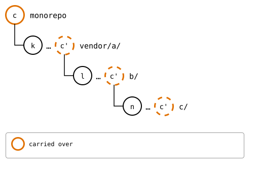
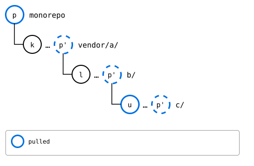
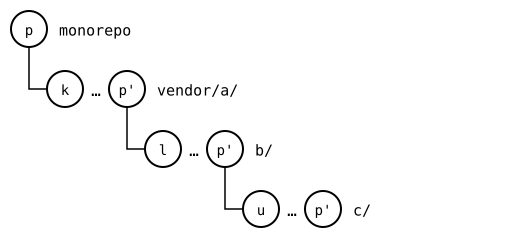
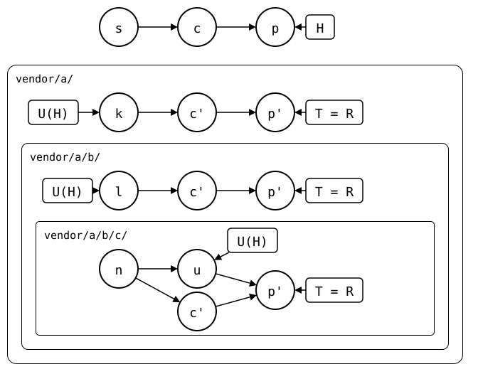

# Scenario: nested-splices, three levels: pulled one level at a time

`git splice pull --recursive vendor/a` pulls `vendor/a/` and each splice
inside it, one level at a time, top-down: as if each upstream were
cloned on its own, pulled one level down there, and the result handed up
to the level above. Here the innermost upstream and the monorepo change
the same file, so the conflict comes up innermost, in the pull of
`vendor/a/b/c/`, and is resolved there; the levels above have nothing to
pull. The monorepo gets one commit for the whole pull, and a push then
records each level's new commit in the level above.

## Output

<!--
```scrut {fail_fast: true, output_stream: combined}
$ source "$TESTDIR/../../../readme-setup.sh" && export GIT_CONFIG_COUNT=5 GIT_CONFIG_KEY_0="url.$UPSTREAM-b.git.insteadOf" GIT_CONFIG_VALUE_0=https://git.example.com/b.git GIT_CONFIG_KEY_1="url.$UPSTREAM-c.git.insteadOf" GIT_CONFIG_VALUE_1=https://git.example.com/c.git GIT_CONFIG_KEY_2=user.name GIT_CONFIG_VALUE_2=Test GIT_CONFIG_KEY_3=user.email GIT_CONFIG_VALUE_3=test@example.com GIT_CONFIG_KEY_4=core.editor GIT_CONFIG_VALUE_4=true
```
-->

[`setup.bash`](setup.bash) builds this state:

```scrut
$ build_scenario scenario_three_levels https://git.example.com/b.git https://git.example.com/c.git
```

The inner upstream and the monorepo change the same file:

```scrut
$ git clone -q https://git.example.com/c.git ../c-work &&
>   echo "c upstream" >>../c-work/file.txt &&
>   git -C ../c-work commit -q -am "c upstream" &&
>   git -C ../c-work push -q origin main
```

```scrut
$ echo "c local" >>vendor/a/b/c/file.txt &&
>   git commit -q -am "c local"
```

```scrut
$ git splice fetch vendor/a vendor/a/b vendor/a/b/c
ok   vendor/a fetched
ok   vendor/a/b fetched
ok   vendor/a/b/c fetched (main moved 0bfc154..68ea527)
```

<!--
```scrut
$ monorepo="$PWD" s="$(git rev-parse HEAD~1)" c="$(git rev-parse HEAD)" &&
>   k="$(git config --file vendor/a/.splice splice.commit)" &&
>   l="$(git config --file vendor/a/b/.splice splice.commit)" &&
>   n="$(git config --file vendor/a/b/c/.splice splice.commit)" &&
>   u="$(git rev-parse refs/splices/c/heads/main)"
```
-->

Before the pull, each splice is at its synced commit, *k*, *l* and *n*.
The monorepo's *c* changed the innermost folder, so each level's rebuild
has a copy of it, *c'*, on top, which the next push would carry over.
Only the innermost upstream moved on, to *u*:



<!--
```scrut
$ check_drawing "$TESTDIR/levels-tree-before.drawio.svg" c="$c" k="$k" l="$l" n="$n"
ok   levels-tree-before.drawio.svg: a tree of 4 rows
```
-->

## The pull

`vendor/a/` and `vendor/a/b/` have nothing to pull, and
`vendor/a/b/c/`'s pull conflicts:

```scrut
$ git splice pull --recursive vendor/a
ok   vendor/a fetched
ok   vendor/a/b fetched
ok   vendor/a/b/c fetched
ok   vendor/a: nothing to pull
ok   vendor/a/b: nothing to pull
Auto-merging vendor/a/b/c/file.txt
CONFLICT (content): Merge conflict in vendor/a/b/c/file.txt
!!   vendor/a/b/c: conflict -- resolve it, then 'git commit' (or 'git cherry-pick --abort' to give up)
!!   vendor/a/b/c: pull failed
!!   Failed: vendor/a/b/c
[1]
```

```scrut
$ printf 'c seed\nc local\nc upstream\n' >vendor/a/b/c/file.txt &&
>   git add vendor/a/b/c/file.txt &&
>   git commit -q --no-edit
```

Run again, it has nothing left to pull. The pull of `vendor/a/b/c/` is the one commit, *p*:

```scrut
$ git splice pull --recursive vendor/a
ok   vendor/a fetched
ok   vendor/a/b fetched
ok   vendor/a/b/c fetched
ok   vendor/a: nothing to pull
ok   vendor/a/b: nothing to pull
ok   vendor/a/b/c: nothing to pull
```

```scrut
$ git log --format=%s -3
splice: pull vendor/a/b/c from main at 68ea527
c local
add vendor/a
```



<!--
```scrut
$ check_drawing "$TESTDIR/levels-pulled.drawio.svg" k="$k" l="$l" u="$u" p=HEAD
ok   levels-pulled.drawio.svg: a tree of 4 rows
```
-->

## Pushed

```scrut
$ git splice push --all
ok   vendor/a/b/c: pushed dcf58ed to main
ok   vendor/a/b: pushed 40da2d0 to main
ok   vendor/a: pushed 9a4ce67 to main
```

After the push, each upstream has *p'*, so it's solid; the monorepo still records *k*, *l* and *u*:



<!--
```scrut
$ check_drawing "$TESTDIR/levels-tree-pushed.drawio.svg" k="$k" l="$l" u="$u" p=HEAD
ok   levels-tree-pushed.drawio.svg: a tree of 4 rows
```
-->

Each upstream records the commit the one inside it has now:

```scrut
$ git -C "$UPSTREAM-b.git" show main:c/.splice | git config --file - splice.commit | cut -c1-7 &&
>   git -C "$UPSTREAM-c.git" rev-parse --short main
dcf58ed
dcf58ed
```

```scrut
$ git -C "$UPSTREAM" show main:b/.splice | git config --file - splice.commit | cut -c1-7 &&
>   git -C "$UPSTREAM-b.git" rev-parse --short main
40da2d0
40da2d0
```

```scrut
$ git splice status
On branch main

  up to date  vendor/a
  up to date  vendor/a/b
  up to date  vendor/a/b/c
```

The same state as lanes, with each upstream's history: *c'* and *p'* on *k* and *l* in the two upstreams above, and in `c/`, *p'* joining *c'*, the monorepo's change, and *u*, its upstream's:



<!--
```scrut
$ check_drawing "$TESTDIR/levels-lanes-pushed.drawio.svg" s="$s" c="$c" k="$k" l="$l" n="$n" u="$u" p=HEAD
ok   levels-lanes-pushed.drawio.svg: 13 commits, 17 arrows, 7 boxes, 3 lanes
```
-->
