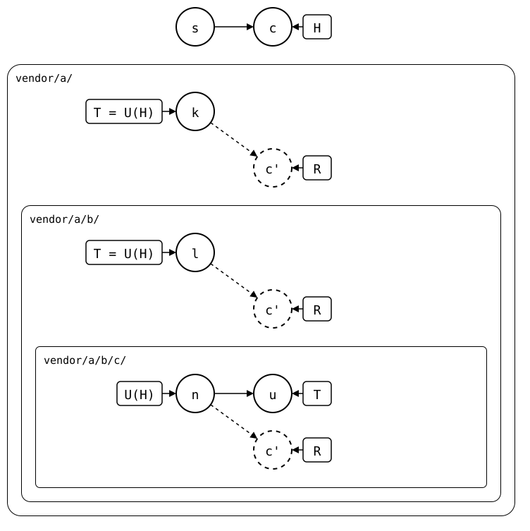
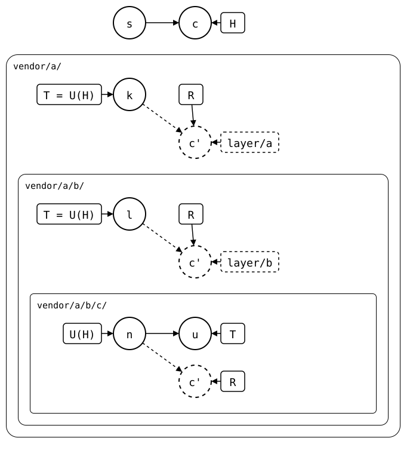
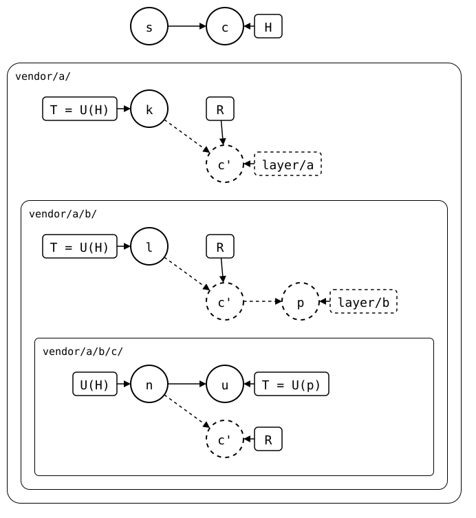
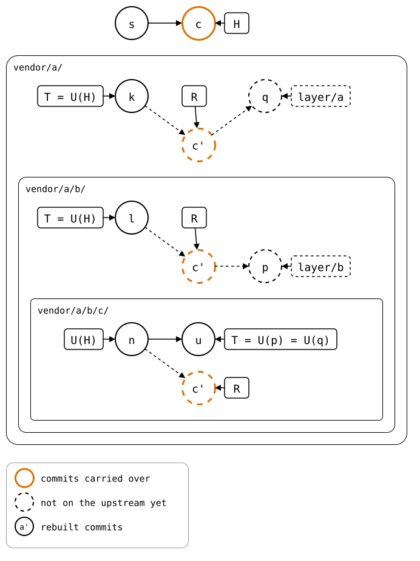
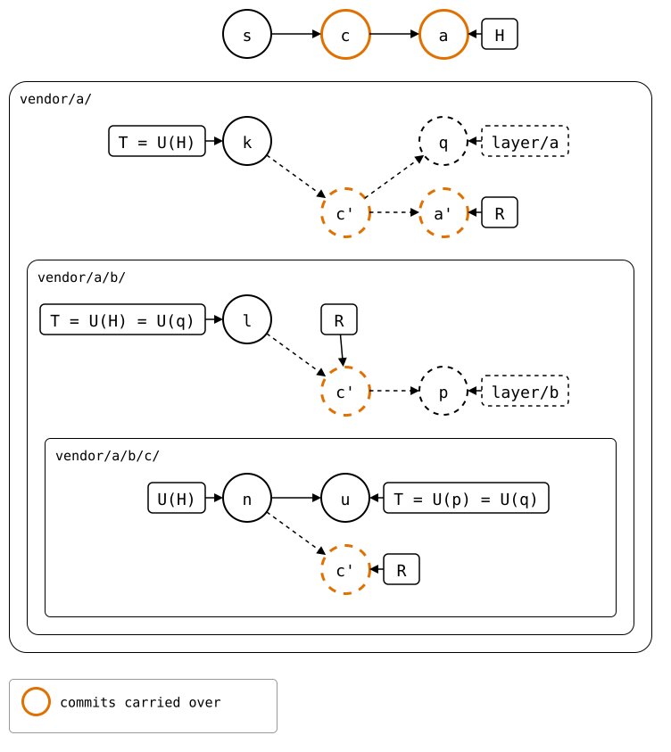
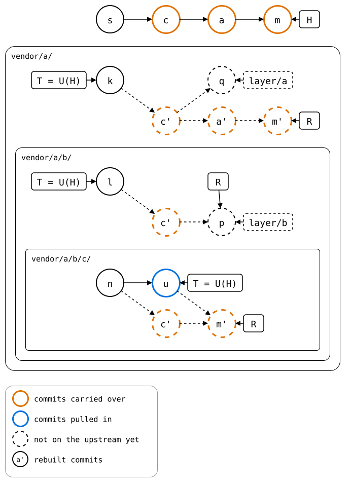
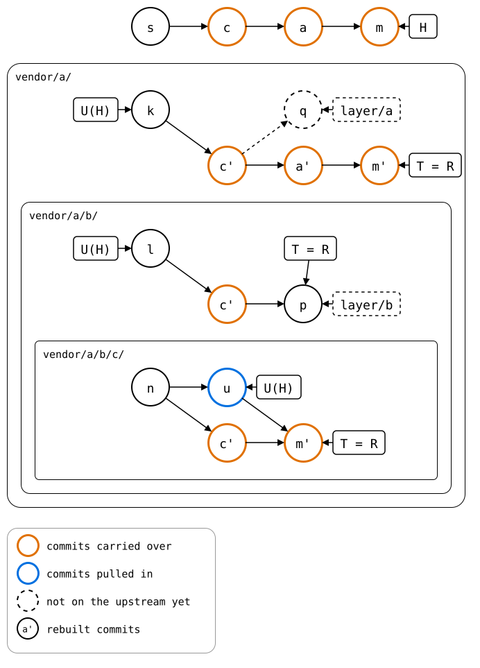

# Scenario: nested-splices, three levels: pulled one level at a time

`git splice pull vendor/a/b/c` merges the innermost upstream straight
into the monorepo. This page does the same pull one level at a time, by
hand, with commands that each know one level only:

1. The rebuild of `vendor/a/`, checked out in a worktree: the outer
   upstream's repository, as the monorepo has it.
2. In there, the rebuild of `b/`, checked out the same way: the middle
   upstream's repository.
3. In there, `git splice pull c`, a pull one level down. Its conflict
   comes up in that repository, and is resolved there.
4. Back in the outer worktree, `git splice merge --rebuilt-commit` takes
   that commit into `b/`.
5. Back in the monorepo, the same takes the outer worktree's commit into
   `vendor/a/`.

The monorepo then has a pull of `vendor/a/b/c/`, as if it had pulled it
itself: the same rebuild, and the same push. It changed `vendor/a/` in
between, and keeps that change.

## Output

<!--
```scrut {fail_fast: true, output_stream: combined}
$ source "$TESTDIR/../../../readme-setup.sh" && export GIT_CONFIG_COUNT=5 GIT_CONFIG_KEY_0="url.$UPSTREAM-b.git.insteadOf" GIT_CONFIG_VALUE_0=https://git.example.com/b.git GIT_CONFIG_KEY_1="url.$UPSTREAM-c.git.insteadOf" GIT_CONFIG_VALUE_1=https://git.example.com/c.git GIT_CONFIG_KEY_2=user.name GIT_CONFIG_VALUE_2=Test GIT_CONFIG_KEY_3=user.email GIT_CONFIG_VALUE_3=test@example.com GIT_CONFIG_KEY_4=core.editor GIT_CONFIG_VALUE_4=true
```
-->

[`setup.bash`](setup.bash) builds this state:

```scrut
$ build_scenario scenario_three_levels https://git.example.com/b.git https://git.example.com/c.git
```

The inner upstream and the monorepo change the same file:

```scrut
$ git clone -q https://git.example.com/c.git ../c-work &&
>   echo "c upstream" >>../c-work/file.txt &&
>   git -C ../c-work commit -q -am "c upstream" &&
>   git -C ../c-work push -q origin main
```

```scrut
$ echo "c local" >>vendor/a/b/c/file.txt &&
>   git commit -q -am "c local"
```

```scrut
$ git splice fetch vendor/a vendor/a/b vendor/a/b/c
ok   vendor/a fetched
ok   vendor/a/b fetched
ok   vendor/a/b/c fetched (main moved 0bfc154..68ea527)
```

<!--
```scrut
$ monorepo="$PWD" s="$(git rev-parse HEAD~1)" c="$(git rev-parse HEAD)" &&
>   k="$(git config --file vendor/a/.splice splice.commit)" &&
>   l="$(git config --file vendor/a/b/.splice splice.commit)" &&
>   n="$(git config --file vendor/a/b/c/.splice splice.commit)" &&
>   u="$(git rev-parse refs/splices/c/heads/main)"
```
-->

Each lane is one level, drawn inside the one above it. The monorepo's
*c* changes the innermost folder, so each level's rebuild, R, has a copy
of it, *c'*, on top of the synced commit, both outlined orange: a change
the rebuild carries over. Only the innermost upstream moved on, to *u*:

<div align="center">



</div>

<!--
```scrut
$ check_drawing "$TESTDIR/levels-before.drawio.svg" \
>   s="$s" c="$c" k="$k" l="$l" n="$n" u="$u"
ok   levels-before.drawio.svg: 9 commits, 13 arrows, 8 boxes, 3 lanes
```
-->

## 1. The outer upstream's repository

The rebuild of `vendor/a/`, checked out in a worktree on a branch of its
own, `layer/a`, is the outer upstream's repository:

```scrut
$ git worktree add -q -b layer/a ../a-layer "$(git splice rebuild vendor/a)"
```

The commands from here on run there, not in the monorepo:

```scrut
$ cd ../a-layer
```

## 2. The middle upstream's repository

In it, `b/` is a splice, and its rebuild, checked out as `layer/b`, is
the middle upstream's repository:

```scrut
$ git worktree add -q -b layer/b ../b-layer "$(git splice rebuild b)"
```

The commands from here on run there, one level further down:

```scrut
$ cd ../b-layer
```

```scrut
$ ls
c
file.txt
```

The two worktrees' branches are rebuilds, unchanged: `layer/a` is R of
`vendor/a/`, and `layer/b`, rebuilt from `layer/a`'s commits, is the
same commit as the monorepo's R of `vendor/a/b/`. They're branches of
the monorepo that no upstream has, so their boxes are dashed. The shaded
lane is the repository the commands run in now, `vendor/a/b/`'s:

<div align="center">



</div>

<!--
```scrut
$ (cd "$monorepo" &&
>   check_drawing "$TESTDIR/levels-worktrees.drawio.svg" \
>     s="$s" c="$c" k="$k" l="$l" n="$n" u="$u")
ok   levels-worktrees.drawio.svg: 9 commits, 15 arrows, 10 boxes, 3 lanes
```
-->

## 3. The pull, one level down

A worktree can't have `main` checked out too, so `--branch` names the
inner upstream's branch:

```scrut
$ git splice pull --branch main c
ok   c fetched
Auto-merging c/file.txt
CONFLICT (content): Merge conflict in c/file.txt
!!   c: conflict -- resolve it, then 'git commit' (or 'git cherry-pick --abort' to give up)
!!   c: pull failed
!!   Failed: c
[1]
```

```scrut
$ printf 'c seed\nc local\nc upstream\n' >c/file.txt &&
>   git add c/file.txt &&
>   git cherry-pick --continue >/dev/null
```

```scrut
$ git log --format=%s -1
splice: pull c from main at 68ea527
```

The pull's commit, *p*, on top of `layer/b`, is a commit of the middle
upstream's repository: its `c/.splice` records *u*. The monorepo hasn't
changed:

<div align="center">



</div>

<!--
```scrut
$ (cd "$monorepo" &&
>   check_drawing "$TESTDIR/levels-pulled-below.drawio.svg" \
>     s="$s" c="$c" k="$k" l="$l" n="$n" u="$u" p=layer/b)
ok   levels-pulled-below.drawio.svg: 10 commits, 16 arrows, 10 boxes, 3 lanes
```
-->

## 4. Into the outer upstream's repository

The commands run in the outer upstream's repository again, one level up:

```scrut
$ cd ../a-layer
```

```scrut
$ git splice merge --rebuilt-commit layer/b b
ok   b: merged 4975461
```

```scrut
$ git log --format=%s -1
splice: pull c from main at 68ea527
```

*q*, on top of `layer/a`, takes *p*'s changes into `b/`, and with them
`b/c/.splice`, which records *u* too. The shaded lane is now
`vendor/a/`'s:

<div align="center">



</div>

<!--
```scrut
$ (cd "$monorepo" &&
>   check_drawing "$TESTDIR/levels-merged-into-a.drawio.svg" \
>     s="$s" c="$c" k="$k" l="$l" n="$n" u="$u" p=layer/b q=layer/a)
ok   levels-merged-into-a.drawio.svg: 11 commits, 17 arrows, 10 boxes, 3 lanes
```
-->

## 5. Into the monorepo

The commands run in the monorepo again, where no lane is shaded:

```scrut
$ cd ../monorepo
```

Meanwhile, the monorepo changes `vendor/a/`:

```scrut
$ echo "a local" >vendor/a/other.txt &&
>   git add vendor/a/other.txt &&
>   git commit -q -m "a local"
```

Its rebuild has *a'* on top of *c'*, beside *q*, as when [a worktree's
commit](../../../01-everyday-sync/02-up-to-date/worked-on-in-a-worktree.md)
and the monorepo both go on from the rebuild:

<div align="center">



</div>

<!--
```scrut
$ check_drawing "$TESTDIR/levels-monorepo-moved-on.drawio.svg" \
>   s="$s" c="$c" k="$k" l="$l" n="$n" u="$u" a="$(git rev-parse HEAD)" p=layer/b q=layer/a
ok   levels-monorepo-moved-on.drawio.svg: 13 commits, 19 arrows, 10 boxes, 3 lanes
```
-->

```scrut
$ git splice merge --rebuilt-commit layer/a vendor/a
ok   vendor/a: merged d441bb3
```

```scrut
$ git log --format=%s -3
splice: pull c from main at 68ea527
a local
c local
```

*m* has *q*'s changes, on top of *a*. Each level's rebuild takes it in:
`vendor/a/`'s as *m'*, on top of *a'*; `vendor/a/b/`'s as *p* itself, the
commit the pull made in the worktree; and `vendor/a/b/c/`'s as *m'*, a
merge of *c'* and *u*, which `.splice` records now. So *u* is outlined
blue from here on, a commit the monorepo pulled in, though the pull
happened two levels down:

<div align="center">



</div>

<!--
```scrut
$ check_drawing "$TESTDIR/levels-merged-into-monorepo.drawio.svg" \
>   s="$s" c="$c" k="$k" l="$l" n="$n" u="$u" a="$(git rev-parse HEAD~1)" m="$(git rev-parse HEAD)" p=layer/b q=layer/a
ok   levels-merged-into-monorepo.drawio.svg: 16 commits, 22 arrows, 9 boxes, 3 lanes
```
-->

`vendor/a/b/c/` is pulled: `.splice` names the inner upstream's commit,
and the rebuild joins the local change and the upstream's, as after a
pull in the monorepo. The pushes go bottom-up:

```scrut
$ git log -1 --format=%s "$(git config --file vendor/a/b/c/.splice splice.commit)"
c upstream
```

```scrut
$ git log --graph --format=%s "$(git splice rebuild vendor/a/b/c)"
*   splice: pull c from main at 68ea527
|\  
| * c upstream
* | c local
|/  
* c seed
```

```scrut
$ git splice status
On branch main

  ahead 3  vendor/a
  ahead 2  vendor/a/b
  ahead 2  vendor/a/b/c
```

```scrut
$ git splice push vendor/a/b/c vendor/a/b vendor/a
ok   vendor/a/b/c: pushed 3ed2724 to main
ok   vendor/a/b: pushed 4975461 to main
ok   vendor/a: pushed 563343b to main
```

```scrut
$ git -C "$UPSTREAM-c.git" log --graph --format=%s main
*   splice: pull c from main at 68ea527
|\  
| * c upstream
* | c local
|/  
* c seed
```

Each upstream has its level's R now. *q* stays on `layer/a` only: the
merge took its changes, not the commit:

<div align="center">



</div>

<!--
```scrut
$ check_drawing "$TESTDIR/levels-pushed.drawio.svg" \
>   s="$s" c="$c" k="$k" l="$l" n="$n" u="$u" a="$(git rev-parse HEAD~1)" m="$(git rev-parse HEAD)" p=layer/b q=layer/a
ok   levels-pushed.drawio.svg: 16 commits, 22 arrows, 9 boxes, 3 lanes
```
-->
