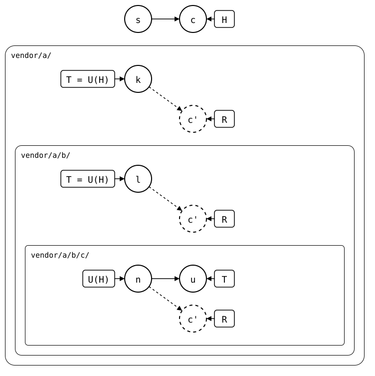
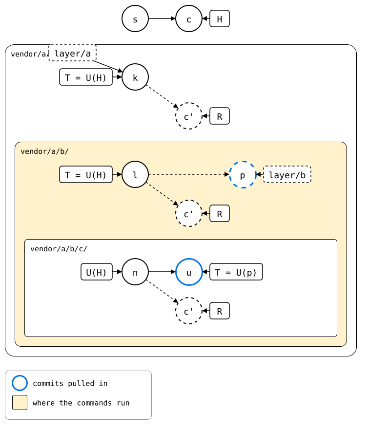
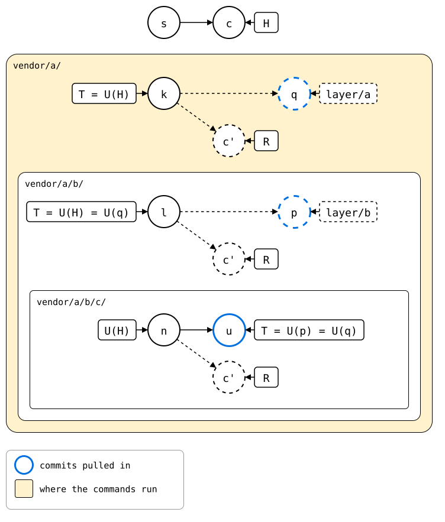
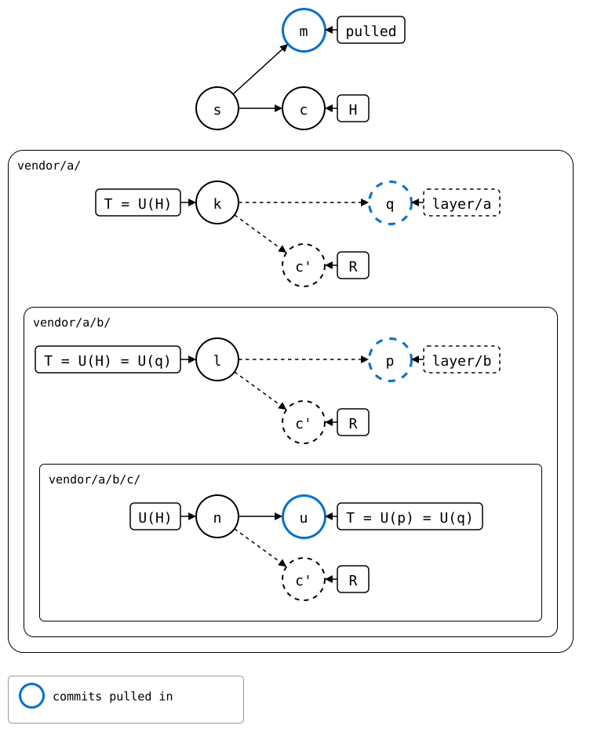
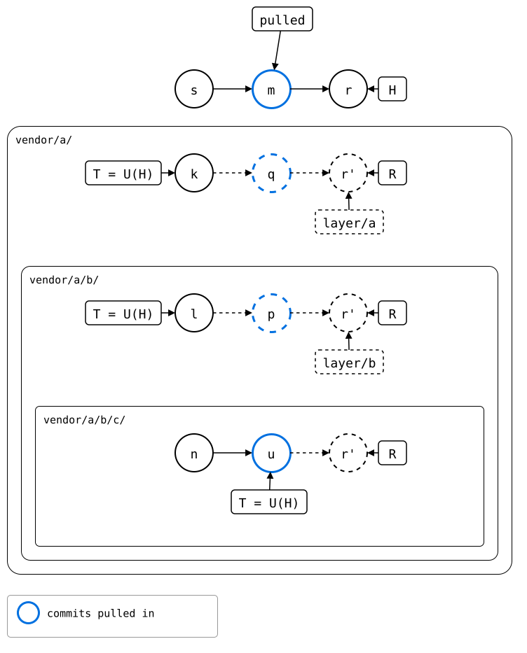
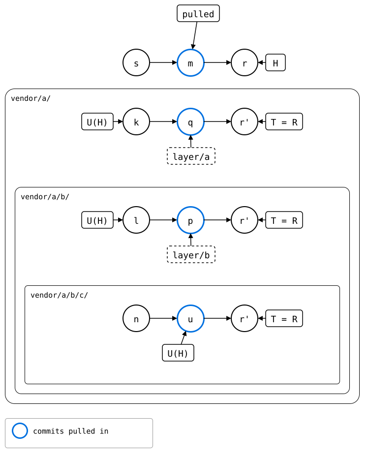

# Scenario: nested-splices, three levels: rebased one level at a time

`git splice pull --rebase vendor/a/b/c` takes the innermost upstream in
on top of the last pull, and replays the monorepo's own commits on top
of it, with `git rebase`. This page does the same one level at a time,
by hand, as [pulled one level at a time](pulled-level-by-level.md) does
for a merge:

- Each worktree starts at its level's rebuild, R, with the monorepo's
  change in it.
- Innermost, `pull --rebase` puts the pull below R. The conflict comes
  up there, once.
- Each level above rebases its R onto its own pull commit too. The
  inner folder comes from the level below, where the conflict was
  resolved, so it doesn't come up again.

## Output

<!--
```scrut {fail_fast: true, output_stream: combined}
$ source "$TESTDIR/../../../readme-setup.sh" && export GIT_CONFIG_COUNT=5 GIT_CONFIG_KEY_0="url.$UPSTREAM-b.git.insteadOf" GIT_CONFIG_VALUE_0=https://git.example.com/b.git GIT_CONFIG_KEY_1="url.$UPSTREAM-c.git.insteadOf" GIT_CONFIG_VALUE_1=https://git.example.com/c.git GIT_CONFIG_KEY_2=user.name GIT_CONFIG_VALUE_2=Test GIT_CONFIG_KEY_3=user.email GIT_CONFIG_VALUE_3=test@example.com GIT_CONFIG_KEY_4=core.editor GIT_CONFIG_VALUE_4=true
```
-->

[`setup.bash`](setup.bash) builds this state:

```scrut
$ build_scenario scenario_three_levels https://git.example.com/b.git https://git.example.com/c.git
```

The inner upstream and the monorepo change the same file:

```scrut
$ git clone -q https://git.example.com/c.git ../c-work &&
>   echo "c upstream" >>../c-work/file.txt &&
>   git -C ../c-work commit -q -am "c upstream" &&
>   git -C ../c-work push -q origin main
```

```scrut
$ echo "c local" >>vendor/a/b/c/file.txt &&
>   git commit -q -am "c local"
```

```scrut
$ git splice fetch vendor/a vendor/a/b vendor/a/b/c
ok   vendor/a fetched
ok   vendor/a/b fetched
ok   vendor/a/b/c fetched (main moved 0bfc154..68ea527)
```

<!--
```scrut
$ monorepo="$PWD" s="$(git rev-parse HEAD~1)" c="$(git rev-parse HEAD)" &&
>   k="$(git config --file vendor/a/.splice splice.commit)" &&
>   l="$(git config --file vendor/a/b/.splice splice.commit)" &&
>   n="$(git config --file vendor/a/b/c/.splice splice.commit)" &&
>   u="$(git rev-parse refs/splices/c/heads/main)"
```
-->

Each lane is one level, drawn inside the one above it. The monorepo's
*c* changes the innermost folder, so each level's rebuild, R, has a copy
of it, *c'*, on top of the synced commit. Only the innermost upstream
moved on, to *u*:

<div align="center">



</div>

<!--
```scrut
$ check_drawing "$TESTDIR/levels-before.drawio.svg" \
>   s="$s" c="$c" k="$k" l="$l" n="$n" u="$u"
ok   levels-before.drawio.svg: 9 commits, 13 arrows, 8 boxes, 3 lanes
```
-->

## 1. The outer upstream's repository

The rebuild of `vendor/a/`, R, checked out in a worktree on a branch of
its own, `layer/a`: the outer upstream's history with the monorepo's
*c'* on top:

```scrut
$ git worktree add -q -b layer/a ../a-layer "$(git splice rebuild vendor/a)"
```

The commands from here on run there, not in the monorepo:

```scrut
$ cd ../a-layer
```

## 2. The middle upstream's repository

In it, `b/` is a splice, and its rebuild, checked out as `layer/b`, is
the middle upstream's history the same way:

```scrut
$ git worktree add -q -b layer/b ../b-layer "$(git splice rebuild b)"
```

The commands from here on run there, one level further down:

```scrut
$ cd ../b-layer
```

```scrut
$ git log --format=%s
c local
add c
b seed
```

## 3. The pull, rebased one level down

A worktree can't have `main` checked out too, so `--branch` names the
upstream branch. `--rebase` takes it in on top of *l*, where this level
last took `c/` in, and rebases *c'* onto it. *c'* changed the same lines
as *u*, so the conflict comes up here:

```scrut
$ git splice pull --rebase --branch main c
ok   c fetched
??   c: synced commit f3e9a12 isn't on main -- made it again here: 0bfc154 and 1 commit of this branch's own
Auto-merging c/.splice
Auto-merging c/file.txt
CONFLICT (content): Merge conflict in c/file.txt
error: could not apply *... c local (glob)
Could not apply *... # c local (glob)
!!   c: conflict while rebasing onto the pull -- resolve it, then 'git rebase --continue' (or 'git rebase --abort' to give up)
!!   Failed: c
[1]
```

```scrut
$ printf 'c seed\nc local\nc upstream\n' >c/file.txt &&
>   git add c/file.txt &&
>   git rebase --continue
[detached HEAD 56402be] c local
 1 file changed, 1 insertion(+)
[0]
```

```scrut
$ git log --format=%s
c local
splice: pull c from main at 68ea527
add c
b seed
```

The pull's commit, *p*, sits on *l*, and *r'*, R's *c'* rebased, on top
of it, with the resolved conflict. The monorepo's rebuild still has R at
*c'*, next to it. Both *p* and *u*, which it brought in, are blue:

<div align="center">



</div>

<!--
```scrut
$ (cd "$monorepo" &&
>   check_drawing "$TESTDIR/rebased-pulled-below.drawio.svg" \
>     s="$s" k="$k" l="$l" n="$n" u="$u" c="$c" p=layer/b~1 "r'=layer/b")
!!   c' is a commit that records a pull: outline it blue, #0070E0
!!   c' is a commit that records a pull: outline it blue, #0070E0
!!   c' is a commit a pull brought in: outline it blue, #0070E0
[1]
```
-->

## 4. Into the outer upstream's repository, rebased too

The commands run in the outer upstream's repository again, one level up:

```scrut
$ cd ../a-layer
```

The pull goes in where this level last took `b/` in, on a branch of its
own, `a-pulled`:

```scrut
$ git switch -q -c a-pulled "$(git splice boundary b)"
```

```scrut
$ git splice merge --rebuilt-commit layer/b~1 b
Auto-merging b/c/.splice
CONFLICT (content): Merge conflict in b/c/.splice
Auto-merging b/c/file.txt
CONFLICT (content): Merge conflict in b/c/file.txt
!!   b: conflict -- resolve it, then 'git commit' (or 'git cherry-pick --abort' to give up)
!!   b: merge failed
[1]
```

R's *c'* goes on top of it, with its own changes, except for `b/c/`:
that comes from the level below, where the conflict was resolved. So it
doesn't come up again:

```scrut
$ git switch -q --detach &&
>   git read-tree layer/a &&
>   git rm -rqf --cached b/c &&
>   git read-tree --prefix=b/c/ layer/b:c &&
>   git commit -q -C layer/a &&
>   git reset -q --hard &&
>   git switch -q -C layer/a
fatal: cannot switch branch while cherry-picking
Consider "git cherry-pick --quit" or "git worktree add".
[128]
```

```scrut
$ git log --format=%s
c local
add b
a seed
```

*q* takes *p* into `b/`, on *k*, and *r'* is R's *c'* rebased onto it:

<div align="center">



</div>

<!--
```scrut
$ (cd "$monorepo" &&
>   check_drawing "$TESTDIR/rebased-merged-into-a.drawio.svg" \
>     s="$s" k="$k" l="$l" n="$n" u="$u" c="$c" p=layer/b~1 q=layer/a~1 \
>     "vendor/a/b/r'=layer/b" "vendor/a/r'=layer/a")
!!   q is dashed, but an upstream branch has it: draw it solid
!!   c' is a commit that records a pull: outline it blue, #0070E0
!!   c' is a commit that records a pull: outline it blue, #0070E0
!!   c' is a commit a pull brought in: outline it blue, #0070E0
!!   q is outlined blue, but it neither records a pull nor came in with one: outline it black
!!   r' is a commit that records a pull: outline it blue, #0070E0
!!   U(q) points at u, the code says n
!!   k -> q: k isn't a parent of q
!!   no arrow q -> c', though q is a parent of c'
!!   no arrow k -> r', though k is a parent of r'
[1]
```
-->

## 5. Into the monorepo, rebased the same way

The commands run in the monorepo again:

```scrut
$ cd ../monorepo
```

The pull goes in where `vendor/a/` was last synced, at B, on a branch of
its own, `pulled`:

```scrut
$ git switch -q -c pulled "$(git splice boundary vendor/a)"
```

```scrut
$ git splice merge --rebuilt-commit layer/a~1 vendor/a
ok   vendor/a: 5bbd8de is part of the rebuild already -- nothing to merge
```

```scrut
$ git switch -q main
```

`main` still has the monorepo's own commit, *c*, on the other side of B:

<div align="center">



</div>

<!--
```scrut
$ check_drawing "$TESTDIR/rebased-pulled-into-monorepo.drawio.svg" \
>   s="$s" k="$k" l="$l" n="$n" u="$u" c="$c" m=pulled p=layer/b~1 q=layer/a~1 \
>   "vendor/a/b/r'=layer/b" "vendor/a/r'=layer/a"
!!   q is dashed, but an upstream branch has it: draw it solid
!!   m is outlined blue, but it neither records a pull nor came in with one: outline it black
!!   c' is a commit that records a pull: outline it blue, #0070E0
!!   c' is a commit that records a pull: outline it blue, #0070E0
!!   c' is a commit a pull brought in: outline it blue, #0070E0
!!   q is outlined blue, but it neither records a pull nor came in with one: outline it black
!!   r' is a commit that records a pull: outline it blue, #0070E0
!!   s -> m: s isn't a parent of m
!!   U(q) points at u, the code says n
!!   k -> q: k isn't a parent of q
!!   no arrow m -> c, though m is a parent of c
!!   no arrow q -> c', though q is a parent of c'
!!   no arrow k -> r', though k is a parent of r'
[1]
```
-->

*c* goes on top of *m* the same way, with `vendor/a/b/c/` from the outer
upstream's repository, and `main` moves there:

```scrut
$ git switch -q --detach pulled &&
>   git read-tree main &&
>   git rm -rqf --cached vendor/a/b/c &&
>   git read-tree --prefix=vendor/a/b/c/ layer/a:b/c &&
>   git commit -q -C main &&
>   git reset -q --hard &&
>   git switch -q -C main
```

The pull is below the monorepo's own commit now, as `pull --rebase`
leaves it:

```scrut
$ git log --format=%s
c local
add vendor/a
initial commit
```

*r* is *c* rebased onto *m*. Each level's rebuild follows: R is the very
*r'* the worktree made there, in `vendor/a/` and in `vendor/a/b/`. At
every level, the blue commit is below the monorepo's own change:

<div align="center">



</div>

<!--
```scrut
$ check_drawing "$TESTDIR/rebased-rebased.drawio.svg" \
>   s="$s" k="$k" l="$l" n="$n" u="$u" m=pulled r=HEAD p=layer/b~1 q=layer/a~1
!!   q is dashed, but an upstream branch has it: draw it solid
!!   m is outlined blue, but it neither records a pull nor came in with one: outline it black
!!   r is a commit that records a pull: outline it blue, #0070E0
!!   q is outlined blue, but it neither records a pull nor came in with one: outline it black
!!   r' is a commit that records a pull: outline it blue, #0070E0
!!   r' is a commit that records a pull: outline it blue, #0070E0
!!   r' is a commit a pull brought in: outline it blue, #0070E0
!!   s -> m: s isn't a parent of m
!!   k -> q: k isn't a parent of q
!!   layer/b points at r', the code says 56402be, which isn't drawn
!!   p -> r': p isn't a parent of r'
!!   u -> r': u isn't a parent of r'
!!   U(H) points at u, the code says r'
!!   no arrow s -> r, though s is a parent of r
!!   no arrow k -> r', though k is a parent of r'
!!   no arrow l -> r', though l is a parent of r'
!!   no arrow n -> r', though n is a parent of r'
[1]
```
-->

The innermost splice has *c* to push. The levels above have the pull
too: its commit took the new `.splice` in as their own change, as in
[pulled one level at a time](pulled-level-by-level.md):

```scrut
$ git splice status
??   vendor/a/b/c: synced commit f3e9a12 isn't on main -- made it again here: 0bfc154 and 1 commit of this branch's own
On branch main

  ahead 1, behind 1  vendor/a/b/c
  ahead 1            vendor/a
  ahead 1            vendor/a/b
```

## 6. Pushed

```scrut
$ git splice push vendor/a/b/c vendor/a/b vendor/a
??   vendor/a/b/c: synced commit f3e9a12 isn't on main -- made it again here: 0bfc154 and 1 commit of this branch's own
!!   vendor/a/b/c: upstream has commits this branch lacks
!!   vendor/a/b: not pushed, since vendor/a/b/c below it failed
!!   vendor/a: not pushed, since vendor/a/b/c below it failed
!!   Failed: vendor/a/b/c vendor/a/b vendor/a
[1]
```

The innermost upstream has the monorepo's change on top of its own, in
one line, with no merge commit: what a rebase is for.

```scrut
$ git -C "$UPSTREAM-c.git" log --format=%s main
c upstream
c seed
```

<div align="center">



</div>

<!--
```scrut
$ check_drawing "$TESTDIR/rebased-pushed.drawio.svg" \
>   s="$s" k="$k" l="$l" n="$n" u="$u" m=pulled r=HEAD p=layer/b~1 q=layer/a~1
!!   r' is solid, but no upstream branch has it: dash it
!!   p is solid, but no upstream branch has it: dash it
!!   r' is solid, but no upstream branch has it: dash it
!!   r' is solid, but no upstream branch has it: dash it
!!   m is outlined blue, but it neither records a pull nor came in with one: outline it black
!!   r is a commit that records a pull: outline it blue, #0070E0
!!   q is outlined blue, but it neither records a pull nor came in with one: outline it black
!!   r' is a commit that records a pull: outline it blue, #0070E0
!!   r' is a commit that records a pull: outline it blue, #0070E0
!!   r' is a commit a pull brought in: outline it blue, #0070E0
!!   s -> m: s isn't a parent of m
!!   k -> q: k isn't a parent of q
!!   q -> r' is solid, but no upstream branch has r': dash it
!!   T points at r', the code says q
!!   l -> p is solid, but no upstream branch has p: dash it
!!   layer/b points at r', the code says 56402be, which isn't drawn
!!   p -> r': p isn't a parent of r'
!!   T points at r', the code says l
!!   u -> r': u isn't a parent of r'
!!   U(H) points at u, the code says r'
!!   T points at r', the code says u
!!   no arrow s -> r, though s is a parent of r
!!   no arrow k -> r', though k is a parent of r'
!!   no arrow l -> r', though l is a parent of r'
!!   no arrow n -> r', though n is a parent of r'
[1]
```
-->
