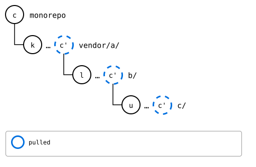

# Scenario: nested-splices, three levels: rebased one level at a time

`git splice pull --rebase --recursive vendor/a` pulls the same way as
[pulled one level at a time](pulled-level-by-level.md), but under the
monorepo's own commits: it pulls each level, top-down, at the last
pull, and then rebases the commits since onto that pull, once. The
innermost upstream and the monorepo change the same file, so the
conflict comes up once, when the monorepo's own commit is replayed.

## Output

<!--
```scrut {fail_fast: true, output_stream: combined}
$ source "$TESTDIR/../../../readme-setup.sh" && export GIT_CONFIG_COUNT=5 GIT_CONFIG_KEY_0="url.$UPSTREAM-b.git.insteadOf" GIT_CONFIG_VALUE_0=https://git.example.com/b.git GIT_CONFIG_KEY_1="url.$UPSTREAM-c.git.insteadOf" GIT_CONFIG_VALUE_1=https://git.example.com/c.git GIT_CONFIG_KEY_2=user.name GIT_CONFIG_VALUE_2=Test GIT_CONFIG_KEY_3=user.email GIT_CONFIG_VALUE_3=test@example.com GIT_CONFIG_KEY_4=core.editor GIT_CONFIG_VALUE_4=true
```
-->

[`setup.bash`](setup.bash) builds this state:

```scrut
$ build_scenario scenario_three_levels https://git.example.com/b.git https://git.example.com/c.git
```

The inner upstream and the monorepo change the same file:

```scrut
$ git clone -q https://git.example.com/c.git ../c-work &&
>   echo "c upstream" >>../c-work/file.txt &&
>   git -C ../c-work commit -q -am "c upstream" &&
>   git -C ../c-work push -q origin main
```

```scrut
$ echo "c local" >>vendor/a/b/c/file.txt &&
>   git commit -q -am "c local"
```

```scrut
$ git splice fetch vendor/a vendor/a/b vendor/a/b/c
ok   vendor/a fetched
ok   vendor/a/b fetched
ok   vendor/a/b/c fetched (main moved 0bfc154..68ea527)
```

<!--
```scrut
$ monorepo="$PWD" s="$(git rev-parse HEAD~1)" c="$(git rev-parse HEAD)" &&
>   k="$(git config --file vendor/a/.splice splice.commit)" &&
>   l="$(git config --file vendor/a/b/.splice splice.commit)" &&
>   n="$(git config --file vendor/a/b/c/.splice splice.commit)" &&
>   u="$(git rev-parse refs/splices/c/heads/main)"
```
-->

Each lane is one level, drawn inside the one above it. The monorepo's
*c* changes the innermost folder, so each level's rebuild, R, has a copy
of it, *c'*, on top of the synced commit. Only the innermost upstream
moved on, to *u*:

<div align="center">


</div>

<!--
```scrut
$ check_drawing "$TESTDIR/levels-before.drawio.svg" \
>   s="$s" c="$c" k="$k" l="$l" n="$n" u="$u"
ok   levels-before.drawio.svg: 9 commits, 13 arrows, 8 boxes, 3 lanes
```
-->

## The pull

The pull goes at *s*, the last commit that changed a `.splice` in the
tree, where `vendor/a/b/c/` has its synced commit's files, so it takes
*u* without a conflict. *c* conflicts when it's rebased onto the pull:

```scrut
$ git splice pull --rebase --recursive vendor/a
ok   vendor/a fetched
ok   vendor/a/b fetched
ok   vendor/a/b/c fetched
ok   vendor/a: nothing to pull
ok   vendor/a/b: nothing to pull
ok   vendor/a/b/c: pulled 68ea527
Auto-merging vendor/a/b/c/file.txt
CONFLICT (content): Merge conflict in vendor/a/b/c/file.txt
error: could not apply *... c local (glob)
Could not apply *... # c local (glob)
!!   conflict while rebasing onto the pull -- resolve it, then 'git rebase --continue' (or 'git rebase --abort' to give up)
[1]
```

```scrut
$ printf 'c seed\nc local\nc upstream\n' >vendor/a/b/c/file.txt &&
>   git add vendor/a/b/c/file.txt &&
>   git rebase --continue >/dev/null
```

*c* is on top of the pull now:

```scrut
$ git log --format=%s -3
c local
splice: pull vendor/a/b/c from main at 68ea527
add vendor/a
```



<!--
```scrut
$ check_drawing "$TESTDIR/rebased-pulled.drawio.svg" k="$k" l="$l" u="$u" p=HEAD~1 c=HEAD
ok   rebased-pulled.drawio.svg: a tree of 4 rows
```
-->

## Pushed

```scrut
$ git splice push --all
ok   vendor/a/b/c: pushed e561e61 to main
ok   vendor/a/b: pushed 5bf7de9 to main
ok   vendor/a: pushed 5ce8aa1 to main
```

Each upstream records the commit the one inside it has now:

```scrut
$ git -C "$UPSTREAM-b.git" show main:c/.splice | git config --file - splice.commit | cut -c1-7 &&
>   git -C "$UPSTREAM-c.git" rev-parse --short main
e561e61
e561e61
```

```scrut
$ git -C "$UPSTREAM" show main:b/.splice | git config --file - splice.commit | cut -c1-7 &&
>   git -C "$UPSTREAM-b.git" rev-parse --short main
5bf7de9
5bf7de9
```

```scrut
$ git splice status
On branch main

  up to date  vendor/a
  up to date  vendor/a/b
  up to date  vendor/a/b/c
```

