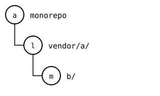
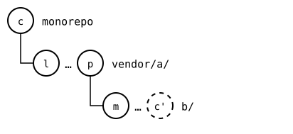
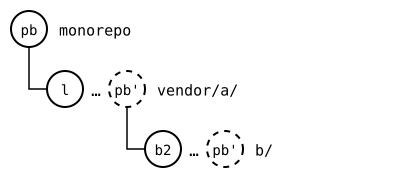
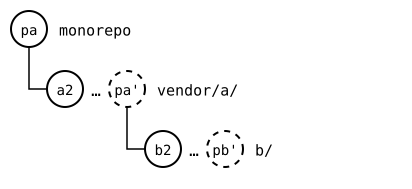

# Scenario: nested-splices, pulled below after a push above

The monorepo pushes `vendor/a/` alone, so its upstream records the
rebuild of `vendor/a/b/`, *c'*, which the inner upstream doesn't have.
Then the monorepo pulls `vendor/a/b/`, and later `vendor/a/`. The merge
of that last pull has to decide `b/.splice`, recorded three times:

- in the merge base, *p*, the outer upstream's commit from the push:
  *c'*;
- in the monorepo, after its pull of `b/`: *b2*;
- in the outer upstream's new commit, which didn't touch `b/`: *c'*.

## Output

<!--
```scrut {fail_fast: true, output_stream: combined}
$ source "$TESTDIR/../../readme-setup.sh" && export GIT_CONFIG_COUNT=3 GIT_CONFIG_KEY_0="url.$UPSTREAM-b.git.insteadOf" GIT_CONFIG_VALUE_0=https://git.example.com/b.git GIT_CONFIG_KEY_1=user.name GIT_CONFIG_VALUE_1=Other GIT_CONFIG_KEY_2=user.email GIT_CONFIG_VALUE_2=other@example.com
```
-->


[`setup.bash`](setup.bash) builds the state of the [README](README.md):

```scrut
$ build_scenario scenario_nested_splices https://git.example.com/b.git
```

The monorepo at *a*, `vendor/a/` at *l*, and `b/` at *m*:



<!--
```scrut
$ check_drawing "$TESTDIR/below-after-before.drawio.svg" a=HEAD l=$(git config --file vendor/a/.splice splice.commit) m=$(git config --file vendor/a/b/.splice splice.commit)
ok   below-after-before.drawio.svg: a tree of 3 rows
```
-->

The monorepo changes `vendor/a/b/`, in *c* (`b local`):

```scrut
$ echo "b local" >>vendor/a/b/file.txt &&
>   git commit -q -a -m "b local"
```

It pushes only `vendor/a/`, as *p*:

```scrut
$ git splice push vendor/a
ok   vendor/a: pushed 9946cf2 to main
```

*p* is upstream now, and records *c'*, which isn't:



<!--
```scrut
$ check_drawing "$TESTDIR/below-after-push.drawio.svg" c=HEAD l=$(git config --file vendor/a/.splice splice.commit) m=$(git config --file vendor/a/b/.splice splice.commit) p=$(git splice rebuild vendor/a) c\'=$(git splice rebuild vendor/a/b)
ok   below-after-push.drawio.svg: a tree of 3 rows
```
-->

The inner upstream moves on, with *b2*:

```scrut
$ git clone -q https://git.example.com/b.git ../b-work &&
>   echo "b upstream" >>../b-work/other.txt &&
>   git -C ../b-work add other.txt &&
>   git -C ../b-work commit -q -m "b2: b upstream" &&
>   git -C ../b-work push -q origin main
```

The monorepo pulls it, in *pb*, which records *b2*:

```scrut
$ git splice pull vendor/a/b
ok   vendor/a/b fetched (main moved 1879be4..a900d91)
ok   vendor/a/b: pulled a900d91
```

`b/` is at *b2* now, with *c* on top as the monorepo's own, in *pb'*:



<!--
```scrut
$ check_drawing "$TESTDIR/below-after-pull-b.drawio.svg" pb=HEAD l=$(git config --file vendor/a/.splice splice.commit) b2=$(git config --file vendor/a/b/.splice splice.commit)
ok   below-after-pull-b.drawio.svg: a tree of 3 rows
```
-->

```scrut
$ git config --file vendor/a/b/.splice splice.commit | cut -c1-7
a900d91
```

The outer upstream moves on too, with *a2*, which doesn't touch `b/`:

```scrut
$ git clone -q "$UPSTREAM" ../a-work &&
>   echo "a upstream" >>../a-work/other.txt &&
>   git -C ../a-work add other.txt &&
>   git -C ../a-work commit -q -m "a2: a upstream" &&
>   git -C ../a-work push -q origin main
```

The monorepo pulls `vendor/a/`, in *pa*:

```scrut
$ git splice pull vendor/a
ok   vendor/a fetched (main moved 9946cf2..a4d6fde)
ok   vendor/a/b fetched
ok   vendor/a: pulled a4d6fde
```

`b/` is still at *b2*, the monorepo's own pull, with *c* on top:



<!--
```scrut
$ check_drawing "$TESTDIR/below-after-pull-a.drawio.svg" pa=HEAD a2=$(git config --file vendor/a/.splice splice.commit) b2=$(git config --file vendor/a/b/.splice splice.commit) pb=HEAD~1
ok   below-after-pull-a.drawio.svg: a tree of 3 rows
```
-->

`vendor/a/b/.splice` still records *b2*, the monorepo's own pull, since
*a2* didn't change it:

```scrut
$ git config --file vendor/a/b/.splice splice.commit | cut -c1-7
a900d91
```

```scrut
$ git -C "$UPSTREAM-b.git" rev-parse --short main
a900d91
```


## The merge base

The pull of `vendor/a/` is a three-way merge. Its base is *p*, the
commit the monorepo's push made, a copy of *c*. Each side is compared
with it in its own terms:

- The outer upstream's side in the upstream's records: *a2* records
  *c'*, as *p* does. Unchanged.
- The monorepo's side in its own records: *pb* records *b2*, while
  *c*, the commit *p* copies, recorded *m*. Changed.

Only the monorepo changed `b/.splice`, so it keeps *b2*. Had the outer
upstream changed it too, the two would conflict; had only the outer
upstream, its record would win.
