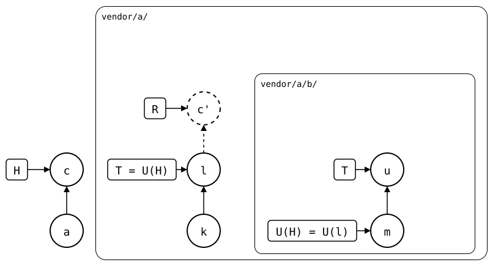
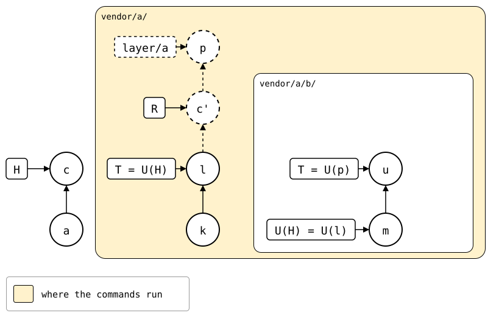

# Scenario: nested-splices, pulled in a worktree of the splice above

`git splice pull vendor/a/b` merges the inner upstream straight into the
monorepo's folder, and a conflict lands in the monorepo's working tree.
This page does the same pull one level down, by hand: in a worktree of
`vendor/a/`'s rebuild, where `b/` is a splice like any other, with no
nesting. The conflict comes up there, and its resolution is a commit of
that repository. Copied back into `vendor/a/`, it's a pull of
`vendor/a/b/` to the monorepo too: the rebuild and the push are the same
as after a pull in the monorepo.

[Rebuilt layer by layer](rebuilt-in-layers.md) shows where running the
commands per level goes wrong for the rebuild.

## Output

<!--
```scrut {fail_fast: true, output_stream: combined}
$ source "$TESTDIR/../../readme-setup.sh" && export GIT_CONFIG_COUNT=4 GIT_CONFIG_KEY_0="url.$UPSTREAM-b.git.insteadOf" GIT_CONFIG_VALUE_0=https://git.example.com/b.git GIT_CONFIG_KEY_1=user.name GIT_CONFIG_VALUE_1=Test GIT_CONFIG_KEY_2=user.email GIT_CONFIG_VALUE_2=test@example.com GIT_CONFIG_KEY_3=core.editor GIT_CONFIG_VALUE_3=true
```
-->

[`setup.bash`](setup.bash) builds the state of the [README](README.md):

```scrut
$ build_scenario scenario_nested_splices https://git.example.com/b.git
```

The inner upstream and the monorepo change the same file:

```scrut
$ git clone -q https://git.example.com/b.git ../b-work &&
>   echo "b upstream" >>../b-work/file.txt &&
>   git -C ../b-work commit -q -am "b upstream" &&
>   git -C ../b-work push -q origin main
```

```scrut
$ echo "b local" >>vendor/a/b/file.txt &&
>   git commit -q -a -m "b local"
```

```scrut
$ git splice fetch vendor/a vendor/a/b
ok   vendor/a fetched
ok   vendor/a/b fetched (main moved 11f4ee8..66aab4e)
```

The monorepo's `b local`, *c*, is in R of `vendor/a/`, rebuilt as *c'*. T
of `vendor/a/b/` is the inner upstream's `b upstream`, *u*:

<div align="center">



</div>

<!--
```scrut
$ check_drawing "$TESTDIR/fetched.drawio.svg" \
>   a=HEAD~1 c=HEAD k=refs/splices/upstream/heads/main~1 \
>   l=refs/splices/upstream/heads/main \
>   m=refs/splices/b/heads/main~1 u=refs/splices/b/heads/main
ok   fetched.drawio.svg: 7 commits, 9 arrows, 5 boxes, 2 lanes
```
-->

## The pull, one level down

R of `vendor/a/`, checked out in a worktree of the monorepo, on a branch
`layer/a`. It shares the monorepo's fetched refs, so the inner upstream
is there:

```scrut
$ git worktree add -q -b layer/a ../a-layer "$(git splice rebuild vendor/a)"
```

The next commands run in the worktree, as the repository `vendor/a/` is
spliced from:

```scrut
$ cd ../a-layer
```

```scrut
$ git log --format=%s
b local
add b
a seed
```

`pull` reads the upstream branch named like the current one, and `b`'s
upstream has no `layer/a`, so `--branch` names its `main`. The conflict
comes up in this repository:

```scrut
$ git splice pull --branch main b
ok   b fetched
Auto-merging b/file.txt
CONFLICT (content): Merge conflict in b/file.txt
!!   b: conflict -- resolve it, then 'git commit' (or 'git cherry-pick --abort' to give up)
!!   b: pull failed
!!   Failed: b
[1]
```

```scrut
$ printf 'b seed\nb local\nb upstream\n' >b/file.txt &&
>   git add b/file.txt &&
>   git cherry-pick --continue
[layer/a 6582d33] splice: pull b from main at 66aab4e
 Date: Thu Jan 1 00:00:00 2026 +0000
 2 files changed, 2 insertions(+), 1 deletion(-)
```

```scrut
$ git log --format=%s -1
splice: pull b from main at 66aab4e
```

The pull adds one commit, *p*, to `layer/a`, on top of *c'*. *p*'s
`b/.splice` records *u*. The monorepo hasn't changed:

<div align="center">



</div>

<!--
```scrut
$ (cd ../monorepo && check_drawing "$TESTDIR/pulled-in-the-worktree.drawio.svg" \
>   a=HEAD~1 c=HEAD k=refs/splices/upstream/heads/main~1 \
>   l=refs/splices/upstream/heads/main p=layer/a \
>   m=refs/splices/b/heads/main~1 u=refs/splices/b/heads/main)
ok   pulled-in-the-worktree.drawio.svg: 8 commits, 11 arrows, 6 boxes, 2 lanes
```
-->

## Back into the monorepo

The next commands run in the monorepo again:

```scrut
$ cd ../monorepo
```

`vendor/a/` gets the worktree's files, and keeps its own `.splice`, which
the rebuild doesn't have:

```scrut
$ git rm -q -r -- vendor/a ':!vendor/a/.splice' &&
>   git archive layer/a | tar -x -C vendor/a &&
>   git add vendor/a &&
>   git commit -q -m "$(git log -1 --format=%s layer/a)"
```

The commit, *q*, changes `vendor/a/b/.splice`, so it's a pull of
`vendor/a/b/` to the monorepo: R of `vendor/a/b/` joins *c'* and *u*, as
after a pull in the monorepo, and the push sends that. `layer/a` is
still there, and plays no part:

<div align="center">


</div>

<!--
```scrut
$ check_drawing "$TESTDIR/copied-back.drawio.svg" \
>   a=HEAD~2 c=HEAD~1 q=HEAD p=layer/a k=refs/splices/upstream/heads/main~1 \
>   l=refs/splices/upstream/heads/main \
>   m=refs/splices/b/heads/main~1 u=refs/splices/b/heads/main
ok   copied-back.drawio.svg: 11 commits, 15 arrows, 6 boxes, 2 lanes
```
-->

```scrut
$ git splice status vendor/a/b
On branch main

  ahead 2  vendor/a/b
```

```scrut
$ git log --graph --format=%s "$(git splice rebuild vendor/a/b)"
*   splice: pull b from main at 66aab4e
|\  
| * b upstream
* | b local
|/  
* b seed
```

```scrut
$ git splice push vendor/a/b
ok   vendor/a/b: pushed d91986f to main
```
