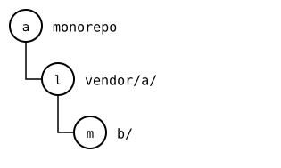

# Scenario: nested-splices, spliced elsewhere after a revert below

> **Known bug, [#467](https://github.com/roschaefer/git-splice/issues/467).** This page shows what `git-splice` does today, bug included. See [known bugs and limitations](../../99-known-bugs.md#known-bugs).

As in [spliced elsewhere before the push below](spliced-elsewhere-before-the-push-below.md),
the monorepo pushes only `vendor/a/`, and another monorepo clones the
outer upstream before `vendor/a/b/` is pushed. Here `vendor/a/b/` has a
change, its revert and another change. The outer upstream records the
inner synced commit after the revert as the one before the change, so
the other monorepo makes the last change again on that one, without the
change and the revert before it: it gets another hash, and reports the
commit missing. The inner rebuild in the first monorepo, which a push of
`vendor/a/b/` sends, has all three commits on *m*.

## Output

<!--
```scrut {fail_fast: true, output_stream: combined}
$ source "$TESTDIR/../../readme-setup.sh" && export GIT_CONFIG_COUNT=3 GIT_CONFIG_KEY_0="url.$UPSTREAM-b.git.insteadOf" GIT_CONFIG_VALUE_0=https://git.example.com/b.git GIT_CONFIG_KEY_1=user.name GIT_CONFIG_VALUE_1=Other GIT_CONFIG_KEY_2=user.email GIT_CONFIG_VALUE_2=other@example.com
```
-->


[`setup.bash`](setup.bash) builds the state of the [README](README.md):

```scrut
$ build_scenario scenario_nested_splices https://git.example.com/b.git
```

As a tree: the monorepo at *a*, `vendor/a/` at *l*, and `b/` in it at *m*:



<!--
```scrut
$ check_drawing "$TESTDIR/elsewhere-before.drawio.svg" a=HEAD l=refs/splices/upstream/heads/main m=refs/splices/b/heads/main
ok   elsewhere-before.drawio.svg: a tree of 3 rows
```
-->

The monorepo changes `vendor/a/b/`, reverts the change, and changes it again,
in *c* (`b again`):

```scrut
$ echo "b first" >>vendor/a/b/file.txt &&
>   git commit -q -a -m "b first" &&
>   git checkout HEAD~1 -- vendor/a/b/file.txt &&
>   git commit -q -m "b revert" &&
>   echo "b again" >>vendor/a/b/file.txt &&
>   git commit -q -a -m "b again"
```

It pushes only `vendor/a/`:

```scrut
$ git splice push vendor/a
ok   vendor/a: pushed 3ff7143 to main
```

The outer upstream has a copy of each. The copy of `b revert` records *m* again in `b/.splice`, as the folder is *m*'s files again:

```scrut
$ git -C "$UPSTREAM" log --format="%h %s" main
3ff7143 b again
81e9d17 b revert
b0b40d6 b first
07512e3 add b
e1802cd a seed
```

```scrut
$ git -C "$UPSTREAM" show main~1:b/.splice | git config --file - splice.commit | cut -c1-7
1879be4
```

## Another monorepo splices the outer upstream in

```scrut
$ git init -q -b main ../other &&
>   cd ../other &&
>   git commit -q --allow-empty -m "other monorepo"
```

```scrut
$ git splice clone "$UPSTREAM" vendor/a >/dev/null && git splice fetch
ok   vendor/a fetched
ok   vendor/a/b fetched
```

*o* clones the outer upstream at *p*, so `vendor/a/b/` is at *c'*, which the inner upstream doesn't have:


<!--
```scrut
$ check_drawing "$TESTDIR/elsewhere-cloned-after-a-revert-below.drawio.svg" o=HEAD p=$(git config --file vendor/a/.splice splice.commit) c\'=$(git config --file vendor/a/b/.splice splice.commit)
ok   elsewhere-cloned-after-a-revert-below.drawio.svg: a tree of 3 rows
```
-->

```scrut
$ git splice status
On branch main

  ?? synced commit 1a0d40f isn't here  vendor/a/b  run 'git splice fetch vendor/a/b', or check that upstream has it

  up to date                           vendor/a
```

The first monorepo still makes *c'*: a push of `vendor/a/b/` from there puts it upstream.
