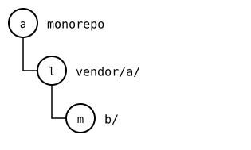
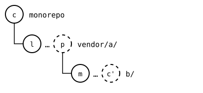
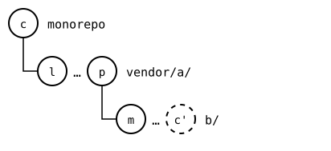

# Scenario: nested-splices, spliced elsewhere before the push below

As in [spliced elsewhere](spliced-elsewhere.md), another monorepo
splices the outer upstream in, but the monorepo pushed only `vendor/a/`,
not the change in `vendor/a/b/`. The outer upstream then records a
commit of the inner one that the inner upstream doesn't have. A clone of
the outer upstream makes such a commit again from its history.
`git splice clone` squashes that history into one commit, so the other
monorepo makes it again from the outer upstream's history instead, at
the commit it cloned, as the rebuild reads the inner splice's history
from there too. A push of `vendor/a/b/` from either monorepo then puts
the commit upstream. With a change, its revert and another change in
`vendor/a/b/`, it can't yet
([spliced elsewhere after a revert below](spliced-elsewhere-after-a-revert-below.md)).

## Output

<!--
```scrut {fail_fast: true, output_stream: combined}
$ source "$TESTDIR/../../readme-setup.sh" && export GIT_CONFIG_COUNT=3 GIT_CONFIG_KEY_0="url.$UPSTREAM-b.git.insteadOf" GIT_CONFIG_VALUE_0=https://git.example.com/b.git GIT_CONFIG_KEY_1=user.name GIT_CONFIG_VALUE_1=Other GIT_CONFIG_KEY_2=user.email GIT_CONFIG_VALUE_2=other@example.com
```
-->


[`setup.bash`](setup.bash) builds the state of the [README](README.md):

```scrut
$ build_scenario scenario_nested_splices https://git.example.com/b.git
```

As a tree: the monorepo at *a*, `vendor/a/` at *l*, and `b/` in it at *m*:



<!--
```scrut
$ check_drawing "$TESTDIR/elsewhere-before.drawio.svg" a=HEAD l=refs/splices/upstream/heads/main m=refs/splices/b/heads/main
ok   elsewhere-before.drawio.svg: a tree of 3 rows
```
-->

The monorepo changes `vendor/a/b/`, in *c* (`b local`):

```scrut
$ echo "b local" >>vendor/a/b/file.txt &&
>   git commit -q -a -m "b local"
```

Each rebuild has it on top: *c'* in `b/`, and *p* in `vendor/a/`, which records *c'*. Neither is upstream yet, so both are dashed:



<!--
```scrut
$ check_drawing "$TESTDIR/elsewhere-changed-below.drawio.svg" c=HEAD l=refs/splices/upstream/heads/main m=refs/splices/b/heads/main p=$(git splice rebuild vendor/a) c\'=$(git splice rebuild vendor/a/b)
ok   elsewhere-changed-below.drawio.svg: a tree of 3 rows
```
-->

It pushes only `vendor/a/`:

```scrut
$ git splice push vendor/a
ok   vendor/a: pushed 9946cf2 to main
```

The outer upstream has *p* now, so it's solid. The monorepo still records *l*, so both commits are there. *c'* is still dashed: no push sent it:



<!--
```scrut
$ check_drawing "$TESTDIR/elsewhere-pushed-above.drawio.svg" c=HEAD l=refs/splices/upstream/heads/main~1 m=refs/splices/b/heads/main p=refs/splices/upstream/heads/main c\'=$(git splice rebuild vendor/a/b)
ok   elsewhere-pushed-above.drawio.svg: a tree of 3 rows
```
-->

The outer upstream records a commit the inner upstream doesn't have:

```scrut
$ git -C "$UPSTREAM" show main:b/.splice | git config --file - splice.commit | cut -c1-7
f47c373
```

```scrut
$ git -C "$UPSTREAM-b.git" log --format="%h %s" main
1879be4 b seed
```

## Another monorepo splices the outer upstream in

```scrut
$ git init -q -b main ../other &&
>   cd ../other &&
>   git commit -q --allow-empty -m "other monorepo"
```

```scrut
$ git splice clone "$UPSTREAM" vendor/a
===  vendor/a: fetching $UPSTREAM
ok   vendor/a: cloned 9946cf2 from main
ok   vendor/a/b fetched
```

```scrut
$ git splice fetch
ok   vendor/a fetched
ok   vendor/a/b fetched
```

*o* clones the outer upstream at *p*, so `vendor/a/b/` is at *c'*, which the inner upstream doesn't have:


<!--
```scrut
$ check_drawing "$TESTDIR/elsewhere-cloned-before-the-push-below.drawio.svg" o=HEAD p=$(git config --file vendor/a/.splice splice.commit) c\'=$(git config --file vendor/a/b/.splice splice.commit)
ok   elsewhere-cloned-before-the-push-below.drawio.svg: a tree of 3 rows
```
-->

```scrut
$ cat vendor/a/b/file.txt
b seed
b local
```

It makes *c'* again from the outer upstream's history, on *m*, the inner upstream's commit that *l* records:

```scrut
$ git splice status
??   vendor/a/b: synced commit f47c373 isn't on main -- made it again here: 1879be4 and 1 commit of this branch's own
On branch main

  ahead 1     vendor/a/b

  up to date  vendor/a
```

A push from this monorepo sends *c'* with its hash:

```scrut
$ git splice push vendor/a/b
??   vendor/a/b: synced commit f47c373 isn't on main -- made it again here: 1879be4 and 1 commit of this branch's own
ok   vendor/a/b: pushed f47c373 to main
```

```scrut
$ git -C "$UPSTREAM-b.git" log --format="%h %s" main
f47c373 b local
1879be4 b seed
```

```scrut
$ git splice fetch vendor/a/b && git splice status
ok   vendor/a/b fetched
On branch main

  up to date  vendor/a
  up to date  vendor/a/b
```
