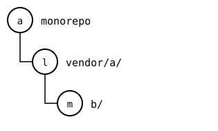
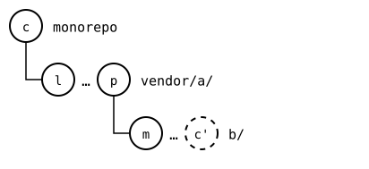

# Scenario: nested-splices, spliced elsewhere before the push below

> **Known bug, [#467](https://github.com/roschaefer/git-splice/issues/467).** This page shows what `git-splice` does today, bug included. See [all known bugs](../../99-known-bugs.md).

As in [spliced elsewhere](spliced-elsewhere.md), another monorepo
splices the outer upstream in, but the monorepo pushed only `vendor/a/`,
not the change in `vendor/a/b/`. The outer upstream then records a
commit of the inner one that the inner upstream doesn't have. A clone of
the outer upstream makes such a commit again from its history, but
`git splice clone` squashes that history into one commit, so the other
monorepo can't: it reports the commit missing. Its files are all there,
as the outer upstream has them; pushing `vendor/a/b/` from the first
monorepo puts the commit upstream.

## Output

<!--
```scrut {fail_fast: true, output_stream: combined}
$ source "$TESTDIR/../../readme-setup.sh" && export GIT_CONFIG_COUNT=3 GIT_CONFIG_KEY_0="url.$UPSTREAM-b.git.insteadOf" GIT_CONFIG_VALUE_0=https://git.example.com/b.git GIT_CONFIG_KEY_1=user.name GIT_CONFIG_VALUE_1=Other GIT_CONFIG_KEY_2=user.email GIT_CONFIG_VALUE_2=other@example.com
```
-->


[`setup.bash`](setup.bash) builds the state of the [README](README.md):

```scrut
$ build_scenario scenario_nested_splices https://git.example.com/b.git
```

As a tree: the monorepo at *a*, `vendor/a/` at *l*, and `b/` in it at *m*:



<!--
```scrut
$ check_drawing "$TESTDIR/elsewhere-before.drawio.svg" a=HEAD l=refs/splices/upstream/heads/main m=refs/splices/b/heads/main
ok   elsewhere-before.drawio.svg: a tree of 3 rows
```
-->

The monorepo changes `vendor/a/b/` and pushes only `vendor/a/`:

```scrut
$ echo "b local" >>vendor/a/b/file.txt &&
>   git commit -q -a -m "b local" &&
>   git splice push vendor/a
ok   vendor/a: pushed 9946cf2 to main
```

*p* went to the outer upstream with `vendor/a/`'s push, and records *c'*, the copy of *c* (`b local`) in `b/`'s rebuild. No push sent *c'*:



<!--
```scrut
$ check_drawing "$TESTDIR/elsewhere-pushed-above.drawio.svg" c=HEAD l=refs/splices/upstream/heads/main~1 m=refs/splices/b/heads/main p=refs/splices/upstream/heads/main
ok   elsewhere-pushed-above.drawio.svg: a tree of 3 rows
```
-->

The outer upstream records a commit the inner upstream doesn't have:

```scrut
$ git -C "$UPSTREAM" show main:b/.splice | git config --file - splice.commit | cut -c1-7
f47c373
```

```scrut
$ git -C "$UPSTREAM-b.git" log --format="%h %s" main
1879be4 b seed
```

## Another monorepo splices the outer upstream in

```scrut
$ git init -q -b main ../other &&
>   cd ../other &&
>   git commit -q --allow-empty -m "other monorepo"
```

```scrut
$ git splice clone "$UPSTREAM" vendor/a
===  vendor/a: fetching $UPSTREAM
ok   vendor/a: cloned 9946cf2 from main
ok   vendor/a/b fetched
```

```scrut
$ git splice fetch
ok   vendor/a fetched
ok   vendor/a/b fetched
```

*o* clones the outer upstream at *p*, so `vendor/a/b/` is at *c'*, which neither the inner upstream nor this monorepo has:


<!--
```scrut
$ check_drawing "$TESTDIR/elsewhere-cloned-before-the-push-below.drawio.svg" o=HEAD p=$(git c\'=$(git
[2]
```
-->

```scrut
$ cat vendor/a/b/file.txt
b seed
b local
```

```scrut
$ git splice status
On branch main

  ?? synced commit f47c373 isn't here  vendor/a/b  run 'git splice fetch vendor/a/b', or check that upstream has it

  up to date                           vendor/a
```

