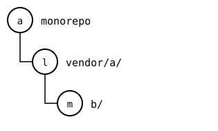
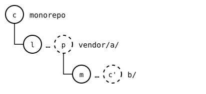
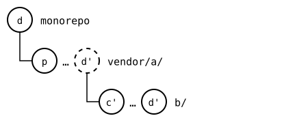

# Scenario: nested-splices, spliced into another monorepo

The monorepo pushes a change in `vendor/a/b/`, the splice below
`vendor/a/`. Then another monorepo splices the outer upstream in. There,
the inner splice's files have the change, and its `.splice` names the
commit the inner upstream got with that push: the rebuild of
`vendor/a/` records each splice inside it at its own rebuild. So the
inner splice is up to date, and its first change is pushed on top.

`git splice clone` squashes the outer upstream's history into one
commit, so the other monorepo's own history has nothing between the
inner splice's synced commits. The rebuild reads that history from the
outer upstream instead, which the other monorepo fetched. Before, the
record named the synced commit from before the change, and the inner
splice read as diverged there
([#74](https://github.com/roschaefer/git-splice/issues/74)).
Pushed without the inner splice, the outer upstream records a commit the
inner upstream lacks, which the other monorepo can't make again
([spliced elsewhere before the push below](spliced-elsewhere-before-the-push-below.md)).

## Output

<!--
```scrut {fail_fast: true, output_stream: combined}
$ source "$TESTDIR/../../readme-setup.sh" && export GIT_CONFIG_COUNT=3 GIT_CONFIG_KEY_0="url.$UPSTREAM-b.git.insteadOf" GIT_CONFIG_VALUE_0=https://git.example.com/b.git GIT_CONFIG_KEY_1=user.name GIT_CONFIG_VALUE_1=Other GIT_CONFIG_KEY_2=user.email GIT_CONFIG_VALUE_2=other@example.com
```
-->

[`setup.bash`](setup.bash) builds the state of the [README](README.md):
the outer upstream with the inner one spliced in at `b/`, cloned into
the monorepo:

```scrut
$ build_scenario scenario_nested_splices https://git.example.com/b.git
```

As a tree: the monorepo at *a*, `vendor/a/` at *l*, and `b/` in it at *m*:



<!--
```scrut
$ check_drawing "$TESTDIR/elsewhere-before.drawio.svg" a=HEAD l=refs/splices/upstream/heads/main m=refs/splices/b/heads/main
ok   elsewhere-before.drawio.svg: a tree of 3 rows
```
-->

The monorepo changes `vendor/a/b/`, in *c* (`b local`):

```scrut
$ echo "b local" >>vendor/a/b/file.txt &&
>   git commit -q -a -m "b local"
```

Each rebuild has it on top: *c'* in `b/`, and *p* in `vendor/a/`, which records *c'*. Neither is upstream yet, so both are dashed:



<!--
```scrut
$ check_drawing "$TESTDIR/elsewhere-changed-below.drawio.svg" c=HEAD l=refs/splices/upstream/heads/main m=refs/splices/b/heads/main p=$(git splice rebuild vendor/a) c\'=$(git splice rebuild vendor/a/b)
ok   elsewhere-changed-below.drawio.svg: a tree of 3 rows
```
-->

It pushes both, bottom-up:

```scrut
$ git splice push vendor/a/b vendor/a
ok   vendor/a/b: pushed f47c373 to main
ok   vendor/a: pushed 9946cf2 to main
```

Both upstreams have them now, so they're solid. The monorepo still records *l* and *m*, so both commits are there in each row:


<!--
```scrut
$ check_drawing "$TESTDIR/elsewhere-pushed.drawio.svg" c=HEAD l=refs/splices/upstream/heads/main~1 m=refs/splices/b/heads/main~1 p=refs/splices/upstream/heads/main c\'=refs/splices/b/heads/main
ok   elsewhere-pushed.drawio.svg: a tree of 3 rows
```
-->

`vendor/a/b/.splice` in the monorepo still names the synced commit from
before the change: a push writes nothing to the monorepo. The push of
`vendor/a/` publishes a commit `b local` in the outer upstream, whose
`b/.splice` records the rebuild of `vendor/a/b/`: the commit the inner
upstream just got.

```scrut
$ git -C "$UPSTREAM" show main:b/.splice |
>   git config --file - splice.commit |
>   xargs git -C "$UPSTREAM-b.git" log -1 --format=%s
b local
```

## Another monorepo splices the outer upstream in

```scrut
$ git init -q -b main ../other &&
>   cd ../other &&
>   git commit -q --allow-empty -m "other monorepo"
```

```scrut
$ git splice clone "$UPSTREAM" vendor/a
===  vendor/a: fetching $UPSTREAM
ok   vendor/a: cloned 9946cf2 from main
ok   vendor/a/b fetched
```

```scrut
$ git splice fetch
ok   vendor/a fetched
ok   vendor/a/b fetched
```

Here, *o* clones the outer upstream at *p*, which records *c'* for `b/`:


<!--
```scrut
$ check_drawing "$TESTDIR/elsewhere-cloned.drawio.svg" o=HEAD p=$(git config --file vendor/a/.splice splice.commit) c\'=$(git config --file vendor/a/b/.splice splice.commit)
ok   elsewhere-cloned.drawio.svg: a tree of 3 rows
```
-->

`clone` squashed the outer upstream's history into one commit. The files
of `vendor/a/b/` there have `b local`, and so has the commit its
`.splice` names:

```scrut
$ git log --format=%s
splice: clone vendor/a from main at 9946cf2
other monorepo
```

```scrut
$ cat vendor/a/b/file.txt
b seed
b local
```

```scrut
$ git log -1 --format=%s "$(git config --file vendor/a/b/.splice splice.commit)"
b local
```

Up to date, since the inner splice's files match the inner upstream:

```scrut
$ git splice status
On branch main

  up to date  vendor/a
  up to date  vendor/a/b
```

The first change to `vendor/a/b/` here:

```scrut
$ echo "b other" >>vendor/a/b/file.txt && git commit -q -a -m "b other"
```

*d* (`b other`) goes on top of *c'* in `b/`'s rebuild, and on top of *p* in `vendor/a/`'s:


<!--
```scrut
$ check_drawing "$TESTDIR/elsewhere-changed.drawio.svg" d=HEAD o=HEAD~1 p=$(git config --file vendor/a/.splice splice.commit) c\'=$(git config --file vendor/a/b/.splice splice.commit)
ok   elsewhere-changed.drawio.svg: a tree of 3 rows
```
-->

The rebuild of `vendor/a/b/` starts at that synced commit, `b local`,
so only `b other` is new:

```scrut
$ git splice status vendor/a/b
On branch main

  ahead 1  vendor/a/b
```

```scrut
$ git splice log vendor/a/b
===  vendor/a/b (main)
< f123e09 b other  (Other <other@example.com>)
```

There's nothing to pull, and the push goes on top of `b local`:

```scrut
$ git splice pull vendor/a/b
ok   vendor/a/b fetched
ok   vendor/a/b: nothing to pull
```

```scrut
$ git splice push vendor/a/b
ok   vendor/a/b: pushed f123e09 to main
```

The inner upstream has *d'* now; `vendor/a/` wasn't pushed, and its *d'* is dashed:



<!--
```scrut
$ check_drawing "$TESTDIR/elsewhere-pushed-below.drawio.svg" d=HEAD p=$(git config --file vendor/a/.splice splice.commit) c\'=$(git config --file vendor/a/b/.splice splice.commit)
ok   elsewhere-pushed-below.drawio.svg: a tree of 3 rows
```
-->

```scrut
$ git -C "$UPSTREAM-b.git" log --format=%s main
b other
b local
b seed
```
