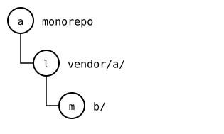
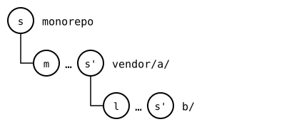

# Scenario: nested-splices, both pushed after the swap of their `.splice`

The two nested splices [trade their `.splice` files](swapped-ids.md),
ids and URLs included. A splice keeps its id for good, so the two
splices traded places, and each push sends the files now in its
folder. Here both splices are pushed:

- **Each upstream gets the files of its splice's new folder**, the
  other upstream's. Both pushes are fast-forwards.
- **The splice of the inner upstream moves with `b/`**: the outer
  upstream's `b/.splice` and `b/file.txt` go to the inner upstream,
  whose splice sits at `vendor/a/` now.
- **Afterwards, both are up to date.**

## Output

<!--
```scrut {fail_fast: true, output_stream: combined}
$ source "$TESTDIR/../../readme-setup.sh" && export GIT_CONFIG_COUNT=2 GIT_CONFIG_KEY_0="url.$UPSTREAM-b.git.insteadOf" GIT_CONFIG_VALUE_0=https://git.example.com/b.git GIT_CONFIG_KEY_1="url.$UPSTREAM.insteadOf" GIT_CONFIG_VALUE_1=https://git.example.com/a.git
```
-->

[`setup.bash`](setup.bash) builds the state of the [README](README.md):
the outer upstream with the inner one spliced in at `b/`, cloned into
the monorepo:

```scrut
$ build_scenario scenario_nested_splices https://git.example.com/b.git https://git.example.com/a.git
```

As a tree: the monorepo at *a*, `vendor/a/` at the outer upstream's
*l*, and `b/` in it at the inner upstream's *m*:



<!--
```scrut
$ check_drawing "$TESTDIR/swapped-ids-before.drawio.svg" a=HEAD l=refs/splices/a/heads/main m=refs/splices/b/heads/main
ok   swapped-ids-before.drawio.svg: a tree of 3 rows
```
-->

Each upstream before:

```scrut
$ git -C "$UPSTREAM" ls-tree -r --name-only main
b/.splice
b/file.txt
file.txt
```

```scrut
$ git -C "$UPSTREAM-b.git" ls-tree -r --name-only main
file.txt
```

## The swap

```scrut
$ git mv vendor/a/.splice tmp.splice &&
>   git mv vendor/a/b/.splice vendor/a/.splice &&
>   git mv tmp.splice vendor/a/b/.splice &&
>   git commit -q -m "s: swap the .splice files"
```

```scrut
$ git grep -e 'id = ' -e 'url = ' -- '*/.splice' | tr '\t' ' '
vendor/a/.splice: id = 548ac82ad47ea22d
vendor/a/.splice: url = https://git.example.com/b.git
vendor/a/b/.splice: id = b5df2a6e9b4ef0fb
vendor/a/b/.splice: url = https://git.example.com/a.git
```

## Both pushed

```scrut
$ git splice push --all
ok   vendor/a/b: pushed 69e827c to main
ok   vendor/a: pushed 36c9c93 to main
```

The outer upstream has the files of `vendor/a/b/`, the inner
upstream's `file.txt`, and no `b/`:

```scrut
$ git -C "$UPSTREAM" ls-tree -r --name-only main
file.txt
```

```scrut
$ git -C "$UPSTREAM" show main:file.txt
b seed
```

```scrut
$ git -C "$UPSTREAM" log --format=%s main
s: swap the .splice files
add b
a seed
```

The inner upstream has the files of `vendor/a/`, the outer upstream's,
with the splice of the inner upstream at `b/`:

```scrut
$ git -C "$UPSTREAM-b.git" ls-tree -r --name-only main
b/.splice
b/file.txt
file.txt
```

```scrut
$ git -C "$UPSTREAM-b.git" show main:file.txt
a seed
```

```scrut
$ git -C "$UPSTREAM-b.git" log --format=%s main
s: swap the .splice files
b seed
```

Both read as up to date, and the tree shows each folder at the other
splice's synced commit, then *s'*, which its upstream has now:
`vendor/a/` at the inner upstream's *m*, `b/` at the outer upstream's
*l*:

```scrut
$ git splice status
On branch main

  up to date  vendor/a
  up to date  vendor/a/b
```



<!--
```scrut
$ check_drawing "$TESTDIR/swapped-ids-both-pushed.drawio.svg" s=HEAD l=refs/splices/a/heads/main~1 m=refs/splices/b/heads/main~1
ok   swapped-ids-both-pushed.drawio.svg: a tree of 3 rows
```
-->
