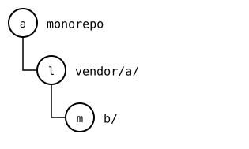
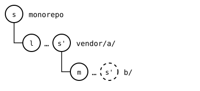

# Scenario: nested-splices, the two splices swap only their ids

> **Limitation.** This page shows behaviour `git-splice` keeps on purpose, and the way out. See [known bugs and limitations](../../99-known-bugs.md#limitations).

The outer splice contains the inner one, as in the [README](README.md).
Then the two `.splice` files trade their ids, and keep their URLs, as
an edit by hand might. Where they
[trade the whole `.splice`](swapped-ids.md), a push sends one splice's
files to the other's upstream. Here each folder still names its own
upstream:

```text
before:  vendor/a    id a, a's upstream      after:  vendor/a    id b, a's upstream
           b/        id b, b's upstream                b/        id a, b's upstream
```

A splice keeps its id for good, so `vendor/a/` is now the splice that
was at `b/`, but its `.splice` names the outer upstream, and a synced
commit that isn't part of that splice's history:

- **Nothing refuses it.** `status` reads it as an ordinary push.
- **The splice's history continues at `vendor/a/`**, from `b/`, where
  its id was, so it builds on the inner upstream's history.
- **So a push publishes the inner upstream's history to the outer
  upstream**, merged with the outer upstream's own. The files stay
  the outer upstream's.
- **A `.splice` like this is the editor's to keep right.** A check that
  the synced commit is part of the splice's own history, as
  [#7](https://github.com/roschaefer/git-splice/issues/7) asks for, would
  catch it. Until then, the way out is to give each `.splice` back its
  own id before the push.

## Output

<!--
```scrut {fail_fast: true, output_stream: combined}
$ source "$TESTDIR/../../readme-setup.sh" && export GIT_CONFIG_COUNT=2 GIT_CONFIG_KEY_0="url.$UPSTREAM-b.git.insteadOf" GIT_CONFIG_VALUE_0=https://git.example.com/b.git GIT_CONFIG_KEY_1="url.$UPSTREAM.insteadOf" GIT_CONFIG_VALUE_1=https://git.example.com/a.git
```
-->

[`setup.bash`](setup.bash) builds the state of the [README](README.md):
the outer upstream with the inner one spliced in at `b/`, cloned into
the monorepo:

```scrut
$ build_scenario scenario_nested_splices https://git.example.com/b.git https://git.example.com/a.git
```

```scrut
$ git grep -e 'id = ' -e 'url = ' -- '*/.splice' | tr '\t' ' '
vendor/a/.splice: id = b5df2a6e9b4ef0fb
vendor/a/.splice: url = https://git.example.com/a.git
vendor/a/b/.splice: id = 548ac82ad47ea22d
vendor/a/b/.splice: url = https://git.example.com/b.git
```

As a tree: the monorepo at *a*, `vendor/a/` at the outer upstream's
*l*, and `b/` in it at the inner upstream's *m*:



<!--
```scrut
$ check_drawing "$TESTDIR/swapped-ids-before.drawio.svg" a=HEAD l=refs/splices/a/heads/main m=refs/splices/b/heads/main
ok   swapped-ids-before.drawio.svg: a tree of 3 rows
```
-->

## The swap

```scrut
$ id_a="$(git config --file vendor/a/.splice splice.id)" &&
>   id_b="$(git config --file vendor/a/b/.splice splice.id)" &&
>   git config --file vendor/a/.splice splice.id "$id_b" &&
>   git config --file vendor/a/b/.splice splice.id "$id_a" &&
>   git commit -q -a -m "s: swap the ids"
```

```scrut
$ git grep -e 'id = ' -e 'url = ' -- '*/.splice' | tr '\t' ' '
vendor/a/.splice: id = 548ac82ad47ea22d
vendor/a/.splice: url = https://git.example.com/a.git
vendor/a/b/.splice: id = b5df2a6e9b4ef0fb
vendor/a/b/.splice: url = https://git.example.com/b.git
```

`vendor/a/`, now with the inner splice's id, has two commits to push:

```scrut
$ git splice status
On branch main

  ahead 2     vendor/a

  up to date  vendor/a/b
```

One is the inner upstream's *m* (`b seed`), from the path where that
id was before the swap:

```scrut
$ git splice log
===  vendor/a (main)
< 0d73bf1 s: swap the ids  (Test <test@example.com>)
< 11f4ee8 b seed  (Test <test@example.com>)
```

## A push publishes the inner upstream's history

```scrut
$ git splice push vendor/a
ok   vendor/a: pushed 0d73bf1 to main
```

The outer upstream gets *s'*, a merge of the outer upstream's *l* and
the inner upstream's *m*. Its history now holds the inner upstream's:

```scrut
$ git -C "$UPSTREAM" log --graph --format=%s main
*   s: swap the ids
|\  
| * add b
| * a seed
* b seed
```

Its files are those of the folder, the outer upstream's own:

```scrut
$ git -C "$UPSTREAM" ls-tree -r --name-only main
b/.splice
b/file.txt
file.txt
```

Both splices read as up to date afterwards:

```scrut
$ git splice status
On branch main

  up to date  vendor/a
  up to date  vendor/a/b
```

As a tree: `vendor/a/` at *l*, then *s'*, which the outer upstream has
now; `b/` at *m*, then *s'*:



<!--
```scrut
$ check_drawing "$TESTDIR/swapped-ids-only-pushed.drawio.svg" s=HEAD l=refs/splices/a/heads/main^2 m=refs/splices/b/heads/main
ok   swapped-ids-only-pushed.drawio.svg: a tree of 3 rows
```
-->
