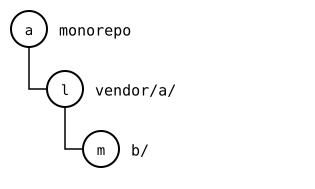
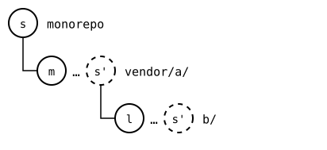
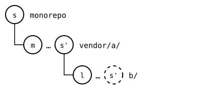
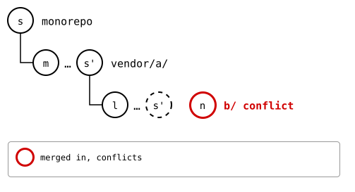

# Scenario: nested-splices, the two splices swap their `.splice`

The outer splice contains the inner one, as in the [README](README.md).
Then the two `.splice` files trade places, ids and URLs included, and
the folder `vendor/a/` names the inner upstream, `vendor/a/b/` the outer
one.

```text
before:  vendor/a    id a, a's upstream      after:  vendor/a    id b, b's upstream
           b/        id b, b's upstream                b/        id a, a's upstream
```

A splice keeps its id for good, so the two splices traded places:

- **Each splice's history continues at its new folder**, as across a
  `git mv`
  ([swapped-splices](../../07-moved-folders/02-swapped-splices/README.md)).
  No id repeats in one line of nesting, so it isn't a cycle, a splice
  that contains itself
  ([#86](https://github.com/roschaefer/git-splice/issues/86)).
- **A push sends the files now in that folder.** The splice of the
  inner upstream sits at `vendor/a/` now, so its push sends the files
  there, the outer upstream's, to the inner upstream.

A push of both splices leaves each upstream with the files of the
other's old folder ([both pushed](swapped-ids-both-pushed.md)).
Splices side by side that trade their `.splice` files do the same
([swapped `.splice` files](../../07-moved-folders/02-swapped-splices/swapped-splice-files.md)).
Where only the ids trade places, and the URLs stay, the push is a
limitation instead ([only the ids](swapped-ids-only.md)).

## Output

<!--
```scrut {fail_fast: true, output_stream: combined}
$ source "$TESTDIR/../../readme-setup.sh" && export GIT_CONFIG_COUNT=2 GIT_CONFIG_KEY_0="url.$UPSTREAM-b.git.insteadOf" GIT_CONFIG_VALUE_0=https://git.example.com/b.git GIT_CONFIG_KEY_1="url.$UPSTREAM.insteadOf" GIT_CONFIG_VALUE_1=https://git.example.com/a.git
```
-->

[`setup.bash`](setup.bash) builds the state of the [README](README.md):
the outer upstream with the inner one spliced in at `b/`, cloned into
the monorepo:

```scrut
$ build_scenario scenario_nested_splices https://git.example.com/b.git https://git.example.com/a.git
```

```scrut
$ git grep -e 'id = ' -e 'url = ' -- '*/.splice' | tr '\t' ' '
vendor/a/.splice: id = b5df2a6e9b4ef0fb
vendor/a/.splice: url = https://git.example.com/a.git
vendor/a/b/.splice: id = 548ac82ad47ea22d
vendor/a/b/.splice: url = https://git.example.com/b.git
```

As a tree: the monorepo at *a*, `vendor/a/` at the outer upstream's
*l*, and `b/` in it at the inner upstream's *m*:



<!--
```scrut
$ check_drawing "$TESTDIR/swapped-ids-before.drawio.svg" a=HEAD l=refs/splices/a/heads/main m=refs/splices/b/heads/main
ok   swapped-ids-before.drawio.svg: a tree of 3 rows
```
-->

## The swap

```scrut
$ git mv vendor/a/.splice tmp.splice &&
>   git mv vendor/a/b/.splice vendor/a/.splice &&
>   git mv tmp.splice vendor/a/b/.splice &&
>   git commit -q -m "s: swap the .splice files"
```

```scrut
$ git grep -e 'id = ' -e 'url = ' -- '*/.splice' | tr '\t' ' '
vendor/a/.splice: id = 548ac82ad47ea22d
vendor/a/.splice: url = https://git.example.com/b.git
vendor/a/b/.splice: id = b5df2a6e9b4ef0fb
vendor/a/b/.splice: url = https://git.example.com/a.git
```

Each splice follows its id back to the other's old path. So `vendor/a/`
now continues from the inner upstream's *m*, and `b/` from the outer
upstream's *l*, each with the swap, *s'*, to push:



<!--
```scrut
$ check_drawing "$TESTDIR/swapped-ids-swapped.drawio.svg" s=HEAD l=refs/splices/a/heads/main m=refs/splices/b/heads/main
ok   swapped-ids-swapped.drawio.svg: a tree of 3 rows
```
-->

Both read as an ordinary push:

```scrut
$ git splice status
On branch main

  ahead 1  vendor/a
  ahead 1  vendor/a/b
```

```scrut
$ git splice log
===  vendor/a (main)
< [0-9a-f]{7} s: swap the \.splice files  \(Test <test@example\.com>\) (regex)
===  vendor/a/b (main)
< 69e827c s: swap the .splice files  (Test <test@example.com>)
```

## A push sends the folder's files to the inner upstream

The inner upstream before:

```scrut
$ git -C "$UPSTREAM-b.git" ls-tree -r --name-only main
file.txt
```

```scrut
$ git splice push vendor/a
ok   vendor/a: pushed [0-9a-f]{7} to main (regex)
```

The inner upstream has *s'* now, a fast-forward from *m*:



<!--
```scrut
$ check_drawing "$TESTDIR/swapped-ids-pushed.drawio.svg" s=HEAD l=refs/splices/a/heads/main m=refs/splices/b/heads/main~1
ok   swapped-ids-pushed.drawio.svg: a tree of 3 rows
```
-->

With it, the inner upstream got the files of `vendor/a/`, the outer
upstream's, with the splice of the inner upstream at `b/`:

```scrut
$ git -C "$UPSTREAM-b.git" ls-tree -r --name-only main
b/.splice
b/file.txt
file.txt
```

```scrut
$ git -C "$UPSTREAM-b.git" show main:file.txt
a seed
```

```scrut
$ git -C "$UPSTREAM-b.git" log --format=%s main
s: swap the .splice files
b seed
```

## A pull of the folder below

The outer upstream moves on, still with the inner one nested in it:

```scrut
$ seed_bare_repo "$UPSTREAM" "a moves on" >/dev/null 2>&1 &&
>   git -C "$UPSTREAM" ls-tree -r --name-only main
b/.splice
b/file.txt
file.txt
```

The pull of `vendor/a/b`, the outer upstream's splice now, merges *n*
(`a moves on`) into *s'*, and conflicts on `file.txt`, which has the
inner upstream's lines here and the outer upstream's there:

```scrut
$ git splice pull vendor/a/b
ok   vendor/a/b fetched (main moved ddf42f3..a5da290)
Auto-merging vendor/a/b/file.txt
CONFLICT (content): Merge conflict in vendor/a/b/file.txt
!!   vendor/a/b: conflict -- resolve it, then 'git commit' (or 'git cherry-pick --abort' to give up)
!!   vendor/a/b: pull failed
!!   Failed: vendor/a/b
[1]
```

```scrut
$ git status --short
M  vendor/a/b/.splice
UU vendor/a/b/file.txt
```

The swap removed the outer upstream's `b/` from the folder, so the merge
keeps it removed: the tree has no splice below `b/`, and the outer
upstream doesn't nest again.



<!--
```scrut
$ check_drawing "$TESTDIR/swapped-ids-end.drawio.svg" s=HEAD l=refs/splices/a/heads/main~1 n=refs/splices/a/heads/main m=refs/splices/b/heads/main~1
ok   swapped-ids-end.drawio.svg: a tree of 3 rows
```
-->
