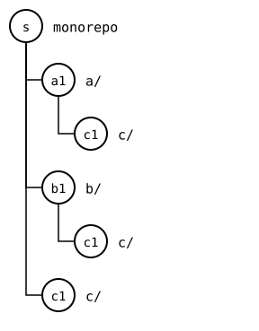
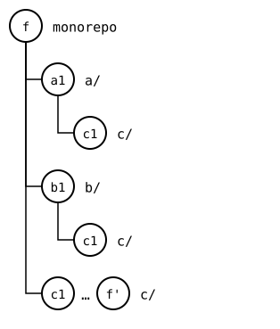
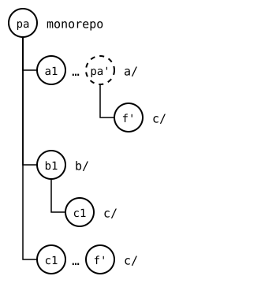
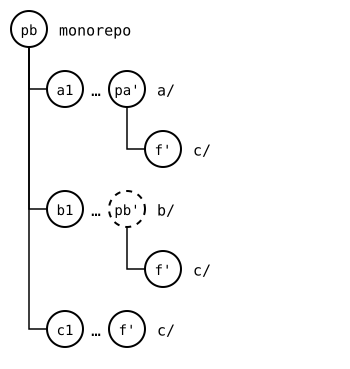
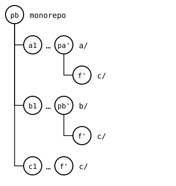

# Scenario: diamond

Two apps, each in a repository of its own, have the library spliced in at
`c/`. The monorepo clones both apps, and the library once more at `c/`,
to work on it directly. So two paths lead from the monorepo to the
library, one through each app, a *diamond*, as in a package manager's
dependency graph. The library is [nested](../../../03-concepts/04-nesting.md)
in each app.

```text
   monorepo
    /  |  \
  a/   |   b/
    \  |  /
      c/
```

Each path has a real copy, so each app's repository still works on its
own. Each copy has its own [id](../../../03-concepts/03-splice-identity.md),
since each repository ran `clone` itself, so the copies are independent
and can be at different versions. Here a change to the library is made
once, in the monorepo's `c/`, and then reaches every copy.

- **Library** (`$UPSTREAM`, reached as `https://git.example.com/c.git`):
  `c seed`.
- **Apps** (`$UPSTREAM-a`, `$UPSTREAM-b`, reached as
  `https://git.example.com/a.git` and `b.git`): a seed commit each, then
  `add c`, which spliced the library in at `c/`.
- **Monorepo**: one commit, no splice yet.

## Output

<!--
```scrut {fail_fast: true, output_stream: combined}
$ source "$TESTDIR/../../readme-setup.sh"
```
-->

[`setup.bash`](setup.bash) builds this state:

```scrut
$ build_scenario scenario_diamond
```

### The monorepo brings them together

```scrut
$ git splice clone https://git.example.com/a.git a
===  a: fetching https://git.example.com/a.git
ok   a: cloned 6962bd0 from main
ok   a/c fetched
```

```scrut
$ git splice clone https://git.example.com/b.git b
===  b: fetching https://git.example.com/b.git
ok   b: cloned 8333d5f from main
ok   b/c fetched
```

```scrut
$ git splice clone https://git.example.com/c.git c
===  c: fetching https://git.example.com/c.git
ok   c: cloned 0bfc154 from main
```

The apps' `c/.splice` came along, so the monorepo has five splices,
three of them of the library:

```scrut
$ git splice status
On branch main

  up to date  a
  up to date  a/c
  up to date  b
  up to date  b/c
  up to date  c
```

Each app's `c/` and the monorepo's own `c/` are at the library's *c1*:



<!--
```scrut
$ check_drawing "$TESTDIR/diamond-start.drawio.svg" s=HEAD a1=$(git config --file a/.splice splice.commit) b1=$(git config --file b/.splice splice.commit) c1=$(git config --file c/.splice splice.commit)
ok   diamond-start.drawio.svg: a tree of 6 rows
```
-->

Each is a splice of its own, with its own id: each app ran `clone` for
the library, and so did the monorepo
([splice identity](../../../03-concepts/03-splice-identity.md)). All three share the
library's upstream, and with it one key and one fetch
([upstreams](../../../03-concepts/01-upstreams.md)):

```scrut
$ git grep 'id = ' -- '*/.splice' | tr '\t' ' '
a/.splice: id = dc1f63e7168fb5f0
a/c/.splice: id = f73be57fd033f814
b/.splice: id = a74f3d3a6a024a89
b/c/.splice: id = 7d96e5d8a73e4c4b
c/.splice: id = 27a7630097a94256
```

By their ids, the three copies of the library are independent splices
([splice identity](../../../03-concepts/03-splice-identity.md#what-an-id-is)): each
repository cloned the library itself. They're one library, at possibly
different versions, as in a package manager's diamond: one app may still
use an older version than the other. Keeping them at the same version is
up to the monorepo, where that's wanted.

```scrut
$ git splice key a/c
c
```

```scrut
$ git splice key b/c
c
```

```scrut
$ git splice key c
c
```

The copies cost little in the repository. Git stores a file by its
content, so the three `file.txt` are one object. Only the `.splice`
files differ, in their ids:

```scrut
$ git ls-tree -r --abbrev=7 --format='%(objectname) %(path)' HEAD -- c a/c b/c
10b4956 a/c/.splice
3436b98 a/c/file.txt
cb3b983 b/c/.splice
3436b98 b/c/file.txt
b6f8f56 c/.splice
3436b98 c/file.txt
```

The checkout does have three copies of each file. A change to one copy
reaches the others only by a push and their pulls, as below.

### A change to the library, round trip

The change is made once, in the monorepo's `c/`, and goes to the
library's upstream:

```scrut
$ echo "c fix" >>c/file.txt && git commit -q -a -m "c fix"
```

```scrut
$ git splice push c
ok   c: pushed 2f685c3 to main
```

The monorepo's fix *f* is in `c/`'s rebuild as *f'*, solid: the library's
upstream has it. `a/c/` and `b/c/` are still at *c1*:



<!--
```scrut
$ check_drawing "$TESTDIR/diamond-pushed-c.drawio.svg" s=HEAD~1 f=HEAD a1=$(git config --file a/.splice splice.commit) b1=$(git config --file b/.splice splice.commit) c1=$(git config --file c/.splice splice.commit) f\'=$(git rev-parse refs/splices/c/heads/main)
ok   diamond-pushed-c.drawio.svg: a tree of 6 rows
```
-->


Now `a/c/` and `b/c/` are behind the library's upstream:

```scrut
$ git splice status
On branch main

  behind 1    a/c
  behind 1    b/c

  up to date  a
  up to date  b
  up to date  c
```

In terms of the [sync model](../../../03-concepts/02-sync-model.md): R of `c/`, the
commit its push sent, is the library's upstream branch T now. `a/c/` and
`b/c/` still have the old content, so their R is the old commit.
`log --graph` leaves out `c/`, which is up to date:

```scrut
$ git splice log --graph c a/c b/c
===  a/c (main)
> 2f685c3 (T) c fix  (Test <test@example.com>)
o 0bfc154 (R) c seed  (Test <test@example.com>)
===  b/c (main)
> 2f685c3 (T) c fix  (Test <test@example.com>)
o 0bfc154 (R) c seed  (Test <test@example.com>)
```

The copies of the library differ now: they're at different versions.
`status` shows it only indirectly, as two splices behind their upstream.
Comparing the folders, without `.splice`, shows it directly:

```scrut
$ git diff --stat HEAD:c HEAD:a/c -- ':!.splice'
 file.txt | 1 -
 1 file changed, 1 deletion(-)
```

Each pulls it in. A hook stops the pull after `a/c/`'s merge:

```scrut
$ git splice pull a/c b/c --exec 'test "$GIT_SPLICE_EVENT" != after-merge'
ok   a/c fetched
ok   b/c fetched
ok   a/c: pulled 2f685c3
!!   --exec stopped pull at after-merge of a/c, what it did so far stays -- re-run pull to go on
[1]
```

The library is at two versions in the monorepo now: `a/c/` at *f'*,
`b/c/` still at *c1*. `a/` has the pull's copy, *pa'*, on top, dashed:
its upstream doesn't have the new `c/` yet:



<!--
```scrut
$ check_drawing "$TESTDIR/diamond-pulled-a.drawio.svg" s=HEAD~2 f=HEAD~1 pa=HEAD a1=$(git config --file a/.splice splice.commit) b1=$(git config --file b/.splice splice.commit) c1=$(git config --file c/.splice splice.commit) f\'=$(git rev-parse refs/splices/c/heads/main) pa\'=$(git splice rebuild a)
ok   diamond-pulled-a.drawio.svg: a tree of 6 rows
```
-->

Run again, `b/c/` follows, and `a/` and `b/` are then ahead of their
upstreams, by the new `c/` content and `c/.splice`:

```scrut
$ git splice pull a/c b/c
ok   a/c fetched
ok   b/c fetched
ok   a/c: nothing to pull
ok   b/c: pulled 2f685c3
```

```scrut
$ git splice status
On branch main

  ahead 1     a
  ahead 1     b

  up to date  a/c
  up to date  b/c
  up to date  c
```

A hook stops the push after `a`'s:

```scrut
$ git splice push a b --exec 'test "$GIT_SPLICE_EVENT" != after-push'
ok   a: pushed 7f874c1 to main
!!   --exec stopped push at after-push of a, what it did so far stays -- re-run push to go on
[1]
```

*pa'* is solid now, as `a`'s upstream has it; *pb'* isn't yet:



<!--
```scrut
$ check_drawing "$TESTDIR/diamond-pushed-a.drawio.svg" s=HEAD~3 f=HEAD~2 pa=HEAD~1 pb=HEAD a1=$(git config --file a/.splice splice.commit) b1=$(git config --file b/.splice splice.commit) c1=$(git config --file c/.splice splice.commit) f\'=$(git rev-parse refs/splices/c/heads/main) pa\'=$(git splice rebuild a) pb\'=$(git splice rebuild b)
ok   diamond-pushed-a.drawio.svg: a tree of 6 rows
```
-->

Run again, `b` follows:

```scrut
$ git splice push a b
ok   a: nothing to push
ok   b: pushed e9b20a7 to main
```

Both apps' upstreams have the library's new version:



<!--
```scrut
$ check_drawing "$TESTDIR/diamond-end.drawio.svg" s=HEAD~3 f=HEAD~2 pa=HEAD~1 pb=HEAD a1=$(git config --file a/.splice splice.commit) b1=$(git config --file b/.splice splice.commit) c1=$(git config --file c/.splice splice.commit) f\'=$(git rev-parse refs/splices/c/heads/main) pa\'=$(git splice rebuild a) pb\'=$(git splice rebuild b)
ok   diamond-end.drawio.svg: a tree of 6 rows
```
-->

A clone of one app on its own, e.g. by an outside contributor, has the
library's new version, as plain files, with the `.splice` that lets
`git-splice` sync it from there:

```scrut
$ git clone -q "$UPSTREAM-a" ../a-standalone && ls -A ../a-standalone/c
.splice
file.txt
```

```scrut
$ cat ../a-standalone/c/file.txt
c seed
c fix
```

After the round trip, the three copies have the same files and every
splice is up to date. Their synced commits differ, though: `c/` pushed
the change and didn't pull it, and a push doesn't move U(H):

```scrut
$ git grep 'commit = ' -- c/.splice a/c/.splice b/c/.splice | tr '\t' ' '
a/c/.splice: commit = 2f685c31331f50c0186c1d8a91e398f13f179d83
b/c/.splice: commit = 2f685c31331f50c0186c1d8a91e398f13f179d83
c/.splice: commit = 0bfc154c1c749180f5927393b915bfb27ad635fd
```

So different synced commits don't mean different versions. Different
files do, and the three copies have the same:

```scrut
$ git diff --quiet HEAD:c HEAD:a/c -- ':!.splice' &&
>   git diff --quiet HEAD:c HEAD:b/c -- ':!.splice' &&
>   echo "the same files"
the same files
```

`git-splice` compares each copy only with its own upstream, not the
copies with each other. Copies with one id,
[mirrors](../../../07-design/07-going-forward/01-mirrors.md), are meant to stay
alike; these three aren't.
